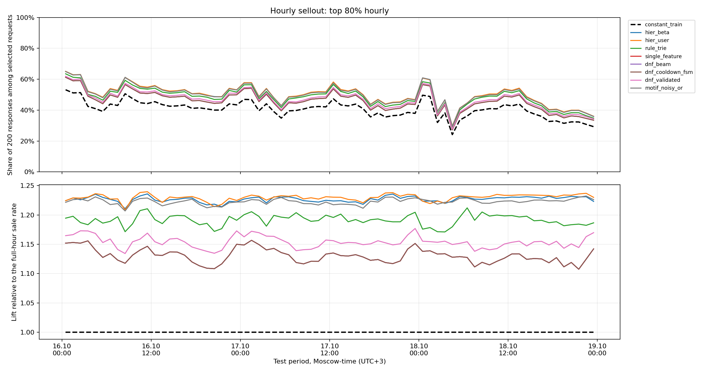
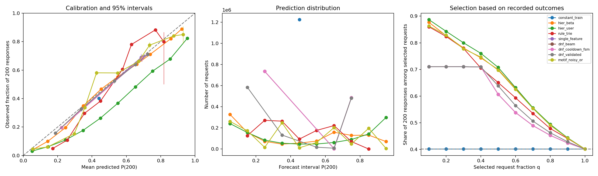

# Quality of Probability of Sale

**Mode:** historical

Train: 1,535,353; test: 1,224,292; users test: 50,660.

Share 200 train/test: 44.09%/40.15%

Train: [2026-10-12, 2026-10-16); test: [2026-10-16, 2026-10-19), Moscow-time. Selection 2.00% user; device pool config. The right boundary of the period is not included. Startup settings are set in advance; The selection of internal parameters only uses train.

Original statuses in selected traffic: 200 : 1,168,497 , 204 : 1,591,148 .Excluded codes outside of 200/204: 0 . Historical status forecast is checked; commercial meaning of 200 requires confirmation.

## Explanation of graphs and tables

1. ** Traffic selection:** In the graph below, each algorithm selects the best 80% requests separately for each hour of test. Sellout (sell-through) is the proportion of 200 responses among the selected ones; the higher the line, the better the selection at that hour. constant_train dashboard is random selection at the same estimates, its expected share of 200 is equal to the share of 200 of just an hour.
2. **Conditions change over time:** bottom-line Lift for all traffic of the same hour. Value 1 — middle-level, 1.2 — share 200 among the above selected 20%. Empty clock missed; mid-hour dots. Hourly volumes are available in JSON.
3. ** Accuracy of probabilities:** in Brier and Logloss pivot tables is less good; ECE is as far as the predictions coincide with the frequencies. ST@q and Lift@q in the table are calculated by a single selection for the entire test, so they may differ from the average by hourly points. Detailed definitions and examples are in the memo at the end of the report.

The graph uses fixed responses and hourly rankings, rather than a separate Seller run for each algorithm. It's a retrospective selection diagnosis; it doesn't measure sales gains under new routing with changing budgets and frequencies. Confidence intervals for hourly curves weren't calculated; small differences can be noise.

## Consolidated comparison

This test is the smallest Brier y **hier_beta** (0.13984); the smallest ECE of **dnf_validated** (2.14 p.p.).

When selecting the top 80% queries, the maximum observable proportion of 200 for **hier_user**: 49.41% vs. 40.15% for the whole test. This is a descriptive comparison on fixed outcomes, not proof of statistically significant superiority or gain in new routing. Different metric winners are permissible.

↑ - more is better; ↓ - less is better. Calibration errors and Bias below are listed in percentage points.

| Model | Brier ↓ | Logloss ↓ | Brier Skill ↑ | Bias, p.p. | ECE, p.p. ↓ | RMSCE, p.p. ↓ | AUC ↑ | AP ↑ | ST@q ↑ | Lift@q ↑ |
|---|---:|---:|---:|---:|---:|---:|---:|---:|---:|---:|
| constant_train | 0.24185 | 0.67679 | 0.00000 | 3.94 | 3.94 | 3.94 | 0.50000 | 0.40150 | 0.40150 | 1.00000 |
| hier_beta | 0.13984 | 0.43489 | 0.42177 | 2.33 | 2.48 | 2.84 | 0.87179 | 0.79096 | 0.49270 | 1.22713 |
| hier_user | 0.15101 | 0.48525 | 0.37561 | 11.93 | 11.93 | 13.23 | 0.88248 | 0.80674 | 0.49414 | 1.23073 |
| rule_trie | 0.17259 | 0.52656 | 0.28640 | 2.58 | 10.10 | 11.14 | 0.83560 | 0.76285 | 0.47831 | 1.19130 |
| single_feature | 0.17748 | 0.53936 | 0.26615 | 2.15 | 2.15 | 2.22 | 0.75647 | 0.61954 | 0.45280 | 1.12775 |
| dnf_beam | 0.17748 | 0.53935 | 0.26615 | 2.15 | 2.15 | 2.22 | 0.75647 | 0.61957 | 0.45280 | 1.12775 |
| dnf_cooldown_fsm | 0.17748 | 0.53935 | 0.26615 | 2.15 | 2.15 | 2.22 | 0.75647 | 0.61957 | 0.45280 | 1.12775 |
| dnf_validated | 0.17348 | 0.52843 | 0.28271 | 2.14 | 2.14 | 2.28 | 0.78057 | 0.64505 | 0.46261 | 1.15220 |
| motif_noisy_or | 0.14434 | 0.44850 | 0.40319 | 2.30 | 3.21 | 4.36 | 0.86827 | 0.77153 | 0.49072 | 1.22221 |

q=80%. Baseline constant_train is fixed by train. All numbers are weighted on request.

The exact values for each query are `test_predictions.parquet`; row is a string in `observations.parquet`. All metrics and cuts are `report.json`.

## Uncertainty intervals

95% percentile bootstrap by whole users; learning parameters are not overestimated.

| Model | Brier | Logloss | Bias, p.p. |
|---|---|---|---|
| constant_train | 0.24103 … 0.24266 | 0.67515 … 0.67842 | 3.25 … 4.63 |
| hier_beta | 0.13781 … 0.14179 | 0.42944 … 0.43968 | 2.07 … 2.60 |
| hier_user | 0.14874 … 0.15298 | 0.47875 … 0.49082 | 11.76 … 12.11 |
| rule_trie | 0.17057 … 0.17453 | 0.52194 … 0.53092 | 2.22 … 2.93 |
| single_feature | 0.17578 … 0.17969 | 0.53553 … 0.54424 | 1.76 … 2.51 |
| dnf_beam | 0.17578 … 0.17969 | 0.53552 … 0.54424 | 1.76 … 2.51 |
| dnf_cooldown_fsm | 0.17578 … 0.17969 | 0.53552 … 0.54424 | 1.76 … 2.51 |
| dnf_validated | 0.17178 … 0.17551 | 0.52472 … 0.53299 | 1.73 … 2.51 |
| motif_noisy_or | 0.14288 … 0.14595 | 0.44475 … 0.45241 | 1.97 … 2.66 |

## constant_train

| Interval p | n | Average forecast | Share 200 | Forecast − fact, p.p. | 95% interval 200 |
|---|---:|---:|---:|---:|---|
| 40%–50% | 1224292 | 44.09% | 40.15% | +3.94 | 39.46% … 40.84% |

| Quotas | Selected | Sell-through | Lift |
|---|---:|---:|---:|
| 10% | 122430 | 40.15% | 1.00000 |
| 20% | 244859 | 40.15% | 1.00000 |
| 30% | 367288 | 40.15% | 1.00000 |
| 40% | 489717 | 40.15% | 1.00000 |
| 50% | 612146 | 40.15% | 1.00000 |
| 60% | 734576 | 40.15% | 1.00000 |
| 70% | 857005 | 40.15% | 1.00000 |
| 80% | 979434 | 40.15% | 1.00000 |
| 90% | 1101863 | 40.15% | 1.00000 |
| 100% | 1224292 | 40.15% | 1.00000 |

Small-observational incisions are not shown; intervals for incisions are not calculated.

| Cut | Value | n | Brier | Logloss | Bias, p.p. | ECE, p.p. |
|---|---|---:|---:|---:|---:|---:|
| day | 4 | 368021 | 0.24595 | 0.68502 | +0.47 | 0.47 |
| day | 5 | 421352 | 0.24205 | 0.67719 | +3.77 | 3.77 |
| day | 6 | 434919 | 0.23819 | 0.66944 | +7.04 | 7.04 |
| history_today | 0 | 96019 | 0.25001 | 0.69319 | -2.97 | 2.97 |
| history_today | 1–4 | 236547 | 0.24648 | 0.68610 | +0.02 | 0.02 |
| history_today | 5+ | 891726 | 0.23974 | 0.67255 | +5.72 | 5.72 |
| Device | ANDROID_TV_A | 291676 | 0.24314 | 0.67937 | +2.85 | 2.85 |
| Device | SMART_TV_PLATFORM_B | 71888 | 0.25796 | 0.70916 | -9.69 | 9.69 |
| Device | SMART_TV_PLATFORM_A | 74655 | 0.25898 | 0.71121 | -10.55 | 10.55 |
| Device | SET_TOP_BOX_A | 497984 | 0.24873 | 0.69061 | -1.88 | 1.88 |
| Device | ANDROID_SET_TOP_BOX_A | 228709 | 0.20983 | 0.61246 | +31.03 | 31.03 |
| Device | SMART_TV_PLATFORM_C | 59318 | 0.26008 | 0.71341 | -11.48 | 11.48 |

## hier_beta

| Interval p | n | Average forecast | Share 200 | Forecast − fact, p.p. | 95% interval 200 |
|---|---:|---:|---:|---:|---|
| 0%–10% | 327741 | 5.66% | 4.15% | +1.50 | 4.02% … 4.30% |
| 10%–20% | 156799 | 14.27% | 9.97% | +4.30 | 9.54% … 10.45% |
| 20%–30% | 72451 | 24.62% | 19.63% | +4.99 | 18.88% … 20.31% |
| 30%–40% | 46471 | 35.00% | 34.92% | +0.09 | 33.84% … 36.11% |
| 40%–50% | 56014 | 45.34% | 46.68% | -1.34 | 45.58% … 47.96% |
| 50%–60% | 74785 | 55.10% | 55.36% | -0.26 | 54.37% … 56.30% |
| 60%–70% | 158857 | 66.03% | 64.15% | +1.88 | 63.33% … 64.76% |
| 70%–80% | 129099 | 73.93% | 71.09% | +2.85 | 70.26% … 71.62% |
| 80%–90% | 131482 | 85.89% | 82.04% | +3.85 | 81.42% … 82.66% |
| 90%–100% | 70593 | 92.28% | 88.90% | +3.39 | 88.42% … 89.37% |

| Quotas | Selected | Sell-through | Lift |
|---|---:|---:|---:|
| 10% | 122430 | 87.69% | 2.18394 |
| 20% | 244859 | 82.69% | 2.05950 |
| 30% | 367288 | 78.05% | 1.94393 |
| 40% | 489717 | 74.36% | 1.85192 |
| 50% | 612146 | 69.95% | 1.74227 |
| 60% | 734576 | 62.82% | 1.56464 |
| 70% | 857005 | 55.45% | 1.38111 |
| 80% | 979434 | 49.27% | 1.22713 |
| 90% | 1101863 | 44.33% | 1.10419 |
| 100% | 1224292 | 40.15% | 1.00000 |

Small-observational incisions are not shown; intervals for incisions are not calculated.

| Cut | Value | n | Brier | Logloss | Bias, p.p. | ECE, p.p. |
|---|---|---:|---:|---:|---:|---:|
| day | 4 | 368021 | 0.12826 | 0.40847 | -1.12 | 3.03 |
| day | 5 | 421352 | 0.14118 | 0.43887 | +2.85 | 2.91 |
| day | 6 | 434919 | 0.14835 | 0.45340 | +4.74 | 4.74 |
| history_today | 0 | 96019 | 0.14092 | 0.43868 | -10.50 | 10.70 |
| history_today | 1–4 | 236547 | 0.14364 | 0.44528 | -3.83 | 4.31 |
| history_today | 5+ | 891726 | 0.13872 | 0.43173 | +5.34 | 5.34 |
| Device | ANDROID_TV_A | 291676 | 0.14567 | 0.44680 | +1.57 | 2.73 |
| Device | SMART_TV_PLATFORM_B | 71888 | 0.13894 | 0.43840 | +3.33 | 3.60 |
| Device | SMART_TV_PLATFORM_A | 74655 | 0.14040 | 0.44226 | +2.59 | 3.30 |
| Device | SET_TOP_BOX_A | 497984 | 0.15642 | 0.47704 | +3.15 | 3.15 |
| Device | ANDROID_SET_TOP_BOX_A | 228709 | 0.09593 | 0.32109 | +1.07 | 1.07 |
| Device | SMART_TV_PLATFORM_C | 59318 | 0.14184 | 0.44780 | +2.47 | 3.01 |

## hier_user

| Interval p | n | Average forecast | Share 200 | Forecast − fact, p.p. | 95% interval 200 |
|---|---:|---:|---:|---:|---|
| 0%–10% | 240677 | 5.06% | 3.07% | +1.99 | 2.96% … 3.18% |
| 10%–20% | 156278 | 14.51% | 6.22% | +8.28 | 6.01% … 6.45% |
| 20%–30% | 84382 | 24.57% | 10.86% | +13.70 | 10.49% … 11.23% |
| 30%–40% | 55083 | 34.76% | 17.62% | +17.15 | 17.11% … 18.18% |
| 40%–50% | 46947 | 44.91% | 26.26% | +18.65 | 25.56% … 26.88% |
| 50%–60% | 47578 | 55.09% | 36.77% | +18.32 | 35.93% … 37.65% |
| 60%–70% | 62071 | 65.30% | 48.23% | +17.07 | 47.51% … 49.08% |
| 70%–80% | 89597 | 75.34% | 59.28% | +16.06 | 58.51% … 59.88% |
| 80%–90% | 142969 | 85.51% | 67.76% | +17.74 | 67.16% … 68.19% |
| 90%–100% | 298710 | 95.50% | 82.29% | +13.20 | 81.94% … 82.64% |

| Quotas | Selected | Sell-through | Lift |
|---|---:|---:|---:|
| 10% | 122430 | 88.70% | 2.20925 |
| 20% | 244859 | 84.29% | 2.09939 |
| 30% | 367288 | 80.00% | 1.99263 |
| 40% | 489717 | 76.04% | 1.89385 |
| 50% | 612146 | 70.77% | 1.76274 |
| 60% | 734576 | 63.18% | 1.57357 |
| 70% | 857005 | 55.62% | 1.38534 |
| 80% | 979434 | 49.41% | 1.23073 |
| 90% | 1101863 | 44.37% | 1.10513 |
| 100% | 1224292 | 40.15% | 1.00000 |

Small-observational incisions are not shown; intervals for incisions are not calculated.

| Cut | Value | n | Brier | Logloss | Bias, p.p. | ECE, p.p. |
|---|---|---:|---:|---:|---:|---:|
| day | 4 | 368021 | 0.13756 | 0.44471 | +10.45 | 10.45 |
| day | 5 | 421352 | 0.15965 | 0.52079 | +14.02 | 14.02 |
| day | 6 | 434919 | 0.15403 | 0.48513 | +11.14 | 11.14 |
| history_today | 0 | 96019 | 0.11879 | 0.39676 | +3.11 | 5.83 |
| history_today | 1–4 | 236547 | 0.14757 | 0.47146 | +9.40 | 9.40 |
| history_today | 5+ | 891726 | 0.15539 | 0.49844 | +13.54 | 13.54 |
| Device | ANDROID_TV_A | 291676 | 0.15204 | 0.48627 | +12.05 | 12.05 |
| Device | SMART_TV_PLATFORM_B | 71888 | 0.14934 | 0.49649 | +12.20 | 12.20 |
| Device | SMART_TV_PLATFORM_A | 74655 | 0.15106 | 0.49906 | +12.17 | 12.17 |
| Device | SET_TOP_BOX_A | 497984 | 0.17580 | 0.55329 | +13.97 | 13.97 |
| Device | ANDROID_SET_TOP_BOX_A | 228709 | 0.09607 | 0.32317 | +7.12 | 7.12 |
| Device | SMART_TV_PLATFORM_C | 59318 | 0.15167 | 0.50291 | +12.08 | 12.08 |

## rule_trie

| Interval p | n | Average forecast | Share 200 | Forecast − fact, p.p. | 95% interval 200 |
|---|---:|---:|---:|---:|---|
| 10%–20% | 126424 | 17.12% | 4.91% | +12.21 | 4.64% … 5.20% |
| 20%–30% | 271290 | 25.56% | 10.82% | +14.75 | 10.51% … 11.21% |
| 30%–40% | 263749 | 35.64% | 29.63% | +6.01 | 29.03% … 30.28% |
| 40%–50% | 94120 | 44.97% | 38.24% | +6.73 | 37.22% … 39.43% |
| 50%–60% | 176412 | 57.78% | 60.49% | -2.70 | 59.08% … 61.43% |
| 60%–70% | 221603 | 62.97% | 77.97% | -15.00 | 77.25% … 78.68% |
| 70%–80% | 70674 | 76.91% | 88.23% | -11.33 | 87.56% … 88.77% |
| 80%–90% | 20 | 81.81% | 80.00% | +1.81 | 50.00% … 86.67% |

| Quotas | Selected | Sell-through | Lift |
|---|---:|---:|---:|
| 10% | 122430 | 86.02% | 2.14238 |
| 20% | 244859 | 82.36% | 2.05131 |
| 30% | 367288 | 77.87% | 1.93951 |
| 40% | 489717 | 70.52% | 1.75648 |
| 50% | 612146 | 65.07% | 1.62076 |
| 60% | 734576 | 59.36% | 1.47846 |
| 70% | 857005 | 53.51% | 1.33264 |
| 80% | 979434 | 47.83% | 1.19130 |
| 90% | 1101863 | 44.11% | 1.09850 |
| 100% | 1224292 | 40.15% | 1.00000 |

Small-observational incisions are not shown; intervals for incisions are not calculated.

| Cut | Value | n | Brier | Logloss | Bias, p.p. | ECE, p.p. |
|---|---|---:|---:|---:|---:|---:|
| day | 4 | 368021 | 0.16903 | 0.51955 | -0.52 | 11.92 |
| day | 5 | 421352 | 0.17289 | 0.52727 | +2.80 | 9.99 |
| day | 6 | 434919 | 0.17530 | 0.53178 | +5.00 | 9.15 |
| history_today | 0 | 96019 | 0.20827 | 0.60245 | -9.96 | 20.38 |
| history_today | 1–4 | 236547 | 0.18531 | 0.55477 | -4.12 | 13.12 |
| history_today | 5+ | 891726 | 0.16537 | 0.51090 | +5.71 | 12.49 |
| Device | ANDROID_TV_A | 291676 | 0.18690 | 0.55951 | -1.49 | 17.59 |
| Device | SMART_TV_PLATFORM_B | 71888 | 0.16261 | 0.50612 | -1.65 | 11.82 |
| Device | SMART_TV_PLATFORM_A | 74655 | 0.16510 | 0.51203 | -2.58 | 12.49 |
| Device | SET_TOP_BOX_A | 497984 | 0.19744 | 0.58434 | +4.75 | 14.60 |
| Device | ANDROID_SET_TOP_BOX_A | 228709 | 0.10896 | 0.37655 | +7.24 | 7.73 |
| Device | SMART_TV_PLATFORM_C | 59318 | 0.16042 | 0.50095 | -1.86 | 11.49 |

## single_feature

| Interval p | n | Average forecast | Share 200 | Forecast − fact, p.p. | 95% interval 200 |
|---|---:|---:|---:|---:|---|
| 20%–30% | 735343 | 22.22% | 19.63% | +2.59 | 19.18% … 20.10% |
| 60%–70% | 3190 | 68.59% | 68.84% | -0.25 | 66.35% … 71.39% |
| 70%–80% | 485759 | 72.53% | 71.02% | +1.51 | 70.38% … 71.61% |

| Quotas | Selected | Sell-through | Lift |
|---|---:|---:|---:|
| 10% | 122430 | 71.02% | 1.76879 |
| 20% | 244859 | 71.02% | 1.76896 |
| 30% | 367288 | 71.03% | 1.76902 |
| 40% | 489717 | 70.93% | 1.76652 |
| 50% | 612146 | 60.67% | 1.51101 |
| 60% | 734576 | 53.83% | 1.34067 |
| 70% | 857005 | 48.94% | 1.21900 |
| 80% | 979434 | 45.28% | 1.12775 |
| 90% | 1101863 | 42.43% | 1.05678 |
| 100% | 1224292 | 40.15% | 1.00000 |

Small-observational incisions are not shown; intervals for incisions are not calculated.

| Cut | Value | n | Brier | Logloss | Bias, p.p. | ECE, p.p. |
|---|---|---:|---:|---:|---:|---:|
| day | 4 | 368021 | 0.17049 | 0.52474 | -1.23 | 2.71 |
| day | 5 | 421352 | 0.17734 | 0.53900 | +2.30 | 2.30 |
| day | 6 | 434919 | 0.18354 | 0.55207 | +4.88 | 4.88 |
| history_today | 0 | 96019 | 0.24979 | 0.70348 | -14.98 | 14.98 |
| history_today | 1–4 | 236547 | 0.19852 | 0.58824 | -7.36 | 7.36 |
| history_today | 5+ | 891726 | 0.16412 | 0.50872 | +6.52 | 6.52 |
| Device | ANDROID_TV_A | 291676 | 0.20051 | 0.59277 | -7.84 | 7.84 |
| Device | SMART_TV_PLATFORM_B | 71888 | 0.17607 | 0.53923 | -9.86 | 9.86 |
| Device | SMART_TV_PLATFORM_A | 74655 | 0.17922 | 0.54635 | -10.46 | 10.46 |
| Device | SET_TOP_BOX_A | 497984 | 0.19128 | 0.56800 | +9.36 | 9.36 |
| Device | ANDROID_SET_TOP_BOX_A | 228709 | 0.11896 | 0.40807 | +10.21 | 10.21 |
| Device | SMART_TV_PLATFORM_C | 59318 | 0.17368 | 0.53394 | -9.83 | 9.83 |

## dnf_beam

| Interval p | n | Average forecast | Share 200 | Forecast − fact, p.p. | 95% interval 200 |
|---|---:|---:|---:|---:|---|
| 20%–30% | 735343 | 22.22% | 19.63% | +2.59 | 19.18% … 20.10% |
| 60%–70% | 3783 | 68.97% | 68.33% | +0.64 | 66.01% … 70.71% |
| 70%–80% | 485166 | 72.53% | 71.03% | +1.50 | 70.38% … 71.62% |

| Quotas | Selected | Sell-through | Lift |
|---|---:|---:|---:|
| 10% | 122430 | 71.02% | 1.76879 |
| 20% | 244859 | 71.02% | 1.76896 |
| 30% | 367288 | 71.03% | 1.76902 |
| 40% | 489717 | 70.93% | 1.76652 |
| 50% | 612146 | 60.67% | 1.51101 |
| 60% | 734576 | 53.83% | 1.34067 |
| 70% | 857005 | 48.94% | 1.21900 |
| 80% | 979434 | 45.28% | 1.12775 |
| 90% | 1101863 | 42.43% | 1.05678 |
| 100% | 1224292 | 40.15% | 1.00000 |

Small-observational incisions are not shown; intervals for incisions are not calculated.

| Cut | Value | n | Brier | Logloss | Bias, p.p. | ECE, p.p. |
|---|---|---:|---:|---:|---:|---:|
| day | 4 | 368021 | 0.17048 | 0.52474 | -1.23 | 2.71 |
| day | 5 | 421352 | 0.17734 | 0.53900 | +2.30 | 2.30 |
| day | 6 | 434919 | 0.18354 | 0.55207 | +4.88 | 4.88 |
| history_today | 0 | 96019 | 0.24978 | 0.70345 | -14.98 | 14.98 |
| history_today | 1–4 | 236547 | 0.19851 | 0.58823 | -7.36 | 7.36 |
| history_today | 5+ | 891726 | 0.16412 | 0.50872 | +6.52 | 6.52 |
| Device | ANDROID_TV_A | 291676 | 0.20050 | 0.59276 | -7.84 | 7.84 |
| Device | SMART_TV_PLATFORM_B | 71888 | 0.17607 | 0.53923 | -9.86 | 9.86 |
| Device | SMART_TV_PLATFORM_A | 74655 | 0.17922 | 0.54634 | -10.46 | 10.46 |
| Device | SET_TOP_BOX_A | 497984 | 0.19127 | 0.56799 | +9.36 | 9.36 |
| Device | ANDROID_SET_TOP_BOX_A | 228709 | 0.11896 | 0.40807 | +10.21 | 10.21 |
| Device | SMART_TV_PLATFORM_C | 59318 | 0.17368 | 0.53393 | -9.83 | 9.83 |

## dnf_cooldown_fsm

| Interval p | n | Average forecast | Share 200 | Forecast − fact, p.p. | 95% interval 200 |
|---|---:|---:|---:|---:|---|
| 20%–30% | 735343 | 22.22% | 19.63% | +2.59 | 19.18% … 20.10% |
| 60%–70% | 3783 | 68.97% | 68.33% | +0.64 | 66.01% … 70.71% |
| 70%–80% | 485166 | 72.53% | 71.03% | +1.50 | 70.38% … 71.62% |

| Quotas | Selected | Sell-through | Lift |
|---|---:|---:|---:|
| 10% | 122430 | 71.02% | 1.76879 |
| 20% | 244859 | 71.02% | 1.76896 |
| 30% | 367288 | 71.03% | 1.76902 |
| 40% | 489717 | 70.93% | 1.76652 |
| 50% | 612146 | 60.67% | 1.51101 |
| 60% | 734576 | 53.83% | 1.34067 |
| 70% | 857005 | 48.94% | 1.21900 |
| 80% | 979434 | 45.28% | 1.12775 |
| 90% | 1101863 | 42.43% | 1.05678 |
| 100% | 1224292 | 40.15% | 1.00000 |

Small-observational incisions are not shown; intervals for incisions are not calculated.

| Cut | Value | n | Brier | Logloss | Bias, p.p. | ECE, p.p. |
|---|---|---:|---:|---:|---:|---:|
| day | 4 | 368021 | 0.17048 | 0.52474 | -1.23 | 2.71 |
| day | 5 | 421352 | 0.17734 | 0.53900 | +2.30 | 2.30 |
| day | 6 | 434919 | 0.18354 | 0.55207 | +4.88 | 4.88 |
| history_today | 0 | 96019 | 0.24978 | 0.70345 | -14.98 | 14.98 |
| history_today | 1–4 | 236547 | 0.19851 | 0.58823 | -7.36 | 7.36 |
| history_today | 5+ | 891726 | 0.16412 | 0.50872 | +6.52 | 6.52 |
| Device | ANDROID_TV_A | 291676 | 0.20050 | 0.59276 | -7.84 | 7.84 |
| Device | SMART_TV_PLATFORM_B | 71888 | 0.17607 | 0.53923 | -9.86 | 9.86 |
| Device | SMART_TV_PLATFORM_A | 74655 | 0.17922 | 0.54634 | -10.46 | 10.46 |
| Device | SET_TOP_BOX_A | 497984 | 0.19127 | 0.56799 | +9.36 | 9.36 |
| Device | ANDROID_SET_TOP_BOX_A | 228709 | 0.11896 | 0.40807 | +10.21 | 10.21 |
| Device | SMART_TV_PLATFORM_C | 59318 | 0.17368 | 0.53393 | -9.83 | 9.83 |

## dnf_validated

| Interval p | n | Average forecast | Share 200 | Forecast − fact, p.p. | 95% interval 200 |
|---|---:|---:|---:|---:|---|
| 10%–20% | 584490 | 18.66% | 15.71% | +2.96 | 15.38% … 16.03% |
| 30%–40% | 132381 | 33.61% | 32.51% | +1.10 | 30.86% … 34.18% |
| 50%–60% | 16822 | 53.03% | 52.34% | +0.70 | 50.55% … 54.30% |
| 60%–70% | 8075 | 65.36% | 63.99% | +1.37 | 62.37% … 65.86% |
| 70%–80% | 482524 | 72.52% | 71.03% | +1.49 | 70.38% … 71.63% |

| Quotas | Selected | Sell-through | Lift |
|---|---:|---:|---:|
| 10% | 122430 | 71.03% | 1.76913 |
| 20% | 244859 | 71.03% | 1.76913 |
| 30% | 367288 | 71.03% | 1.76913 |
| 40% | 489717 | 70.93% | 1.76665 |
| 50% | 612146 | 63.84% | 1.58990 |
| 60% | 734576 | 56.45% | 1.40588 |
| 70% | 857005 | 50.63% | 1.26092 |
| 80% | 979434 | 46.26% | 1.15220 |
| 90% | 1101863 | 42.87% | 1.06765 |
| 100% | 1224292 | 40.15% | 1.00000 |

Small-observational incisions are not shown; intervals for incisions are not calculated.

| Cut | Value | n | Brier | Logloss | Bias, p.p. | ECE, p.p. |
|---|---|---:|---:|---:|---:|---:|
| day | 4 | 368021 | 0.16622 | 0.51349 | -1.31 | 2.90 |
| day | 5 | 421352 | 0.17358 | 0.52865 | +2.36 | 2.36 |
| day | 6 | 434919 | 0.17953 | 0.54087 | +4.83 | 4.83 |
| history_today | 0 | 96019 | 0.23130 | 0.66110 | -15.40 | 15.40 |
| history_today | 1–4 | 236547 | 0.18767 | 0.56234 | -7.53 | 7.53 |
| history_today | 5+ | 891726 | 0.16349 | 0.50515 | +6.59 | 6.59 |
| Device | ANDROID_TV_A | 291676 | 0.19039 | 0.56878 | -7.47 | 7.47 |
| Device | SMART_TV_PLATFORM_B | 71888 | 0.16897 | 0.52214 | -9.55 | 9.55 |
| Device | SMART_TV_PLATFORM_A | 74655 | 0.17267 | 0.53081 | -10.27 | 10.27 |
| Device | SET_TOP_BOX_A | 497984 | 0.18937 | 0.56170 | +8.58 | 8.58 |
| Device | ANDROID_SET_TOP_BOX_A | 228709 | 0.12066 | 0.40847 | +11.10 | 11.10 |
| Device | SMART_TV_PLATFORM_C | 59318 | 0.16710 | 0.51803 | -9.48 | 9.48 |

## motif_noisy_or

| Interval p | n | Average forecast | Share 200 | Forecast − fact, p.p. | 95% interval 200 |
|---|---:|---:|---:|---:|---|
| 0%–10% | 261643 | 5.50% | 4.59% | +0.92 | 4.34% … 4.82% |
| 10%–20% | 173078 | 14.09% | 5.95% | +8.14 | 5.60% … 6.26% |
| 20%–30% | 15707 | 29.72% | 15.33% | +14.39 | 14.00% … 17.16% |
| 30%–40% | 247978 | 35.84% | 33.68% | +2.16 | 32.53% … 34.88% |
| 40%–50% | 11621 | 42.63% | 58.08% | -15.45 | 56.42% … 59.52% |
| 50%–60% | 61940 | 54.95% | 57.99% | -3.04 | 56.80% … 59.03% |
| 60%–70% | 202602 | 67.10% | 66.09% | +1.01 | 65.23% … 66.76% |
| 70%–80% | 47631 | 73.56% | 77.51% | -3.95 | 75.50% … 79.60% |
| 80%–90% | 196520 | 87.63% | 84.01% | +3.62 | 83.43% … 84.61% |
| 90%–100% | 5572 | 93.03% | 84.96% | +8.07 | 78.60% … 90.70% |

| Quotas | Selected | Sell-through | Lift |
|---|---:|---:|---:|
| 10% | 122430 | 86.31% | 2.14962 |
| 20% | 244859 | 82.88% | 2.06421 |
| 30% | 367288 | 77.76% | 1.93673 |
| 40% | 489717 | 74.65% | 1.85916 |
| 50% | 612146 | 69.71% | 1.73626 |
| 60% | 734576 | 62.52% | 1.55716 |
| 70% | 857005 | 55.38% | 1.37931 |
| 80% | 979434 | 49.07% | 1.22221 |
| 90% | 1101863 | 44.25% | 1.10213 |
| 100% | 1224292 | 40.15% | 1.00000 |

Small-observational incisions are not shown; intervals for incisions are not calculated.

| Cut | Value | n | Brier | Logloss | Bias, p.p. | ECE, p.p. |
|---|---|---:|---:|---:|---:|---:|
| day | 4 | 368021 | 0.13296 | 0.42198 | -1.47 | 3.87 |
| day | 5 | 421352 | 0.14510 | 0.45053 | +2.56 | 3.27 |
| day | 6 | 434919 | 0.15324 | 0.46896 | +5.23 | 5.54 |
| history_today | 0 | 96019 | 0.16085 | 0.48328 | -13.16 | 18.14 |
| history_today | 1–4 | 236547 | 0.14521 | 0.44938 | -5.98 | 10.02 |
| history_today | 5+ | 891726 | 0.14233 | 0.44452 | +6.16 | 6.38 |
| Device | ANDROID_TV_A | 291676 | 0.15478 | 0.47554 | -0.98 | 8.81 |
| Device | SMART_TV_PLATFORM_B | 71888 | 0.13898 | 0.44020 | -0.36 | 4.96 |
| Device | SMART_TV_PLATFORM_A | 74655 | 0.13933 | 0.44002 | -0.96 | 5.46 |
| Device | SET_TOP_BOX_A | 497984 | 0.15726 | 0.48052 | +3.05 | 3.22 |
| Device | ANDROID_SET_TOP_BOX_A | 228709 | 0.10775 | 0.35193 | +7.20 | 7.29 |
| Device | SMART_TV_PLATFORM_C | 59318 | 0.13848 | 0.43986 | +0.52 | 4.75 |

## Guide: interpreting probability quality

**Quick review.** Start with `sellout_over_time.png`. Each line represents an algorithm.
The X axis shows the test period in Moscow time. The upper panel shows sellout:
the fraction of 200 responses among the requests ranked highest within each hour.
All algorithms use the same quota (80% by default). A higher line means better
selection during that hour. The lower panel shows Lift: selected sellout divided
by the fraction of 200 responses across the entire hour. The dashed `constant_train`
line represents expected random selection. At a tie on the quota boundary, the
expected outcome of random selection is used; responses never affect ranking.
Empty hours remain gaps. Exact counts and values are stored in JSON under
`time_series` and `algorithms.<name>.selection_over_time`. Lift is undefined when
there are no sales.

Each hour selects `ceil(q * N_hour)` requests from fixed, recorded responses.
Seller budgets and frequencies are not recalculated for each algorithm. These
curves describe retrospective selection rather than independent live routing.
Uncertainty intervals are not calculated for hourly curves. ST@q in the summary
uses one selection across the entire test and can differ from the chart average.
Regional slices are omitted from the report. Original features remain in local
Parquet files and campaign inputs for replay; published report labels are pseudonyms.

**Task.** For each request, the model returns `p = P(status 200)`, between 0 and 1.
A prediction of 0.7 means an expected 70% sale rate in similar situations.
The observed outcome `y` is 1 for status 200 and 0 for status 204. In historical
mode this predicts a status; treating 200 as a commercial impression requires
confirmation of the log's meaning. One rejection at p=0.9 does not establish a
model error: rejections should occur in about 10% of such cases. Evaluate many
requests together.

**Train / test / baseline.** Models train on earlier days and are evaluated on
later days. The baseline assigns every request the fraction of 200 responses in
train; it does not know the future sale rate. Models within a mode share the same
requests. Outcomes differ between modes, so their error magnitudes cannot directly
determine a winner across modes.

| Metric | Calculation | Interpretation |
|---|---|---|
| n | Number of test requests | Fewer observations make results less stable |
| Actual / Predicted | Mean y / mean p | Observed sale rate / mean prediction |
| Brier ↓ | mean((p−y)²), range 0…1 | Lower is better. Random outcomes produce nonzero error even with correct probabilities |
| Logloss ↓ | −mean(y·ln(p)+(1−y)·ln(1−p)) | Lower is better; confidently wrong predictions receive a large penalty. Uses natural logarithms; only this calculation clips p to [10⁻¹⁵,1−10⁻¹⁵] to avoid ln(0) |
| Brier Skill ↑ | 1−Brier/Brier_baseline on the same test | 0 matches baseline; 0.2 means 20% less error; negative is worse. Undefined if baseline error is zero |
| Bias, pp | 100·(mean(p)−mean(y)) | +10 pp means average overprediction by 10 percentage points; opposite errors can cancel |
| ECE, pp ↓ | 100·Σ(n_b/N)·abs(mean(p_b)−mean(y_b)) | Mean calibration error across probability bins |
| RMSCE, pp ↓ | 100·sqrt(Σ(n_b/N)·(mean(p_b)−mean(y_b))²) | Calibration error with greater weight on large deviations |
| ROC-AUC ↑ | Fraction of 200/204 pairs where 200 ranks higher; ties count as 0.5 | 1 is perfect ranking; 0.5 is random. Undefined for a single class |
| AP ↑ | Σ increase in recall · precision as the threshold decreases | Average Precision measures concentration of sales near the top. Tied scores enter together. Compare against the test sale rate; undefined without sales |
| Sell-through@q ↑ | Sales among the top q fraction / number selected | Quality of traffic selection at the given quota; q=0.8 selects the best 80% |
| Lift@q ↑ | Sell-through@q / overall test sale rate | 1 matches the average; 1.1 means a 10% relative increase, not 10 percentage points. Undefined without sales |

**Why several metrics?** Brier and Logloss assess overall probability quality,
including calibration and discrimination. ECE and RMSCE compare predictions with
observed frequencies. AUC and AP assess ranking rather than the numerical accuracy
of p. Predicting the correct overall rate for everyone can be well calibrated yet
useless for selection. Accuracy/F1 at a 0.5 threshold are secondary here.

**Charts and tables.** In the calibration chart, X is the bin's mean prediction
and Y is its actual fraction of 200 responses. The diagonal indicates agreement;
a point below it indicates overprediction. Equal probability bins are used
(10 by default), with 1 included in the final bin. Empty bins are omitted.
ECE/RMSCE depend on binning and are noisy with small samples; use identical bins
when comparing models. The histogram shows request counts per bin. The selection
curve shows sale rates at different quotas. Each quota selects `ceil(q * N)`
requests; boundary ties use expected random selection without consulting outcomes.

**Example.** Predicting 70% for everyone when 60% sell gives Bias=+10 pp and
ECE=RMSCE=10 pp. A rejection at p=0.9 contributes 0.81 to Brier and approximately
2.303 to Logloss. Brier=0.1 does not mean a 10% probability error or 90% accuracy.

**Uncertainty.** The 95% intervals for Brier, Logloss, Bias and calibration points
use a user bootstrap: sample whole users with replacement, retaining all their
test requests. This accounts for dependence within a user, but not shared time
drift or dependence between users. Intervals describe this test period, not a
guarantee for next week. Other metrics have no intervals; intervals are undefined
for groups containing one user. Compare models on shared requests. Overlapping
individual intervals are not themselves a statistical test.

**Protocol and limitations.** `hier_beta`, `hier_user` and `rule_trie` train on
train, then receive a completed hour's responses only after predicting that entire
hour, as in the main stand. New responses are unavailable within the hour.
Reconstruction models are static; the FSM sees each response only after predicting
that request. Baseline remains fixed. Models share one observed history rather
than seeing outcomes from different routers. The history slice counts the user's
previous observed requests that day; activity outside the sample is unknown.
Zero feature codes represent missing values.

Simulator mode combines real requests with synthetic Seller responses. Historical
mode retains only original 200/204 responses within the configured pool; other
codes are counted and excluded. It does not recover failure causes, routing to a
specific manager or missing outcomes. Previous routing policies may have selected
the logged traffic. A good historical status forecast does not establish higher
sales under a new policy, because budgets and frequencies can change. That requires
a separate simulation or live experiment.

Metric references: [calibration and probabilistic losses](https://scikit-learn.org/stable/modules/calibration),
[ROC-AUC](https://scikit-learn.org/stable/modules/generated/sklearn.metrics.roc_auc_score.html),
[Average Precision](https://scikit-learn.org/stable/modules/generated/sklearn.metrics.average_precision_score.html).
