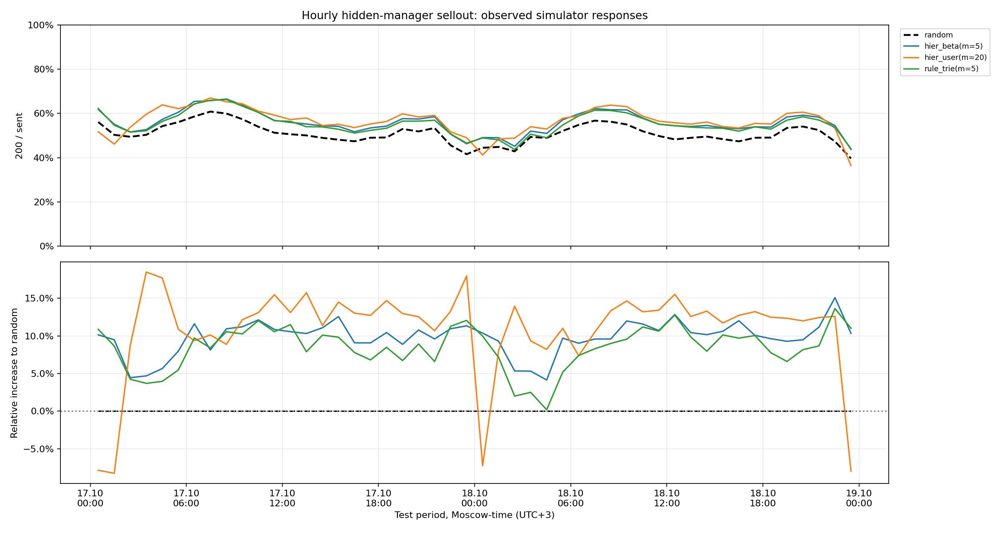

# Closed run of `shtuka`

Training on the open run log (0:4 days, `random` policy, 2 313 097 lines). Target share q = 0.8, ε = 0.02, price 200 = 150.0.

### Validation (days of 4:5)

| Politics | Days | Sent / pool | Sent / traffic | Sell-through (200/gone) | 200 / pool | 200 piece | Manager’s revenue | Revenue from ours | Total |
|---|---|---|---|---|---|---|---|---|---|
| random | 4:5 | 80.05% | 49.47% | 53.99% | 43.22% | 303 124 | 45 468 600 | 125 617 755 | 171 086 355 |
| hier_beta(m=5) | 4:5 | 80.21% | 49.57% | 59.57% | 47.78% | 335 095 | 50 264 250 | 115 648 310 | 165 912 560 |
| hier_beta(m=20) | 4:5 | 80.21% | 49.57% | 59.54% | 47.76% | 334 954 | 50 243 100 | 115 624 945 | 165 868 045 |
| hier_beta(m=80) | 4:5 | 80.20% | 49.56% | 59.49% | 47.71% | 334 603 | 50 190 450 | 115 657 670 | 165 848 120 |
| hier_user(m=5) | 4:5 | 79.85% | 49.35% | 60.29% | 48.14% | 337 636 | 50 645 400 | 119 692 820 | 170 338 220 |
| hier_user(m=20) | 4:5 | 79.84% | 49.34% | 60.31% | 48.15% | 337 706 | 50 655 900 | 119 657 335 | 170 313 235 |
| hier_user(m=80) | 4:5 | 79.82% | 49.33% | 60.31% | 48.14% | 337 641 | 50 646 150 | 119 620 800 | 170 266 950 |
| rule_trie(m=5) | 4:5 | 80.10% | 49.50% | 58.79% | 47.09% | 330 286 | 49 542 900 | 117 304 580 | 166 847 480 |
| rule_trie(m=20) | 4:5 | 80.10% | 49.50% | 58.79% | 47.09% | 330 272 | 49 540 800 | 117 306 785 | 166 847 585 |
| rule_trie(m=80) | 4:5 | 80.10% | 49.50% | 58.79% | 47.09% | 330 265 | 49 539 750 | 117 307 510 | 166 847 260 |

Regarding `random` (same-size): `hier_beta(m=5)`: sell-through +5.57 p.p.  200 +31 971; `hier_beta(m=20)`: sell-through +5.55 p.p.  200 +31 830; `hier_beta(m=80)`: sell-through +5.49 p.p.  200 +31 479; `hier_user(m=5)`: sell-through +6.29 p.p.  200 +34 512; `hier_user(m=20)`: sell-through +6.31 p.p.  200 +34 582; `hier_user(m=80)`: sell-through +6.32 p.p.  200 +34 517; `rule_trie(m=5)`: sell-through +4.80 p.p.  200 +27 162; `rule_trie(m=20)`: sell-through +4.79 p.p.  200 +27 148; `rule_trie(m=80)`: sell-through +4.79 p.p.  200 +27 141

#### `random` - by day

| Day | Requests | Pool | Sent | Sent/pool | 200 | Sell-through |
|---|---|---|---|---|---|---|
| 0 | 1 134 922 | 701 345 | 561 409 | 80.05% | 303 124 | 53.99% |

Our companies (`random`): sold 567 141 impressions, without targeting 0.00%, cut off by 1.11% filters from queries that have reached ours.

| Campaign | cpm | volume | impressions | sell-out | revenue |
|---|---|---|---|---|---|
| Bank_24d40196bd94b649 | 280.0 | 87 911 | 87 911 | 100.00% | 24 615 080 |
| Telecom_d46ed517452394a2 | 160.0 | 128 382 | 45 254 | 35.25% | 7 240 640 |
| Retail_59c52779836b2bae | 140.0 | 104 573 | 18 286 | 17.49% | 2 560 040 |
| Campaign_51288482374d537c | 90.0 | 77 303 | 198 | 0.26% | 17 820 |
| Automotive_9e1edff89ac9a790 | 250.0 | 56 689 | 56 689 | 100.00% | 14 172 250 |
| Campaign_4d4dc901c2e49788 | 200.0 | 111 602 | 85 139 | 76.29% | 17 027 800 |
| Property_5a34d256a53751c3 | 320.0 | 75 655 | 75 655 | 100.00% | 24 209 600 |
| Retail_5d131e8ff2fd6390 | 130.0 | 32 393 | 18 245 | 56.32% | 2 371 850 |
| Health_0676356d6ba137b6 | 150.0 | 11 443 | 217 | 1.90% | 32 550 |
| Travel_3724963d1920e16a | 200.0 | 12 630 | 9 700 | 76.80% | 1 940 000 |
| Bank_93461467de106ae8 | 200.0 | 11 267 | 340 | 3.02% | 68 000 |
| Retail_6162b5875d2e4e9b | 130.0 | 22 456 | 7 347 | 32.72% | 955 110 |
| Children_90daa9b022baf620 | 110.0 | 16 451 | 11 832 | 71.92% | 1 301 520 |
| Children_1aa561689b8b57e7 | 150.0 | 3 205 | 114 | 3.56% | 17 100 |
| Retail_8846b13f4335d7b7 | 120.0 | 5 449 | 367 | 6.74% | 44 040 |
| Entertainment_69bc7e453450b097 | 170.0 | 6 634 | 797 | 12.01% | 135 490 |
| Entertainment_a1dfc2a1e842d0a2 | 220.0 | 22 660 | 7 634 | 33.69% | 1 679 480 |
| Entertainment_9237fb2e70bf48fc | 180.0 | 20 518 | 8 166 | 39.80% | 1 469 880 |
| Campaign_4ada123d5805979b | 100.0 | 11 330 | 8 598 | 75.89% | 859 800 |
| Entertainment_6e3c73f12bc64057 | 90.0 | 7 129 | 201 | 2.82% | 18 090 |
| Retail_de2dbf9477c474eb | 140.0 | 9 961 | 3 198 | 32.11% | 447 720 |
| Health_f41f5144a75c3d01 | 160.0 | 9 529 | 5 013 | 52.61% | 802 080 |
| Bank_1da9a798e900c021 | 300.0 | 11 302 | 11 302 | 100.00% | 3 390 600 |
| Automotive_ee52e22a84292a1f | 210.0 | 2 017 | 719 | 35.65% | 150 990 |
| Campaign_5cb77808ad316b86 | 80.0 | 2 814 | 399 | 14.18% | 31 920 |
| Campaign_c49a8ec579219c40 | 85.0 | 291 | 9 | 3.09% | 765 |
| Campaign_8bc4330af9c149de | 95.0 | 4 633 | 32 | 0.69% | 3 040 |
| Campaign_e02df8d0c6b01b69 | 60.0 | 224 701 | 4 935 | 2.20% | 296 100 |
| Campaign_2320b836ad0f2d84 | 75.0 | 136 145 | 16 056 | 11.79% | 1 204 200 |
| Campaign_e5908cfe00510515 | 70.0 | 72 504 | 3 044 | 4.20% | 213 080 |
| Campaign_ee21aa935c0ed10e | 230.0 | 87 911 | 11 812 | 13.44% | 2 716 760 |
| Campaign_f3fec2802fa06a3c | 230.0 | 87 911 | 67 932 | 77.27% | 15 624 360 |

Hidden Manager Companies (`random`, Diagnostics – The Algorithm Cannot See):

| Campaign | volume | 200 | sell-out |
|---|---|---|---|
| Campaign_4d61f9faeb01d35c | 46 040 | 27 520 | 59.77% |
| Campaign_78f39f90f4505c10 | 64 421 | 45 383 | 70.45% |
| Campaign_0823aa18c3c2ca3c | 14 786 | 11 554 | 78.14% |
| Campaign_bfbd684ea6d38f9c | 227 489 | 124 330 | 54.65% |
| Campaign_30b60302c20096a3 | 69 118 | 24 984 | 36.15% |
| Campaign_18a033858fcef7cd | 1 679 | 655 | 39.01% |
| Children_b0f1e3ceb0b3da30 | 1 605 | 488 | 30.40% |
| Campaign_15cc393e200b3c64 | 8 861 | 5 955 | 67.20% |
| Campaign_a16460025af591cd | 18 989 | 5 964 | 31.41% |
| Campaign_82eaaf51f6f9f1de | 24 106 | 2 937 | 12.18% |
| Campaign_b3953d44c96cf68e | 252 305 | 53 354 | 21.15% |

#### `hier_beta(m=5)` - by day

| Day | Requests | Pool | Sent | Sent/pool | 200 | Sell-through |
|---|---|---|---|---|---|---|
| 0 | 1 134 922 | 701 345 | 562 559 | 80.21% | 335 095 | 59.57% |

Our companies (`hier_beta(m=5)`): sold 558 673 impressions, without targeting 0.00%, cut off by 2.39% filters from queries that have reached ours.

| Campaign | cpm | volume | impressions | sell-out | revenue |
|---|---|---|---|---|---|
| Bank_24d40196bd94b649 | 280.0 | 87 911 | 87 911 | 100.00% | 24 615 080 |
| Telecom_d46ed517452394a2 | 160.0 | 128 382 | 20 860 | 16.25% | 3 337 600 |
| Retail_59c52779836b2bae | 140.0 | 104 573 | 17 176 | 16.42% | 2 404 640 |
| Campaign_51288482374d537c | 90.0 | 77 303 | 207 | 0.27% | 18 630 |
| Automotive_9e1edff89ac9a790 | 250.0 | 56 689 | 56 267 | 99.26% | 14 066 750 |
| Campaign_4d4dc901c2e49788 | 200.0 | 111 602 | 63 015 | 56.46% | 12 603 000 |
| Property_5a34d256a53751c3 | 320.0 | 75 655 | 75 655 | 100.00% | 24 209 600 |
| Retail_5d131e8ff2fd6390 | 130.0 | 32 393 | 16 187 | 49.97% | 2 104 310 |
| Health_0676356d6ba137b6 | 150.0 | 11 443 | 183 | 1.60% | 27 450 |
| Travel_3724963d1920e16a | 200.0 | 12 630 | 306 | 2.42% | 61 200 |
| Bank_93461467de106ae8 | 200.0 | 11 267 | 307 | 2.72% | 61 400 |
| Retail_6162b5875d2e4e9b | 130.0 | 22 456 | 906 | 4.03% | 117 780 |
| Children_90daa9b022baf620 | 110.0 | 16 451 | 16 451 | 100.00% | 1 809 610 |
| Children_1aa561689b8b57e7 | 150.0 | 3 205 | 113 | 3.53% | 16 950 |
| Retail_8846b13f4335d7b7 | 120.0 | 5 449 | 442 | 8.11% | 53 040 |
| Entertainment_69bc7e453450b097 | 170.0 | 6 634 | 198 | 2.98% | 33 660 |
| Entertainment_a1dfc2a1e842d0a2 | 220.0 | 22 660 | 2 564 | 11.32% | 564 080 |
| Entertainment_9237fb2e70bf48fc | 180.0 | 20 518 | 7 134 | 34.77% | 1 284 120 |
| Campaign_4ada123d5805979b | 100.0 | 11 330 | 8 747 | 77.20% | 874 700 |
| Entertainment_6e3c73f12bc64057 | 90.0 | 7 129 | 230 | 3.23% | 20 700 |
| Retail_de2dbf9477c474eb | 140.0 | 9 961 | 6 441 | 64.66% | 901 740 |
| Health_f41f5144a75c3d01 | 160.0 | 9 529 | 7 297 | 76.58% | 1 167 520 |
| Bank_1da9a798e900c021 | 300.0 | 11 302 | 11 302 | 100.00% | 3 390 600 |
| Automotive_ee52e22a84292a1f | 210.0 | 2 017 | 100 | 4.96% | 21 000 |
| Campaign_5cb77808ad316b86 | 80.0 | 2 814 | 87 | 3.09% | 6 960 |
| Campaign_c49a8ec579219c40 | 85.0 | 291 | 120 | 41.24% | 10 200 |
| Campaign_8bc4330af9c149de | 95.0 | 4 633 | 30 | 0.65% | 2 850 |
| Campaign_e02df8d0c6b01b69 | 60.0 | 224 701 | 12 809 | 5.70% | 768 540 |
| Campaign_2320b836ad0f2d84 | 75.0 | 136 145 | 76 864 | 56.46% | 5 764 800 |
| Campaign_e5908cfe00510515 | 70.0 | 72 504 | 3 037 | 4.19% | 212 590 |
| Campaign_ee21aa935c0ed10e | 230.0 | 87 911 | 10 522 | 11.97% | 2 420 060 |
| Campaign_f3fec2802fa06a3c | 230.0 | 87 911 | 55 205 | 62.80% | 12 697 150 |

Hidden Manager Companies (`hier_beta(m=5)`, Diagnostics – The Algorithm Cannot See):

| Campaign | volume | 200 | sell-out |
|---|---|---|---|
| Campaign_4d61f9faeb01d35c | 46 040 | 30 934 | 67.19% |
| Campaign_78f39f90f4505c10 | 64 421 | 55 365 | 85.94% |
| Campaign_0823aa18c3c2ca3c | 14 786 | 13 810 | 93.40% |
| Campaign_bfbd684ea6d38f9c | 227 489 | 143 387 | 63.03% |
| Campaign_30b60302c20096a3 | 69 118 | 25 047 | 36.24% |
| Campaign_18a033858fcef7cd | 1 679 | 709 | 42.23% |
| Children_b0f1e3ceb0b3da30 | 1 605 | 495 | 30.84% |
| Campaign_15cc393e200b3c64 | 8 861 | 6 876 | 77.60% |
| Campaign_a16460025af591cd | 18 989 | 6 060 | 31.91% |
| Campaign_82eaaf51f6f9f1de | 24 106 | 3 798 | 15.76% |
| Campaign_b3953d44c96cf68e | 252 305 | 48 614 | 19.27% |

#### `hier_beta(m=20)` - by day

| Day | Requests | Pool | Sent | Sent/pool | 200 | Sell-through |
|---|---|---|---|---|---|---|
| 0 | 1 134 922 | 701 345 | 562 533 | 80.21% | 334 954 | 59.54% |

Our companies (`hier_beta(m=20)`): sold 558 781 impressions, without targeting 0.00%, cut off by 2.38% filters from queries that have reached ours.

| Campaign | cpm | volume | impressions | sell-out | revenue |
|---|---|---|---|---|---|
| Bank_24d40196bd94b649 | 280.0 | 87 911 | 87 911 | 100.00% | 24 615 080 |
| Telecom_d46ed517452394a2 | 160.0 | 128 382 | 20 383 | 15.88% | 3 261 280 |
| Retail_59c52779836b2bae | 140.0 | 104 573 | 17 163 | 16.41% | 2 402 820 |
| Campaign_51288482374d537c | 90.0 | 77 303 | 207 | 0.27% | 18 630 |
| Automotive_9e1edff89ac9a790 | 250.0 | 56 689 | 56 292 | 99.30% | 14 073 000 |
| Campaign_4d4dc901c2e49788 | 200.0 | 111 602 | 62 968 | 56.42% | 12 593 600 |
| Property_5a34d256a53751c3 | 320.0 | 75 655 | 75 655 | 100.00% | 24 209 600 |
| Retail_5d131e8ff2fd6390 | 130.0 | 32 393 | 16 821 | 51.93% | 2 186 730 |
| Health_0676356d6ba137b6 | 150.0 | 11 443 | 161 | 1.41% | 24 150 |
| Travel_3724963d1920e16a | 200.0 | 12 630 | 305 | 2.41% | 61 000 |
| Bank_93461467de106ae8 | 200.0 | 11 267 | 307 | 2.72% | 61 400 |
| Retail_6162b5875d2e4e9b | 130.0 | 22 456 | 716 | 3.19% | 93 080 |
| Children_90daa9b022baf620 | 110.0 | 16 451 | 16 451 | 100.00% | 1 809 610 |
| Children_1aa561689b8b57e7 | 150.0 | 3 205 | 113 | 3.53% | 16 950 |
| Retail_8846b13f4335d7b7 | 120.0 | 5 449 | 410 | 7.52% | 49 200 |
| Entertainment_69bc7e453450b097 | 170.0 | 6 634 | 164 | 2.47% | 27 880 |
| Entertainment_a1dfc2a1e842d0a2 | 220.0 | 22 660 | 2 577 | 11.37% | 566 940 |
| Entertainment_9237fb2e70bf48fc | 180.0 | 20 518 | 7 141 | 34.80% | 1 285 380 |
| Campaign_4ada123d5805979b | 100.0 | 11 330 | 8 748 | 77.21% | 874 800 |
| Entertainment_6e3c73f12bc64057 | 90.0 | 7 129 | 230 | 3.23% | 20 700 |
| Retail_de2dbf9477c474eb | 140.0 | 9 961 | 6 422 | 64.47% | 899 080 |
| Health_f41f5144a75c3d01 | 160.0 | 9 529 | 7 361 | 77.25% | 1 177 760 |
| Bank_1da9a798e900c021 | 300.0 | 11 302 | 11 302 | 100.00% | 3 390 600 |
| Automotive_ee52e22a84292a1f | 210.0 | 2 017 | 100 | 4.96% | 21 000 |
| Campaign_5cb77808ad316b86 | 80.0 | 2 814 | 86 | 3.06% | 6 880 |
| Campaign_c49a8ec579219c40 | 85.0 | 291 | 111 | 38.14% | 9 435 |
| Campaign_8bc4330af9c149de | 95.0 | 4 633 | 30 | 0.65% | 2 850 |
| Campaign_e02df8d0c6b01b69 | 60.0 | 224 701 | 12 776 | 5.69% | 766 560 |
| Campaign_2320b836ad0f2d84 | 75.0 | 136 145 | 77 194 | 56.70% | 5 789 550 |
| Campaign_e5908cfe00510515 | 70.0 | 72 504 | 3 038 | 4.19% | 212 660 |
| Campaign_ee21aa935c0ed10e | 230.0 | 87 911 | 10 517 | 11.96% | 2 418 910 |
| Campaign_f3fec2802fa06a3c | 230.0 | 87 911 | 55 121 | 62.70% | 12 677 830 |

Hidden Manager Companies (`hier_beta(m=20)`, Diagnostics – The Algorithm Cannot See):

| Campaign | volume | 200 | sell-out |
|---|---|---|---|
| Campaign_4d61f9faeb01d35c | 46 040 | 30 935 | 67.19% |
| Campaign_78f39f90f4505c10 | 64 421 | 55 365 | 85.94% |
| Campaign_0823aa18c3c2ca3c | 14 786 | 13 810 | 93.40% |
| Campaign_bfbd684ea6d38f9c | 227 489 | 143 505 | 63.08% |
| Campaign_30b60302c20096a3 | 69 118 | 24 977 | 36.14% |
| Campaign_18a033858fcef7cd | 1 679 | 709 | 42.23% |
| Children_b0f1e3ceb0b3da30 | 1 605 | 495 | 30.84% |
| Campaign_15cc393e200b3c64 | 8 861 | 6 876 | 77.60% |
| Campaign_a16460025af591cd | 18 989 | 6 018 | 31.69% |
| Campaign_82eaaf51f6f9f1de | 24 106 | 3 798 | 15.76% |
| Campaign_b3953d44c96cf68e | 252 305 | 48 466 | 19.21% |

#### `hier_beta(m=80)` - by day

| Day | Requests | Pool | Sent | Sent/pool | 200 | Sell-through |
|---|---|---|---|---|---|---|
| 0 | 1 134 922 | 701 345 | 562 471 | 80.20% | 334 603 | 59.49% |

Our companies (`hier_beta(m=80)`): sold 559 294 impressions, without targeting 0.00%, cut off by 2.30% filters from queries that have reached ours.

| Campaign | cpm | volume | impressions | sell-out | revenue |
|---|---|---|---|---|---|
| Bank_24d40196bd94b649 | 280.0 | 87 911 | 87 911 | 100.00% | 24 615 080 |
| Telecom_d46ed517452394a2 | 160.0 | 128 382 | 19 805 | 15.43% | 3 168 800 |
| Retail_59c52779836b2bae | 140.0 | 104 573 | 17 140 | 16.39% | 2 399 600 |
| Campaign_51288482374d537c | 90.0 | 77 303 | 207 | 0.27% | 18 630 |
| Automotive_9e1edff89ac9a790 | 250.0 | 56 689 | 56 315 | 99.34% | 14 078 750 |
| Campaign_4d4dc901c2e49788 | 200.0 | 111 602 | 63 164 | 56.60% | 12 632 800 |
| Property_5a34d256a53751c3 | 320.0 | 75 655 | 75 655 | 100.00% | 24 209 600 |
| Retail_5d131e8ff2fd6390 | 130.0 | 32 393 | 17 536 | 54.14% | 2 279 680 |
| Health_0676356d6ba137b6 | 150.0 | 11 443 | 131 | 1.14% | 19 650 |
| Travel_3724963d1920e16a | 200.0 | 12 630 | 312 | 2.47% | 62 400 |
| Bank_93461467de106ae8 | 200.0 | 11 267 | 307 | 2.72% | 61 400 |
| Retail_6162b5875d2e4e9b | 130.0 | 22 456 | 622 | 2.77% | 80 860 |
| Children_90daa9b022baf620 | 110.0 | 16 451 | 16 451 | 100.00% | 1 809 610 |
| Children_1aa561689b8b57e7 | 150.0 | 3 205 | 113 | 3.53% | 16 950 |
| Retail_8846b13f4335d7b7 | 120.0 | 5 449 | 402 | 7.38% | 48 240 |
| Entertainment_69bc7e453450b097 | 170.0 | 6 634 | 143 | 2.16% | 24 310 |
| Entertainment_a1dfc2a1e842d0a2 | 220.0 | 22 660 | 2 594 | 11.45% | 570 680 |
| Entertainment_9237fb2e70bf48fc | 180.0 | 20 518 | 7 132 | 34.76% | 1 283 760 |
| Campaign_4ada123d5805979b | 100.0 | 11 330 | 8 751 | 77.24% | 875 100 |
| Entertainment_6e3c73f12bc64057 | 90.0 | 7 129 | 230 | 3.23% | 20 700 |
| Retail_de2dbf9477c474eb | 140.0 | 9 961 | 6 358 | 63.83% | 890 120 |
| Health_f41f5144a75c3d01 | 160.0 | 9 529 | 7 424 | 77.91% | 1 187 840 |
| Bank_1da9a798e900c021 | 300.0 | 11 302 | 11 302 | 100.00% | 3 390 600 |
| Automotive_ee52e22a84292a1f | 210.0 | 2 017 | 100 | 4.96% | 21 000 |
| Campaign_5cb77808ad316b86 | 80.0 | 2 814 | 81 | 2.88% | 6 480 |
| Campaign_c49a8ec579219c40 | 85.0 | 291 | 106 | 36.43% | 9 010 |
| Campaign_8bc4330af9c149de | 95.0 | 4 633 | 30 | 0.65% | 2 850 |
| Campaign_e02df8d0c6b01b69 | 60.0 | 224 701 | 12 821 | 5.71% | 769 260 |
| Campaign_2320b836ad0f2d84 | 75.0 | 136 145 | 77 580 | 56.98% | 5 818 500 |
| Campaign_e5908cfe00510515 | 70.0 | 72 504 | 3 037 | 4.19% | 212 590 |
| Campaign_ee21aa935c0ed10e | 230.0 | 87 911 | 10 509 | 11.95% | 2 417 070 |
| Campaign_f3fec2802fa06a3c | 230.0 | 87 911 | 55 025 | 62.59% | 12 655 750 |

Hidden Manager Companies (`hier_beta(m=80)`, Diagnostics – The Algorithm Cannot See):

| Campaign | volume | 200 | sell-out |
|---|---|---|---|
| Campaign_4d61f9faeb01d35c | 46 040 | 30 928 | 67.18% |
| Campaign_78f39f90f4505c10 | 64 421 | 55 363 | 85.94% |
| Campaign_0823aa18c3c2ca3c | 14 786 | 13 810 | 93.40% |
| Campaign_bfbd684ea6d38f9c | 227 489 | 143 622 | 63.13% |
| Campaign_30b60302c20096a3 | 69 118 | 24 902 | 36.03% |
| Campaign_18a033858fcef7cd | 1 679 | 709 | 42.23% |
| Children_b0f1e3ceb0b3da30 | 1 605 | 495 | 30.84% |
| Campaign_15cc393e200b3c64 | 8 861 | 6 876 | 77.60% |
| Campaign_a16460025af591cd | 18 989 | 5 941 | 31.29% |
| Campaign_82eaaf51f6f9f1de | 24 106 | 3 798 | 15.76% |
| Campaign_b3953d44c96cf68e | 252 305 | 48 159 | 19.09% |

#### `hier_user(m=5)` - by day

| Day | Requests | Pool | Sent | Sent/pool | 200 | Sell-through |
|---|---|---|---|---|---|---|
| 0 | 1 134 922 | 701 345 | 560 036 | 79.85% | 337 636 | 60.29% |

Our companies (`hier_user(m=5)`): sold 557 874 impressions, without targeting 0.00%, cut off by 2.96% filters from queries that have reached ours.

| Campaign | cpm | volume | impressions | sell-out | revenue |
|---|---|---|---|---|---|
| Bank_24d40196bd94b649 | 280.0 | 87 911 | 87 911 | 100.00% | 24 615 080 |
| Telecom_d46ed517452394a2 | 160.0 | 128 382 | 29 768 | 23.19% | 4 762 880 |
| Retail_59c52779836b2bae | 140.0 | 104 573 | 20 058 | 19.18% | 2 808 120 |
| Campaign_51288482374d537c | 90.0 | 77 303 | 238 | 0.31% | 21 420 |
| Automotive_9e1edff89ac9a790 | 250.0 | 56 689 | 56 689 | 100.00% | 14 172 250 |
| Campaign_4d4dc901c2e49788 | 200.0 | 111 602 | 75 366 | 67.53% | 15 073 200 |
| Property_5a34d256a53751c3 | 320.0 | 75 655 | 75 655 | 100.00% | 24 209 600 |
| Retail_5d131e8ff2fd6390 | 130.0 | 32 393 | 19 499 | 60.20% | 2 534 870 |
| Health_0676356d6ba137b6 | 150.0 | 11 443 | 652 | 5.70% | 97 800 |
| Travel_3724963d1920e16a | 200.0 | 12 630 | 780 | 6.18% | 156 000 |
| Bank_93461467de106ae8 | 200.0 | 11 267 | 332 | 2.95% | 66 400 |
| Retail_6162b5875d2e4e9b | 130.0 | 22 456 | 4 548 | 20.25% | 591 240 |
| Children_90daa9b022baf620 | 110.0 | 16 451 | 16 451 | 100.00% | 1 809 610 |
| Children_1aa561689b8b57e7 | 150.0 | 3 205 | 162 | 5.05% | 24 300 |
| Retail_8846b13f4335d7b7 | 120.0 | 5 449 | 885 | 16.24% | 106 200 |
| Entertainment_69bc7e453450b097 | 170.0 | 6 634 | 444 | 6.69% | 75 480 |
| Entertainment_a1dfc2a1e842d0a2 | 220.0 | 22 660 | 4 029 | 17.78% | 886 380 |
| Entertainment_9237fb2e70bf48fc | 180.0 | 20 518 | 8 180 | 39.87% | 1 472 400 |
| Campaign_4ada123d5805979b | 100.0 | 11 330 | 8 619 | 76.07% | 861 900 |
| Entertainment_6e3c73f12bc64057 | 90.0 | 7 129 | 231 | 3.24% | 20 790 |
| Retail_de2dbf9477c474eb | 140.0 | 9 961 | 4 008 | 40.24% | 561 120 |
| Health_f41f5144a75c3d01 | 160.0 | 9 529 | 3 829 | 40.18% | 612 640 |
| Bank_1da9a798e900c021 | 300.0 | 11 302 | 11 302 | 100.00% | 3 390 600 |
| Automotive_ee52e22a84292a1f | 210.0 | 2 017 | 140 | 6.94% | 29 400 |
| Campaign_5cb77808ad316b86 | 80.0 | 2 814 | 609 | 21.64% | 48 720 |
| Campaign_c49a8ec579219c40 | 85.0 | 291 | 118 | 40.55% | 10 030 |
| Campaign_8bc4330af9c149de | 95.0 | 4 633 | 193 | 4.17% | 18 335 |
| Campaign_e02df8d0c6b01b69 | 60.0 | 224 701 | 12 659 | 5.63% | 759 540 |
| Campaign_2320b836ad0f2d84 | 75.0 | 136 145 | 38 437 | 28.23% | 2 882 775 |
| Campaign_e5908cfe00510515 | 70.0 | 72 504 | 3 032 | 4.18% | 212 240 |
| Campaign_ee21aa935c0ed10e | 230.0 | 87 911 | 11 281 | 12.83% | 2 594 630 |
| Campaign_f3fec2802fa06a3c | 230.0 | 87 911 | 61 769 | 70.26% | 14 206 870 |

Hidden Manager Companies (`hier_user(m=5)`, Diagnostics – The Algorithm Cannot See):

| Campaign | volume | 200 | sell-out |
|---|---|---|---|
| Campaign_4d61f9faeb01d35c | 46 040 | 30 136 | 65.46% |
| Campaign_78f39f90f4505c10 | 64 421 | 55 242 | 85.75% |
| Campaign_0823aa18c3c2ca3c | 14 786 | 13 594 | 91.94% |
| Campaign_bfbd684ea6d38f9c | 227 489 | 142 693 | 62.73% |
| Campaign_30b60302c20096a3 | 69 118 | 23 064 | 33.37% |
| Campaign_18a033858fcef7cd | 1 679 | 691 | 41.16% |
| Children_b0f1e3ceb0b3da30 | 1 605 | 494 | 30.78% |
| Campaign_15cc393e200b3c64 | 8 861 | 6 864 | 77.46% |
| Campaign_a16460025af591cd | 18 989 | 5 831 | 30.71% |
| Campaign_82eaaf51f6f9f1de | 24 106 | 3 776 | 15.66% |
| Campaign_b3953d44c96cf68e | 252 305 | 55 251 | 21.90% |

#### `hier_user(m=20)` - by day

| Day | Requests | Pool | Sent | Sent/pool | 200 | Sell-through |
|---|---|---|---|---|---|---|
| 0 | 1 134 922 | 701 345 | 559 965 | 79.84% | 337 706 | 60.31% |

Our companies (`hier_user(m=20)`): sold 558 021 impressions, without targeting 0.00%, cut off by 2.95% filters from queries that have reached ours.

| Campaign | cpm | volume | impressions | sell-out | revenue |
|---|---|---|---|---|---|
| Bank_24d40196bd94b649 | 280.0 | 87 911 | 87 911 | 100.00% | 24 615 080 |
| Telecom_d46ed517452394a2 | 160.0 | 128 382 | 29 560 | 23.03% | 4 729 600 |
| Retail_59c52779836b2bae | 140.0 | 104 573 | 20 007 | 19.13% | 2 800 980 |
| Campaign_51288482374d537c | 90.0 | 77 303 | 234 | 0.30% | 21 060 |
| Automotive_9e1edff89ac9a790 | 250.0 | 56 689 | 56 689 | 100.00% | 14 172 250 |
| Campaign_4d4dc901c2e49788 | 200.0 | 111 602 | 75 272 | 67.45% | 15 054 400 |
| Property_5a34d256a53751c3 | 320.0 | 75 655 | 75 655 | 100.00% | 24 209 600 |
| Retail_5d131e8ff2fd6390 | 130.0 | 32 393 | 19 499 | 60.20% | 2 534 870 |
| Health_0676356d6ba137b6 | 150.0 | 11 443 | 638 | 5.58% | 95 700 |
| Travel_3724963d1920e16a | 200.0 | 12 630 | 808 | 6.40% | 161 600 |
| Bank_93461467de106ae8 | 200.0 | 11 267 | 329 | 2.92% | 65 800 |
| Retail_6162b5875d2e4e9b | 130.0 | 22 456 | 4 470 | 19.91% | 581 100 |
| Children_90daa9b022baf620 | 110.0 | 16 451 | 16 451 | 100.00% | 1 809 610 |
| Children_1aa561689b8b57e7 | 150.0 | 3 205 | 156 | 4.87% | 23 400 |
| Retail_8846b13f4335d7b7 | 120.0 | 5 449 | 880 | 16.15% | 105 600 |
| Entertainment_69bc7e453450b097 | 170.0 | 6 634 | 433 | 6.53% | 73 610 |
| Entertainment_a1dfc2a1e842d0a2 | 220.0 | 22 660 | 4 007 | 17.68% | 881 540 |
| Entertainment_9237fb2e70bf48fc | 180.0 | 20 518 | 8 150 | 39.72% | 1 467 000 |
| Campaign_4ada123d5805979b | 100.0 | 11 330 | 8 632 | 76.19% | 863 200 |
| Entertainment_6e3c73f12bc64057 | 90.0 | 7 129 | 231 | 3.24% | 20 790 |
| Retail_de2dbf9477c474eb | 140.0 | 9 961 | 4 050 | 40.66% | 567 000 |
| Health_f41f5144a75c3d01 | 160.0 | 9 529 | 3 827 | 40.16% | 612 320 |
| Bank_1da9a798e900c021 | 300.0 | 11 302 | 11 302 | 100.00% | 3 390 600 |
| Automotive_ee52e22a84292a1f | 210.0 | 2 017 | 140 | 6.94% | 29 400 |
| Campaign_5cb77808ad316b86 | 80.0 | 2 814 | 606 | 21.54% | 48 480 |
| Campaign_c49a8ec579219c40 | 85.0 | 291 | 118 | 40.55% | 10 030 |
| Campaign_8bc4330af9c149de | 95.0 | 4 633 | 194 | 4.19% | 18 430 |
| Campaign_e02df8d0c6b01b69 | 60.0 | 224 701 | 12 707 | 5.66% | 762 420 |
| Campaign_2320b836ad0f2d84 | 75.0 | 136 145 | 39 015 | 28.66% | 2 926 125 |
| Campaign_e5908cfe00510515 | 70.0 | 72 504 | 3 036 | 4.19% | 212 520 |
| Campaign_ee21aa935c0ed10e | 230.0 | 87 911 | 11 259 | 12.81% | 2 589 570 |
| Campaign_f3fec2802fa06a3c | 230.0 | 87 911 | 61 755 | 70.25% | 14 203 650 |

Hidden Manager Companies (`hier_user(m=20)`, Diagnostics – The Algorithm Cannot See):

| Campaign | volume | 200 | sell-out |
|---|---|---|---|
| Campaign_4d61f9faeb01d35c | 46 040 | 30 142 | 65.47% |
| Campaign_78f39f90f4505c10 | 64 421 | 55 236 | 85.74% |
| Campaign_0823aa18c3c2ca3c | 14 786 | 13 595 | 91.95% |
| Campaign_bfbd684ea6d38f9c | 227 489 | 142 748 | 62.75% |
| Campaign_30b60302c20096a3 | 69 118 | 23 090 | 33.41% |
| Campaign_18a033858fcef7cd | 1 679 | 691 | 41.16% |
| Children_b0f1e3ceb0b3da30 | 1 605 | 494 | 30.78% |
| Campaign_15cc393e200b3c64 | 8 861 | 6 864 | 77.46% |
| Campaign_a16460025af591cd | 18 989 | 5 831 | 30.71% |
| Campaign_82eaaf51f6f9f1de | 24 106 | 3 776 | 15.66% |
| Campaign_b3953d44c96cf68e | 252 305 | 55 239 | 21.89% |

#### `hier_user(m=80)` - by day

| Day | Requests | Pool | Sent | Sent/pool | 200 | Sell-through |
|---|---|---|---|---|---|---|
| 0 | 1 134 922 | 701 345 | 559 831 | 79.82% | 337 641 | 60.31% |

Our companies (`hier_user(m=80)`): sold 558 165 impressions, without targeting 0.00%, cut off by 2.94% filters from queries that have reached ours.

| Campaign | cpm | volume | impressions | sell-out | revenue |
|---|---|---|---|---|---|
| Bank_24d40196bd94b649 | 280.0 | 87 911 | 87 911 | 100.00% | 24 615 080 |
| Telecom_d46ed517452394a2 | 160.0 | 128 382 | 29 312 | 22.83% | 4 689 920 |
| Retail_59c52779836b2bae | 140.0 | 104 573 | 19 975 | 19.10% | 2 796 500 |
| Campaign_51288482374d537c | 90.0 | 77 303 | 236 | 0.31% | 21 240 |
| Automotive_9e1edff89ac9a790 | 250.0 | 56 689 | 56 689 | 100.00% | 14 172 250 |
| Campaign_4d4dc901c2e49788 | 200.0 | 111 602 | 75 081 | 67.28% | 15 016 200 |
| Property_5a34d256a53751c3 | 320.0 | 75 655 | 75 655 | 100.00% | 24 209 600 |
| Retail_5d131e8ff2fd6390 | 130.0 | 32 393 | 19 549 | 60.35% | 2 541 370 |
| Health_0676356d6ba137b6 | 150.0 | 11 443 | 626 | 5.47% | 93 900 |
| Travel_3724963d1920e16a | 200.0 | 12 630 | 975 | 7.72% | 195 000 |
| Bank_93461467de106ae8 | 200.0 | 11 267 | 331 | 2.94% | 66 200 |
| Retail_6162b5875d2e4e9b | 130.0 | 22 456 | 4 327 | 19.27% | 562 510 |
| Children_90daa9b022baf620 | 110.0 | 16 451 | 16 451 | 100.00% | 1 809 610 |
| Children_1aa561689b8b57e7 | 150.0 | 3 205 | 158 | 4.93% | 23 700 |
| Retail_8846b13f4335d7b7 | 120.0 | 5 449 | 865 | 15.87% | 103 800 |
| Entertainment_69bc7e453450b097 | 170.0 | 6 634 | 446 | 6.72% | 75 820 |
| Entertainment_a1dfc2a1e842d0a2 | 220.0 | 22 660 | 3 973 | 17.53% | 874 060 |
| Entertainment_9237fb2e70bf48fc | 180.0 | 20 518 | 8 141 | 39.68% | 1 465 380 |
| Campaign_4ada123d5805979b | 100.0 | 11 330 | 8 637 | 76.23% | 863 700 |
| Entertainment_6e3c73f12bc64057 | 90.0 | 7 129 | 231 | 3.24% | 20 790 |
| Retail_de2dbf9477c474eb | 140.0 | 9 961 | 4 092 | 41.08% | 572 880 |
| Health_f41f5144a75c3d01 | 160.0 | 9 529 | 3 856 | 40.47% | 616 960 |
| Bank_1da9a798e900c021 | 300.0 | 11 302 | 11 302 | 100.00% | 3 390 600 |
| Automotive_ee52e22a84292a1f | 210.0 | 2 017 | 139 | 6.89% | 29 190 |
| Campaign_5cb77808ad316b86 | 80.0 | 2 814 | 603 | 21.43% | 48 240 |
| Campaign_c49a8ec579219c40 | 85.0 | 291 | 118 | 40.55% | 10 030 |
| Campaign_8bc4330af9c149de | 95.0 | 4 633 | 195 | 4.21% | 18 525 |
| Campaign_e02df8d0c6b01b69 | 60.0 | 224 701 | 12 798 | 5.70% | 767 880 |
| Campaign_2320b836ad0f2d84 | 75.0 | 136 145 | 39 535 | 29.04% | 2 965 125 |
| Campaign_e5908cfe00510515 | 70.0 | 72 504 | 3 035 | 4.19% | 212 450 |
| Campaign_ee21aa935c0ed10e | 230.0 | 87 911 | 11 263 | 12.81% | 2 590 490 |
| Campaign_f3fec2802fa06a3c | 230.0 | 87 911 | 61 660 | 70.14% | 14 181 800 |

Hidden Manager Companies (`hier_user(m=80)`, Diagnostics – The Algorithm Cannot See):

| Campaign | volume | 200 | sell-out |
|---|---|---|---|
| Campaign_4d61f9faeb01d35c | 46 040 | 30 174 | 65.54% |
| Campaign_78f39f90f4505c10 | 64 421 | 55 098 | 85.53% |
| Campaign_0823aa18c3c2ca3c | 14 786 | 13 565 | 91.74% |
| Campaign_bfbd684ea6d38f9c | 227 489 | 142 816 | 62.78% |
| Campaign_30b60302c20096a3 | 69 118 | 23 126 | 33.46% |
| Campaign_18a033858fcef7cd | 1 679 | 692 | 41.22% |
| Children_b0f1e3ceb0b3da30 | 1 605 | 494 | 30.78% |
| Campaign_15cc393e200b3c64 | 8 861 | 6 863 | 77.45% |
| Campaign_a16460025af591cd | 18 989 | 5 829 | 30.70% |
| Campaign_82eaaf51f6f9f1de | 24 106 | 3 777 | 15.67% |
| Campaign_b3953d44c96cf68e | 252 305 | 55 207 | 21.88% |

#### `rule_trie(m=5)` - by day

| Day | Requests | Pool | Sent | Sent/pool | 200 | Sell-through |
|---|---|---|---|---|---|---|
| 0 | 1 134 922 | 701 345 | 561 800 | 80.10% | 330 286 | 58.79% |

Our companies (`rule_trie(m=5)`): sold 565 078 impressions, without targeting 0.00%, cut off by 1.40% filters from queries that have reached ours.

| Campaign | cpm | volume | impressions | sell-out | revenue |
|---|---|---|---|---|---|
| Bank_24d40196bd94b649 | 280.0 | 87 911 | 87 911 | 100.00% | 24 615 080 |
| Telecom_d46ed517452394a2 | 160.0 | 128 382 | 16 603 | 12.93% | 2 656 480 |
| Retail_59c52779836b2bae | 140.0 | 104 573 | 16 917 | 16.18% | 2 368 380 |
| Campaign_51288482374d537c | 90.0 | 77 303 | 187 | 0.24% | 16 830 |
| Automotive_9e1edff89ac9a790 | 250.0 | 56 689 | 56 689 | 100.00% | 14 172 250 |
| Campaign_4d4dc901c2e49788 | 200.0 | 111 602 | 71 514 | 64.08% | 14 302 800 |
| Property_5a34d256a53751c3 | 320.0 | 75 655 | 75 655 | 100.00% | 24 209 600 |
| Retail_5d131e8ff2fd6390 | 130.0 | 32 393 | 21 025 | 64.91% | 2 733 250 |
| Health_0676356d6ba137b6 | 150.0 | 11 443 | 57 | 0.50% | 8 550 |
| Travel_3724963d1920e16a | 200.0 | 12 630 | 288 | 2.28% | 57 600 |
| Bank_93461467de106ae8 | 200.0 | 11 267 | 308 | 2.73% | 61 600 |
| Retail_6162b5875d2e4e9b | 130.0 | 22 456 | 0 | 0.00% | 0 |
| Children_90daa9b022baf620 | 110.0 | 16 451 | 16 451 | 100.00% | 1 809 610 |
| Children_1aa561689b8b57e7 | 150.0 | 3 205 | 169 | 5.27% | 25 350 |
| Retail_8846b13f4335d7b7 | 120.0 | 5 449 | 1 | 0.02% | 120 |
| Entertainment_69bc7e453450b097 | 170.0 | 6 634 | 3 | 0.05% | 510 |
| Entertainment_a1dfc2a1e842d0a2 | 220.0 | 22 660 | 2 698 | 11.91% | 593 560 |
| Entertainment_9237fb2e70bf48fc | 180.0 | 20 518 | 7 156 | 34.88% | 1 288 080 |
| Campaign_4ada123d5805979b | 100.0 | 11 330 | 8 766 | 77.37% | 876 600 |
| Entertainment_6e3c73f12bc64057 | 90.0 | 7 129 | 230 | 3.23% | 20 700 |
| Retail_de2dbf9477c474eb | 140.0 | 9 961 | 5 804 | 58.27% | 812 560 |
| Health_f41f5144a75c3d01 | 160.0 | 9 529 | 6 685 | 70.15% | 1 069 600 |
| Bank_1da9a798e900c021 | 300.0 | 11 302 | 11 302 | 100.00% | 3 390 600 |
| Automotive_ee52e22a84292a1f | 210.0 | 2 017 | 100 | 4.96% | 21 000 |
| Campaign_5cb77808ad316b86 | 80.0 | 2 814 | 81 | 2.88% | 6 480 |
| Campaign_c49a8ec579219c40 | 85.0 | 291 | 47 | 16.15% | 3 995 |
| Campaign_8bc4330af9c149de | 95.0 | 4 633 | 0 | 0.00% | 0 |
| Campaign_e02df8d0c6b01b69 | 60.0 | 224 701 | 11 289 | 5.02% | 677 340 |
| Campaign_2320b836ad0f2d84 | 75.0 | 136 145 | 76 455 | 56.16% | 5 734 125 |
| Campaign_e5908cfe00510515 | 70.0 | 72 504 | 3 038 | 4.19% | 212 660 |
| Campaign_ee21aa935c0ed10e | 230.0 | 87 911 | 10 781 | 12.26% | 2 479 630 |
| Campaign_f3fec2802fa06a3c | 230.0 | 87 911 | 56 868 | 64.69% | 13 079 640 |

Hidden Manager Companies (`rule_trie(m=5)`, Diagnostics – The Algorithm Cannot See):

| Campaign | volume | 200 | sell-out |
|---|---|---|---|
| Campaign_4d61f9faeb01d35c | 46 040 | 29 654 | 64.41% |
| Campaign_78f39f90f4505c10 | 64 421 | 55 365 | 85.94% |
| Campaign_0823aa18c3c2ca3c | 14 786 | 13 810 | 93.40% |
| Campaign_bfbd684ea6d38f9c | 227 489 | 144 222 | 63.40% |
| Campaign_30b60302c20096a3 | 69 118 | 23 028 | 33.32% |
| Campaign_18a033858fcef7cd | 1 679 | 709 | 42.23% |
| Children_b0f1e3ceb0b3da30 | 1 605 | 495 | 30.84% |
| Campaign_15cc393e200b3c64 | 8 861 | 6 876 | 77.60% |
| Campaign_a16460025af591cd | 18 989 | 6 126 | 32.26% |
| Campaign_82eaaf51f6f9f1de | 24 106 | 3 810 | 15.81% |
| Campaign_b3953d44c96cf68e | 252 305 | 46 191 | 18.31% |

#### `rule_trie(m=20)` - by day

| Day | Requests | Pool | Sent | Sent/pool | 200 | Sell-through |
|---|---|---|---|---|---|---|
| 0 | 1 134 922 | 701 345 | 561 807 | 80.10% | 330 272 | 58.79% |

Our companies (`rule_trie(m=20)`): sold 565 087 impressions, without targeting 0.00%, cut off by 1.40% filters from queries that have reached ours.

| Campaign | cpm | volume | impressions | sell-out | revenue |
|---|---|---|---|---|---|
| Bank_24d40196bd94b649 | 280.0 | 87 911 | 87 911 | 100.00% | 24 615 080 |
| Telecom_d46ed517452394a2 | 160.0 | 128 382 | 16 603 | 12.93% | 2 656 480 |
| Retail_59c52779836b2bae | 140.0 | 104 573 | 16 917 | 16.18% | 2 368 380 |
| Campaign_51288482374d537c | 90.0 | 77 303 | 187 | 0.24% | 16 830 |
| Automotive_9e1edff89ac9a790 | 250.0 | 56 689 | 56 689 | 100.00% | 14 172 250 |
| Campaign_4d4dc901c2e49788 | 200.0 | 111 602 | 71 519 | 64.08% | 14 303 800 |
| Property_5a34d256a53751c3 | 320.0 | 75 655 | 75 655 | 100.00% | 24 209 600 |
| Retail_5d131e8ff2fd6390 | 130.0 | 32 393 | 21 032 | 64.93% | 2 734 160 |
| Health_0676356d6ba137b6 | 150.0 | 11 443 | 57 | 0.50% | 8 550 |
| Travel_3724963d1920e16a | 200.0 | 12 630 | 288 | 2.28% | 57 600 |
| Bank_93461467de106ae8 | 200.0 | 11 267 | 308 | 2.73% | 61 600 |
| Retail_6162b5875d2e4e9b | 130.0 | 22 456 | 0 | 0.00% | 0 |
| Children_90daa9b022baf620 | 110.0 | 16 451 | 16 451 | 100.00% | 1 809 610 |
| Children_1aa561689b8b57e7 | 150.0 | 3 205 | 169 | 5.27% | 25 350 |
| Retail_8846b13f4335d7b7 | 120.0 | 5 449 | 1 | 0.02% | 120 |
| Entertainment_69bc7e453450b097 | 170.0 | 6 634 | 3 | 0.05% | 510 |
| Entertainment_a1dfc2a1e842d0a2 | 220.0 | 22 660 | 2 701 | 11.92% | 594 220 |
| Entertainment_9237fb2e70bf48fc | 180.0 | 20 518 | 7 157 | 34.88% | 1 288 260 |
| Campaign_4ada123d5805979b | 100.0 | 11 330 | 8 766 | 77.37% | 876 600 |
| Entertainment_6e3c73f12bc64057 | 90.0 | 7 129 | 230 | 3.23% | 20 700 |
| Retail_de2dbf9477c474eb | 140.0 | 9 961 | 5 804 | 58.27% | 812 560 |
| Health_f41f5144a75c3d01 | 160.0 | 9 529 | 6 682 | 70.12% | 1 069 120 |
| Bank_1da9a798e900c021 | 300.0 | 11 302 | 11 302 | 100.00% | 3 390 600 |
| Automotive_ee52e22a84292a1f | 210.0 | 2 017 | 100 | 4.96% | 21 000 |
| Campaign_5cb77808ad316b86 | 80.0 | 2 814 | 81 | 2.88% | 6 480 |
| Campaign_c49a8ec579219c40 | 85.0 | 291 | 47 | 16.15% | 3 995 |
| Campaign_8bc4330af9c149de | 95.0 | 4 633 | 0 | 0.00% | 0 |
| Campaign_e02df8d0c6b01b69 | 60.0 | 224 701 | 11 294 | 5.03% | 677 640 |
| Campaign_2320b836ad0f2d84 | 75.0 | 136 145 | 76 444 | 56.15% | 5 733 300 |
| Campaign_e5908cfe00510515 | 70.0 | 72 504 | 3 038 | 4.19% | 212 660 |
| Campaign_ee21aa935c0ed10e | 230.0 | 87 911 | 10 781 | 12.26% | 2 479 630 |
| Campaign_f3fec2802fa06a3c | 230.0 | 87 911 | 56 870 | 64.69% | 13 080 100 |

Hidden Manager Companies (`rule_trie(m=20)`, Diagnostics – The Algorithm Cannot See):

| Campaign | volume | 200 | sell-out |
|---|---|---|---|
| Campaign_4d61f9faeb01d35c | 46 040 | 29 652 | 64.40% |
| Campaign_78f39f90f4505c10 | 64 421 | 55 365 | 85.94% |
| Campaign_0823aa18c3c2ca3c | 14 786 | 13 810 | 93.40% |
| Campaign_bfbd684ea6d38f9c | 227 489 | 144 222 | 63.40% |
| Campaign_30b60302c20096a3 | 69 118 | 23 019 | 33.30% |
| Campaign_18a033858fcef7cd | 1 679 | 709 | 42.23% |
| Children_b0f1e3ceb0b3da30 | 1 605 | 495 | 30.84% |
| Campaign_15cc393e200b3c64 | 8 861 | 6 876 | 77.60% |
| Campaign_a16460025af591cd | 18 989 | 6 125 | 32.26% |
| Campaign_82eaaf51f6f9f1de | 24 106 | 3 810 | 15.81% |
| Campaign_b3953d44c96cf68e | 252 305 | 46 189 | 18.31% |

#### `rule_trie(m=80)` - by day

| Day | Requests | Pool | Sent | Sent/pool | 200 | Sell-through |
|---|---|---|---|---|---|---|
| 0 | 1 134 922 | 701 345 | 561 797 | 80.10% | 330 265 | 58.79% |

Our companies (`rule_trie(m=80)`): sold 565 111 impressions, without targeting 0.00%, cut off by 1.40% filters from queries that have reached ours.

| Campaign | cpm | volume | impressions | sell-out | revenue |
|---|---|---|---|---|---|
| Bank_24d40196bd94b649 | 280.0 | 87 911 | 87 911 | 100.00% | 24 615 080 |
| Telecom_d46ed517452394a2 | 160.0 | 128 382 | 16 604 | 12.93% | 2 656 640 |
| Retail_59c52779836b2bae | 140.0 | 104 573 | 16 917 | 16.18% | 2 368 380 |
| Campaign_51288482374d537c | 90.0 | 77 303 | 187 | 0.24% | 16 830 |
| Automotive_9e1edff89ac9a790 | 250.0 | 56 689 | 56 689 | 100.00% | 14 172 250 |
| Campaign_4d4dc901c2e49788 | 200.0 | 111 602 | 71 534 | 64.10% | 14 306 800 |
| Property_5a34d256a53751c3 | 320.0 | 75 655 | 75 655 | 100.00% | 24 209 600 |
| Retail_5d131e8ff2fd6390 | 130.0 | 32 393 | 21 007 | 64.85% | 2 730 910 |
| Health_0676356d6ba137b6 | 150.0 | 11 443 | 57 | 0.50% | 8 550 |
| Travel_3724963d1920e16a | 200.0 | 12 630 | 288 | 2.28% | 57 600 |
| Bank_93461467de106ae8 | 200.0 | 11 267 | 308 | 2.73% | 61 600 |
| Retail_6162b5875d2e4e9b | 130.0 | 22 456 | 0 | 0.00% | 0 |
| Children_90daa9b022baf620 | 110.0 | 16 451 | 16 451 | 100.00% | 1 809 610 |
| Children_1aa561689b8b57e7 | 150.0 | 3 205 | 169 | 5.27% | 25 350 |
| Retail_8846b13f4335d7b7 | 120.0 | 5 449 | 1 | 0.02% | 120 |
| Entertainment_69bc7e453450b097 | 170.0 | 6 634 | 3 | 0.05% | 510 |
| Entertainment_a1dfc2a1e842d0a2 | 220.0 | 22 660 | 2 704 | 11.93% | 594 880 |
| Entertainment_9237fb2e70bf48fc | 180.0 | 20 518 | 7 155 | 34.87% | 1 287 900 |
| Campaign_4ada123d5805979b | 100.0 | 11 330 | 8 766 | 77.37% | 876 600 |
| Entertainment_6e3c73f12bc64057 | 90.0 | 7 129 | 230 | 3.23% | 20 700 |
| Retail_de2dbf9477c474eb | 140.0 | 9 961 | 5 796 | 58.19% | 811 440 |
| Health_f41f5144a75c3d01 | 160.0 | 9 529 | 6 679 | 70.09% | 1 068 640 |
| Bank_1da9a798e900c021 | 300.0 | 11 302 | 11 302 | 100.00% | 3 390 600 |
| Automotive_ee52e22a84292a1f | 210.0 | 2 017 | 100 | 4.96% | 21 000 |
| Campaign_5cb77808ad316b86 | 80.0 | 2 814 | 81 | 2.88% | 6 480 |
| Campaign_c49a8ec579219c40 | 85.0 | 291 | 47 | 16.15% | 3 995 |
| Campaign_8bc4330af9c149de | 95.0 | 4 633 | 0 | 0.00% | 0 |
| Campaign_e02df8d0c6b01b69 | 60.0 | 224 701 | 11 306 | 5.03% | 678 360 |
| Campaign_2320b836ad0f2d84 | 75.0 | 136 145 | 76 481 | 56.18% | 5 736 075 |
| Campaign_e5908cfe00510515 | 70.0 | 72 504 | 3 038 | 4.19% | 212 660 |
| Campaign_ee21aa935c0ed10e | 230.0 | 87 911 | 10 781 | 12.26% | 2 479 630 |
| Campaign_f3fec2802fa06a3c | 230.0 | 87 911 | 56 864 | 64.68% | 13 078 720 |

Hidden Manager Companies (`rule_trie(m=80)`, Diagnostics – The Algorithm Cannot See):

| Campaign | volume | 200 | sell-out |
|---|---|---|---|
| Campaign_4d61f9faeb01d35c | 46 040 | 29 647 | 64.39% |
| Campaign_78f39f90f4505c10 | 64 421 | 55 365 | 85.94% |
| Campaign_0823aa18c3c2ca3c | 14 786 | 13 810 | 93.40% |
| Campaign_bfbd684ea6d38f9c | 227 489 | 144 222 | 63.40% |
| Campaign_30b60302c20096a3 | 69 118 | 23 013 | 33.30% |
| Campaign_18a033858fcef7cd | 1 679 | 709 | 42.23% |
| Children_b0f1e3ceb0b3da30 | 1 605 | 495 | 30.84% |
| Campaign_15cc393e200b3c64 | 8 861 | 6 876 | 77.60% |
| Campaign_a16460025af591cd | 18 989 | 6 127 | 32.27% |
| Campaign_82eaaf51f6f9f1de | 24 106 | 3 810 | 15.81% |
| Campaign_b3953d44c96cf68e | 252 305 | 46 191 | 18.31% |

Selected by validation for `hier_beta` : m = 5 (maximum number 200 )

Selected by validation for `hier_user` : m = 20 (maximum number 200 )

Selected by validation for `rule_trie` : m = 5 (maximum number 200 )

### Test (days of 5:7)

| Politics | Days | Sent / pool | Sent / traffic | Sell-through (200/gone) | 200 / pool | 200 piece | Manager’s revenue | Revenue from ours | Total |
|---|---|---|---|---|---|---|---|---|---|
| random | 5:7 | 80.01% | 51.07% | 50.70% | 40.56% | 657 593 | 98 638 950 | 270 173 090 | 368 812 040 |
| hier_beta(m=5) | 5:7 | 79.96% | 51.03% | 55.92% | 44.71% | 724 839 | 108 725 850 | 246 762 000 | 355 487 850 |
| hier_user(m=20) | 5:7 | 80.11% | 51.14% | 56.42% | 45.20% | 732 713 | 109 906 950 | 255 851 000 | 365 757 950 |
| rule_trie(m=5) | 5:7 | 79.86% | 50.98% | 55.25% | 44.13% | 715 380 | 107 307 000 | 250 270 915 | 357 577 915 |

Regarding `random` (same volume): `hier_beta(m=5)`: sell-through +5.23 p.p. 200 +67 246; `hier_user(m=20)`: sell-through +5.72 p.p. 200 +75 120; `rule_trie(m=5)`: sell-through +4.56 p.p. 200 +57 787

#### `random` - by day

| Day | Requests | Pool | Sent | Sent/pool | 200 | Sell-through |
|---|---|---|---|---|---|---|
| 0 | 1 247 134 | 798 376 | 638 776 | 80.01% | 328 239 | 51.39% |
| 1 | 1 292 659 | 822 754 | 658 356 | 80.02% | 329 354 | 50.03% |

Our companies (`random`): sold 1 222 715 impressions, without targeting 0.00%, cut off by 1.61% filters from queries that have reached ours.

| Campaign | cpm | volume | impressions | sell-out | revenue |
|---|---|---|---|---|---|
| Bank_24d40196bd94b649 | 280.0 | 196 733 | 196 733 | 100.00% | 55 085 240 |
| Telecom_d46ed517452394a2 | 160.0 | 287 299 | 104 672 | 36.43% | 16 747 520 |
| Retail_59c52779836b2bae | 140.0 | 234 020 | 38 671 | 16.52% | 5 413 940 |
| Campaign_51288482374d537c | 90.0 | 172 993 | 1 215 | 0.70% | 109 350 |
| Automotive_9e1edff89ac9a790 | 250.0 | 126 861 | 126 861 | 100.00% | 31 715 250 |
| Campaign_4d4dc901c2e49788 | 200.0 | 249 749 | 164 325 | 65.80% | 32 865 000 |
| Property_5a34d256a53751c3 | 320.0 | 169 306 | 169 306 | 100.00% | 54 177 920 |
| Retail_5d131e8ff2fd6390 | 130.0 | 72 491 | 39 458 | 54.43% | 5 129 540 |
| Health_0676356d6ba137b6 | 150.0 | 25 607 | 585 | 2.28% | 87 750 |
| Travel_3724963d1920e16a | 200.0 | 28 265 | 20 480 | 72.46% | 4 096 000 |
| Bank_93461467de106ae8 | 200.0 | 25 214 | 1 117 | 4.43% | 223 400 |
| Retail_6162b5875d2e4e9b | 130.0 | 50 252 | 17 498 | 34.82% | 2 274 740 |
| Children_90daa9b022baf620 | 110.0 | 36 815 | 24 163 | 65.63% | 2 657 930 |
| Children_1aa561689b8b57e7 | 150.0 | 7 172 | 334 | 4.66% | 50 100 |
| Retail_8846b13f4335d7b7 | 120.0 | 12 195 | 1 091 | 8.95% | 130 920 |
| Entertainment_69bc7e453450b097 | 170.0 | 14 846 | 2 336 | 15.73% | 397 120 |
| Entertainment_a1dfc2a1e842d0a2 | 220.0 | 50 710 | 9 318 | 18.38% | 2 049 960 |
| Entertainment_9237fb2e70bf48fc | 180.0 | 45 916 | 17 046 | 37.12% | 3 068 280 |
| Campaign_4ada123d5805979b | 100.0 | 25 354 | 18 778 | 74.06% | 1 877 800 |
| Entertainment_6e3c73f12bc64057 | 90.0 | 15 953 | 1 036 | 6.49% | 93 240 |
| Retail_de2dbf9477c474eb | 140.0 | 22 291 | 7 168 | 32.16% | 1 003 520 |
| Health_f41f5144a75c3d01 | 160.0 | 21 325 | 11 218 | 52.60% | 1 794 880 |
| Bank_1da9a798e900c021 | 300.0 | 25 292 | 25 292 | 100.00% | 7 587 600 |
| Automotive_ee52e22a84292a1f | 210.0 | 4 514 | 1 337 | 29.62% | 280 770 |
| Campaign_5cb77808ad316b86 | 80.0 | 6 296 | 946 | 15.03% | 75 680 |
| Campaign_c49a8ec579219c40 | 85.0 | 651 | 30 | 4.61% | 2 550 |
| Campaign_8bc4330af9c149de | 95.0 | 10 369 | 59 | 0.57% | 5 605 |
| Campaign_e02df8d0c6b01b69 | 60.0 | 502 848 | 14 382 | 2.86% | 862 920 |
| Campaign_2320b836ad0f2d84 | 75.0 | 304 673 | 38 633 | 12.68% | 2 897 475 |
| Campaign_e5908cfe00510515 | 70.0 | 162 254 | 8 582 | 5.29% | 600 740 |
| Campaign_ee21aa935c0ed10e | 230.0 | 196 733 | 57 411 | 29.18% | 13 204 530 |
| Campaign_f3fec2802fa06a3c | 230.0 | 196 733 | 102 634 | 52.17% | 23 605 820 |

Hidden Manager Companies (`random`, Diagnostics – The Algorithm Cannot See):

| Campaign | volume | 200 | sell-out |
|---|---|---|---|
| Campaign_4d61f9faeb01d35c | 106 419 | 62 353 | 58.59% |
| Campaign_78f39f90f4505c10 | 148 906 | 93 709 | 62.93% |
| Campaign_0823aa18c3c2ca3c | 34 177 | 28 775 | 84.19% |
| Campaign_bfbd684ea6d38f9c | 525 832 | 280 141 | 53.28% |
| Campaign_30b60302c20096a3 | 159 763 | 49 209 | 30.80% |
| Campaign_18a033858fcef7cd | 3 881 | 1 272 | 32.78% |
| Children_b0f1e3ceb0b3da30 | 3 709 | 981 | 26.45% |
| Campaign_15cc393e200b3c64 | 20 483 | 12 872 | 62.84% |
| Campaign_a16460025af591cd | 43 892 | 9 721 | 22.15% |
| Campaign_82eaaf51f6f9f1de | 55 720 | 7 707 | 13.83% |
| Campaign_b3953d44c96cf68e | 583 193 | 110 853 | 19.01% |

#### `hier_beta(m=5)` - by day

| Day | Requests | Pool | Sent | Sent/pool | 200 | Sell-through |
|---|---|---|---|---|---|---|
| 0 | 1 247 134 | 798 376 | 638 960 | 80.03% | 361 647 | 56.60% |
| 1 | 1 292 659 | 822 754 | 657 220 | 79.88% | 363 192 | 55.26% |

Our companies (`hier_beta(m=5)`): sold 1 202 510 impressions, without targeting 0.00%, cut off by 3.31% filters from queries that have reached ours.

| Campaign | cpm | volume | impressions | sell-out | revenue |
|---|---|---|---|---|---|
| Bank_24d40196bd94b649 | 280.0 | 196 733 | 196 733 | 100.00% | 55 085 240 |
| Telecom_d46ed517452394a2 | 160.0 | 287 299 | 50 154 | 17.46% | 8 024 640 |
| Retail_59c52779836b2bae | 140.0 | 234 020 | 36 468 | 15.58% | 5 105 520 |
| Campaign_51288482374d537c | 90.0 | 172 993 | 1 272 | 0.74% | 114 480 |
| Automotive_9e1edff89ac9a790 | 250.0 | 126 861 | 120 027 | 94.61% | 30 006 750 |
| Campaign_4d4dc901c2e49788 | 200.0 | 249 749 | 125 957 | 50.43% | 25 191 400 |
| Property_5a34d256a53751c3 | 320.0 | 169 306 | 169 306 | 100.00% | 54 177 920 |
| Retail_5d131e8ff2fd6390 | 130.0 | 72 491 | 39 490 | 54.48% | 5 133 700 |
| Health_0676356d6ba137b6 | 150.0 | 25 607 | 602 | 2.35% | 90 300 |
| Travel_3724963d1920e16a | 200.0 | 28 265 | 768 | 2.72% | 153 600 |
| Bank_93461467de106ae8 | 200.0 | 25 214 | 1 091 | 4.33% | 218 200 |
| Retail_6162b5875d2e4e9b | 130.0 | 50 252 | 2 470 | 4.92% | 321 100 |
| Children_90daa9b022baf620 | 110.0 | 36 815 | 36 815 | 100.00% | 4 049 650 |
| Children_1aa561689b8b57e7 | 150.0 | 7 172 | 356 | 4.96% | 53 400 |
| Retail_8846b13f4335d7b7 | 120.0 | 12 195 | 1 491 | 12.23% | 178 920 |
| Entertainment_69bc7e453450b097 | 170.0 | 14 846 | 616 | 4.15% | 104 720 |
| Entertainment_a1dfc2a1e842d0a2 | 220.0 | 50 710 | 4 258 | 8.40% | 936 760 |
| Entertainment_9237fb2e70bf48fc | 180.0 | 45 916 | 14 982 | 32.63% | 2 696 760 |
| Campaign_4ada123d5805979b | 100.0 | 25 354 | 19 042 | 75.10% | 1 904 200 |
| Entertainment_6e3c73f12bc64057 | 90.0 | 15 953 | 1 060 | 6.64% | 95 400 |
| Retail_de2dbf9477c474eb | 140.0 | 22 291 | 13 669 | 61.32% | 1 913 660 |
| Health_f41f5144a75c3d01 | 160.0 | 21 325 | 16 172 | 75.84% | 2 587 520 |
| Bank_1da9a798e900c021 | 300.0 | 25 292 | 25 292 | 100.00% | 7 587 600 |
| Automotive_ee52e22a84292a1f | 210.0 | 4 514 | 236 | 5.23% | 49 560 |
| Campaign_5cb77808ad316b86 | 80.0 | 6 296 | 229 | 3.64% | 18 320 |
| Campaign_c49a8ec579219c40 | 85.0 | 651 | 426 | 65.44% | 36 210 |
| Campaign_8bc4330af9c149de | 95.0 | 10 369 | 39 | 0.38% | 3 705 |
| Campaign_e02df8d0c6b01b69 | 60.0 | 502 848 | 37 096 | 7.38% | 2 225 760 |
| Campaign_2320b836ad0f2d84 | 75.0 | 304 673 | 166 475 | 54.64% | 12 485 625 |
| Campaign_e5908cfe00510515 | 70.0 | 162 254 | 8 561 | 5.28% | 599 270 |
| Campaign_ee21aa935c0ed10e | 230.0 | 196 733 | 36 369 | 18.49% | 8 364 870 |
| Campaign_f3fec2802fa06a3c | 230.0 | 196 733 | 74 988 | 38.12% | 17 247 240 |

Hidden Manager Companies (`hier_beta(m=5)`, Diagnostics – The Algorithm Cannot See):

| Campaign | volume | 200 | sell-out |
|---|---|---|---|
| Campaign_4d61f9faeb01d35c | 106 419 | 69 906 | 65.69% |
| Campaign_78f39f90f4505c10 | 148 906 | 113 681 | 76.34% |
| Campaign_0823aa18c3c2ca3c | 34 177 | 34 177 | 100.00% |
| Campaign_bfbd684ea6d38f9c | 525 832 | 320 308 | 60.91% |
| Campaign_30b60302c20096a3 | 159 763 | 48 904 | 30.61% |
| Campaign_18a033858fcef7cd | 3 881 | 1 356 | 34.94% |
| Children_b0f1e3ceb0b3da30 | 3 709 | 980 | 26.42% |
| Campaign_15cc393e200b3c64 | 20 483 | 14 778 | 72.15% |
| Campaign_a16460025af591cd | 43 892 | 9 190 | 20.94% |
| Campaign_82eaaf51f6f9f1de | 55 720 | 10 141 | 18.20% |
| Campaign_b3953d44c96cf68e | 583 193 | 101 418 | 17.39% |

#### `hier_user(m=20)` - by day

| Day | Requests | Pool | Sent | Sent/pool | 200 | Sell-through |
|---|---|---|---|---|---|---|
| 0 | 1 247 134 | 798 376 | 635 976 | 79.66% | 365 265 | 57.43% |
| 1 | 1 292 659 | 822 754 | 662 782 | 80.56% | 367 448 | 55.44% |

Our companies (`hier_user(m=20)`): sold 1 194 517 impressions, without targeting 0.00%, cut off by 3.75% filters from queries that have reached ours.

| Campaign | cpm | volume | impressions | sell-out | revenue |
|---|---|---|---|---|---|
| Bank_24d40196bd94b649 | 280.0 | 196 733 | 196 733 | 100.00% | 55 085 240 |
| Telecom_d46ed517452394a2 | 160.0 | 287 299 | 67 983 | 23.66% | 10 877 280 |
| Retail_59c52779836b2bae | 140.0 | 234 020 | 42 893 | 18.33% | 6 005 020 |
| Campaign_51288482374d537c | 90.0 | 172 993 | 1 364 | 0.79% | 122 760 |
| Automotive_9e1edff89ac9a790 | 250.0 | 126 861 | 126 861 | 100.00% | 31 715 250 |
| Campaign_4d4dc901c2e49788 | 200.0 | 249 749 | 153 594 | 61.50% | 30 718 800 |
| Property_5a34d256a53751c3 | 320.0 | 169 306 | 169 306 | 100.00% | 54 177 920 |
| Retail_5d131e8ff2fd6390 | 130.0 | 72 491 | 42 563 | 58.71% | 5 533 190 |
| Health_0676356d6ba137b6 | 150.0 | 25 607 | 1 700 | 6.64% | 255 000 |
| Travel_3724963d1920e16a | 200.0 | 28 265 | 2 267 | 8.02% | 453 400 |
| Bank_93461467de106ae8 | 200.0 | 25 214 | 1 201 | 4.76% | 240 200 |
| Retail_6162b5875d2e4e9b | 130.0 | 50 252 | 10 800 | 21.49% | 1 404 000 |
| Children_90daa9b022baf620 | 110.0 | 36 815 | 36 815 | 100.00% | 4 049 650 |
| Children_1aa561689b8b57e7 | 150.0 | 7 172 | 467 | 6.51% | 70 050 |
| Retail_8846b13f4335d7b7 | 120.0 | 12 195 | 2 624 | 21.52% | 314 880 |
| Entertainment_69bc7e453450b097 | 170.0 | 14 846 | 1 392 | 9.38% | 236 640 |
| Entertainment_a1dfc2a1e842d0a2 | 220.0 | 50 710 | 4 315 | 8.51% | 949 300 |
| Entertainment_9237fb2e70bf48fc | 180.0 | 45 916 | 17 242 | 37.55% | 3 103 560 |
| Campaign_4ada123d5805979b | 100.0 | 25 354 | 18 689 | 73.71% | 1 868 900 |
| Entertainment_6e3c73f12bc64057 | 90.0 | 15 953 | 1 035 | 6.49% | 93 150 |
| Retail_de2dbf9477c474eb | 140.0 | 22 291 | 7 944 | 35.64% | 1 112 160 |
| Health_f41f5144a75c3d01 | 160.0 | 21 325 | 8 354 | 39.17% | 1 336 640 |
| Bank_1da9a798e900c021 | 300.0 | 25 292 | 25 292 | 100.00% | 7 587 600 |
| Automotive_ee52e22a84292a1f | 210.0 | 4 514 | 295 | 6.54% | 61 950 |
| Campaign_5cb77808ad316b86 | 80.0 | 6 296 | 1 560 | 24.78% | 124 800 |
| Campaign_c49a8ec579219c40 | 85.0 | 651 | 275 | 42.24% | 23 375 |
| Campaign_8bc4330af9c149de | 95.0 | 10 369 | 545 | 5.26% | 51 775 |
| Campaign_e02df8d0c6b01b69 | 60.0 | 502 848 | 32 621 | 6.49% | 1 957 260 |
| Campaign_2320b836ad0f2d84 | 75.0 | 304 673 | 80 096 | 26.29% | 6 007 200 |
| Campaign_e5908cfe00510515 | 70.0 | 162 254 | 8 468 | 5.22% | 592 760 |
| Campaign_ee21aa935c0ed10e | 230.0 | 196 733 | 44 346 | 22.54% | 10 199 580 |
| Campaign_f3fec2802fa06a3c | 230.0 | 196 733 | 84 877 | 43.14% | 19 521 710 |

Hidden Manager Companies (`hier_user(m=20)`, Diagnostics – The Algorithm Cannot See):

| Campaign | volume | 200 | sell-out |
|---|---|---|---|
| Campaign_4d61f9faeb01d35c | 106 419 | 68 140 | 64.03% |
| Campaign_78f39f90f4505c10 | 148 906 | 113 302 | 76.09% |
| Campaign_0823aa18c3c2ca3c | 34 177 | 33 682 | 98.55% |
| Campaign_bfbd684ea6d38f9c | 525 832 | 319 815 | 60.82% |
| Campaign_30b60302c20096a3 | 159 763 | 45 689 | 28.60% |
| Campaign_18a033858fcef7cd | 3 881 | 1 345 | 34.66% |
| Children_b0f1e3ceb0b3da30 | 3 709 | 981 | 26.45% |
| Campaign_15cc393e200b3c64 | 20 483 | 14 726 | 71.89% |
| Campaign_a16460025af591cd | 43 892 | 9 505 | 21.66% |
| Campaign_82eaaf51f6f9f1de | 55 720 | 10 087 | 18.10% |
| Campaign_b3953d44c96cf68e | 583 193 | 115 441 | 19.79% |

#### `rule_trie(m=5)` - by day

| Day | Requests | Pool | Sent | Sent/pool | 200 | Sell-through |
|---|---|---|---|---|---|---|
| 0 | 1 247 134 | 798 376 | 636 878 | 79.77% | 356 627 | 56.00% |
| 1 | 1 292 659 | 822 754 | 657 837 | 79.96% | 358 753 | 54.54% |

Our companies (`rule_trie(m=5)`): sold 1 216 825 impressions, without targeting 0.00%, cut off by 2.27% filters from queries that have reached ours.

| Campaign | cpm | volume | impressions | sell-out | revenue |
|---|---|---|---|---|---|
| Bank_24d40196bd94b649 | 280.0 | 196 733 | 196 733 | 100.00% | 55 085 240 |
| Telecom_d46ed517452394a2 | 160.0 | 287 299 | 37 494 | 13.05% | 5 999 040 |
| Retail_59c52779836b2bae | 140.0 | 234 020 | 35 286 | 15.08% | 4 940 040 |
| Campaign_51288482374d537c | 90.0 | 172 993 | 1 213 | 0.70% | 109 170 |
| Automotive_9e1edff89ac9a790 | 250.0 | 126 861 | 123 224 | 97.13% | 30 806 000 |
| Campaign_4d4dc901c2e49788 | 200.0 | 249 749 | 143 020 | 57.27% | 28 604 000 |
| Property_5a34d256a53751c3 | 320.0 | 169 306 | 169 306 | 100.00% | 54 177 920 |
| Retail_5d131e8ff2fd6390 | 130.0 | 72 491 | 54 705 | 75.46% | 7 111 650 |
| Health_0676356d6ba137b6 | 150.0 | 25 607 | 267 | 1.04% | 40 050 |
| Travel_3724963d1920e16a | 200.0 | 28 265 | 688 | 2.43% | 137 600 |
| Bank_93461467de106ae8 | 200.0 | 25 214 | 1 089 | 4.32% | 217 800 |
| Retail_6162b5875d2e4e9b | 130.0 | 50 252 | 0 | 0.00% | 0 |
| Children_90daa9b022baf620 | 110.0 | 36 815 | 36 815 | 100.00% | 4 049 650 |
| Children_1aa561689b8b57e7 | 150.0 | 7 172 | 489 | 6.82% | 73 350 |
| Retail_8846b13f4335d7b7 | 120.0 | 12 195 | 6 | 0.05% | 720 |
| Entertainment_69bc7e453450b097 | 170.0 | 14 846 | 14 | 0.09% | 2 380 |
| Entertainment_a1dfc2a1e842d0a2 | 220.0 | 50 710 | 4 265 | 8.41% | 938 300 |
| Entertainment_9237fb2e70bf48fc | 180.0 | 45 916 | 14 908 | 32.47% | 2 683 440 |
| Campaign_4ada123d5805979b | 100.0 | 25 354 | 19 044 | 75.11% | 1 904 400 |
| Entertainment_6e3c73f12bc64057 | 90.0 | 15 953 | 1 060 | 6.64% | 95 400 |
| Retail_de2dbf9477c474eb | 140.0 | 22 291 | 12 355 | 55.43% | 1 729 700 |
| Health_f41f5144a75c3d01 | 160.0 | 21 325 | 14 400 | 67.53% | 2 304 000 |
| Bank_1da9a798e900c021 | 300.0 | 25 292 | 25 292 | 100.00% | 7 587 600 |
| Automotive_ee52e22a84292a1f | 210.0 | 4 514 | 236 | 5.23% | 49 560 |
| Campaign_5cb77808ad316b86 | 80.0 | 6 296 | 184 | 2.92% | 14 720 |
| Campaign_c49a8ec579219c40 | 85.0 | 651 | 271 | 41.63% | 23 035 |
| Campaign_8bc4330af9c149de | 95.0 | 10 369 | 0 | 0.00% | 0 |
| Campaign_e02df8d0c6b01b69 | 60.0 | 502 848 | 34 052 | 6.77% | 2 043 120 |
| Campaign_2320b836ad0f2d84 | 75.0 | 304 673 | 166 976 | 54.80% | 12 523 200 |
| Campaign_e5908cfe00510515 | 70.0 | 162 254 | 8 561 | 5.28% | 599 270 |
| Campaign_ee21aa935c0ed10e | 230.0 | 196 733 | 38 067 | 19.35% | 8 755 410 |
| Campaign_f3fec2802fa06a3c | 230.0 | 196 733 | 76 805 | 39.04% | 17 665 150 |

Hidden Manager Companies (`rule_trie(m=5)`, Diagnostics – The Algorithm Cannot See):

| Campaign | volume | 200 | sell-out |
|---|---|---|---|
| Campaign_4d61f9faeb01d35c | 106 419 | 67 990 | 63.89% |
| Campaign_78f39f90f4505c10 | 148 906 | 113 689 | 76.35% |
| Campaign_0823aa18c3c2ca3c | 34 177 | 34 177 | 100.00% |
| Campaign_bfbd684ea6d38f9c | 525 832 | 322 934 | 61.41% |
| Campaign_30b60302c20096a3 | 159 763 | 43 856 | 27.45% |
| Campaign_18a033858fcef7cd | 3 881 | 1 371 | 35.33% |
| Children_b0f1e3ceb0b3da30 | 3 709 | 992 | 26.75% |
| Campaign_15cc393e200b3c64 | 20 483 | 14 782 | 72.17% |
| Campaign_a16460025af591cd | 43 892 | 9 448 | 21.53% |
| Campaign_82eaaf51f6f9f1de | 55 720 | 10 169 | 18.25% |
| Campaign_b3953d44c96cf68e | 583 193 | 95 972 | 16.46% |

### Segments of rule_trie after the test

Observed segments, not campaign identifiers; statistics include online updates.

| Tags | Requests | 200 | Evaluation | Deviation from the general |
|---|---|---|---|---|
| {"Device": "ANDROID_TV_A", "Category": "<none>"} | 693 461 | 609 244 | 87.86% | +36.30 p.p. |
| {"Child": "<none>", "Device": "ANDROID_TV_A"} | 693 461 | 609 244 | 87.86% | +36.30 p.p. |
| {"Device": "SET_TOP_BOX_A", "Channel": "<none>"} | 1 208 218 | 293 283 | 24.27% | -27.29 p.p. |
| {"Device": "SET_TOP_BOX_A"} | 1 358 959 | 357 010 | 26.27% | -25.29 p.p. |
| {"Device": "ANDROID_TV_A"} | 919 617 | 737 347 | 80.18% | +28.62 p.p. |
| {"Child": "false", "Device": "SET_TOP_BOX_A"} | 952 471 | 252 603 | 26.52% | -25.04 p.p. |
| {"Channel": "<none>"} | 1 757 325 | 591 907 | 33.68% | -17.88 p.p. |
| {"Child": "<none>"} | 1 850 487 | 1 268 291 | 68.54% | +16.98 p.p. |
| {"Category": "<none>"} | 1 850 487 | 1 268 291 | 68.54% | +16.98 p.p. |
| {"Child": "false"} | 1 459 687 | 531 877 | 36.44% | -15.12 p.p. |
| {"Child": "true", "Device": "SET_TOP_BOX_A"} | 255 747 | 40 680 | 15.91% | -35.65 p.p. |
| {"Child": "true"} | 297 638 | 60 030 | 20.17% | -31.39 p.p. |
| {"Category": "909258896386"} | 184 472 | 27 808 | 15.08% | -36.48 p.p. |
| {"Device": "SET_TOP_BOX_A", "Category": "909258896386"} | 176 621 | 25 924 | 14.68% | -36.88 p.p. |
| {"Channel": "952037271457"} | 124 763 | 119 030 | 95.40% | +43.84 p.p. |

### Selaut on time (test)

Selaut = 200 / sent per hour. Gain = selaut politicians / selaut random − 1; these are relative percentages, not percentage points. Empty hours and zero random comparison are shown by gaps. Each policy separately changes the budgets and frequencies of the manager; this is a repeated simulation of routing, not selection on fixed answers.