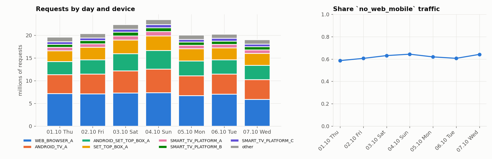
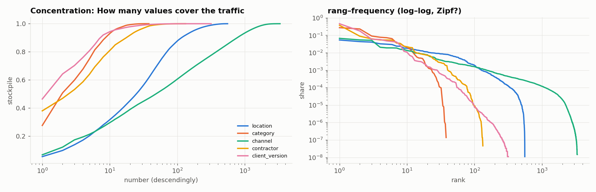
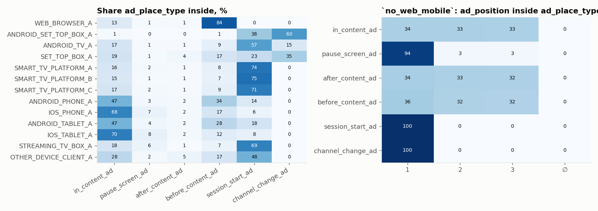
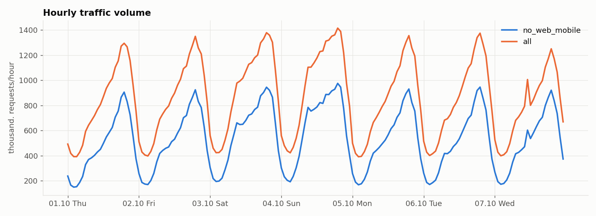
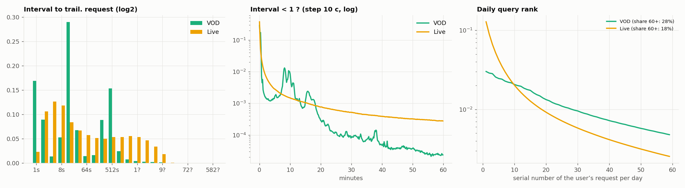

# EDA Conclusions: Traffic for the Manager (200 / 2 xx black box)

Source: `docs/benchmark/manager_traffic/reports/eda_report.md` (full tables and 13 charts; paths to images below are relative).
Period: 7 days, 01.10 (ht) ... 07.10 (cp), time MSC. Logs: `benchmarks/logs/janus-2026100{1..7}.parquet`, 145,024,355 valid queries.

## 0. The main limitation

In the lairs **no response codes** manager and **no sign «request went to the manager»**. Checked out:
- diagram of all 7 files: 5 columns (`datetime`, `path`, `http_x_real_ip`, `user_agent`, `referer`);
- 28 query-parameter `path` (names) on 10 000 two-day random requests: status/result;
- The values "2 xx" occur only as `channel_number`, "200" in `user_agent`: this is the `Hi3798MV200` processor and WebKit versions.

The sample of 10 k from ~145 M is ≈0.007%: a rare feature with a frequency of less than ~1/3000, she may not have caught. All the conclusions below are about **inflow**. This EDA says nothing about the salesout of the manager and P(200).

## 1 . Markup and volume

The manager, as the customer assumes, leaves the set-top boxes, and the markup is set by the `device_type` rule (`config.py`):

| Markings | What’s in | Share of traffic | Requests/days |
|---|---|---|---|
| `all` | everything 13 type | 100% | 20.7 million |
| `no_web_mobile` | without WEB_BROWSER_A, OTHER_DEVICE_CLIENT_A, ANDROID_PHONE_A, IOS_PHONE_A, ANDROID_TABLET_A, IOS_TABLET_A (STREAMING_TV_BOX_A abandoned) | **61.9%** | 12.8 million |

- The largest devices are WEB_BROWSER_A 33.4%, ANDROID_TV_A 22.0%, ANDROID_SET_TOP_BOX_A 16.1%, SET_TOP_BOX_A 13.3%.
- `no_web_mobile` on 76% consists of Live; WEB_BROWSER_A is almost entirely VOD (99.6%).
- The share of `no_web_mobile` is stable by day (58-64%).
- **Clarification of the customer:** The manager is leaving now **80% traffic** (16.6 million/days), one for sale ≈50%. Markings `no_web_mobile` gives 62% (12.8 million) — **lack ≈18 p.p.** So, The manager leaves and part is not-fixture.
- Hypothesis (sample ≈394 k WEB_BROWSER_A requests per day): the web is `web_client_type` desktop_computer 67.6%, mobile_device 27.9%, tablet_device 1.7%. If the manager does not leave only the desktop_computer web (≈22.6% of total traffic), the manager's share is ≈ 77%, that is, close to 80%. This is a hypothesis; you need to check with the customer.

*How to read:* **left** — column: day-by-day (million), colour = device (legend: WEB_BROWSER_A blue, ANDROID_TV_A orange, ANDROID_SET_TOP_BOX_A green, SET_TOP_BOX_A yellowish.d.; grey — «other»). Color segment height — fixture. **Right** — share `no_web_mobile` day-to-day (0.6 = 60%); The color of the line is meaningless. Red/blue «lowly/high-pitched» It’s not here — Colours only distinguish categories.

## 2 tagged

- Structure: VOD has `category`, `contractor`, `is_child`; Live has `channel`. ** Category and channel don't meet together once** (0% intersections), so a campaign targeting both won't receive queries.
- `ad_position` = 1 for 85% queries, 2 and 3 for 7.6%.
- `age_value` = 18 in 99.5% is useless as a sign.
- Regions: 556 values, top-25 give 50%, 116 - 90%, 321 - 99%.
- Channels: 3325 values, 49 gives 50%, 768 - 90%, 1847 - 99%.
- Categories: 38 values (top-9 = 90%); counterparties: 133 values (top-18 = 90%).
- `client_version` and `ua` are almost entirely determined by the device (NMI 0.79 and 1.0): they give a weakly separate feature.
- Misprints/register: `swithroll` (≈27 requests/days), `OTT`/`internet_streaming`, `IPTV`/`managed_tv_network` — normalize when loaded.

*How to read:* lineage = tag (`location` blue, `category` orange, `channel` green, `contractor` yellow, `client_version` pink), «lowly/high-pitched» colorless. **Left:** by x number of most frequent tag values, by y What percentage of requests do they cover; **steeper and lefter, the concentration** (at `category`/`client_version` 10 value ≈ 90%, at `channel` We need hundreds and thousands — tail). **Right:** query (y, log) rank (x, log); drop-down = ponytail.

## 3. `ad_place_type`: Are there any patterns?

6 normal values are `session_start_ad` 47.6%, `channel_change_ad` 28.3%, `in_content_ad` 13.3%, `before_content_ad` 8.5%, `after_content_ad` 1.3%, `pause_screen_ad` 1.0% (in `no_web_mobile`).

- Unconditional dependencies (with `ep`, `is_child`, `position`) **structural**: the location of the display is uniquely related to the type of traffic, this is not a regularity.
- The device × VOD/Live pair already explains **52% ** entropy of `ad_place_type`.
- After taking into account the device and the type, there are weak connections: with `channel` - 0.18 from residual entropy, with `category` and `contractor` - 0.06. With hour of day, region, age, broadcast - almost no (< 0.01).
- **Conclusion: as a standalone markup axis, `ad_place_type` adds little beyond `device × ep`.** The significance for P(200) cannot be verified without codes.

*How to read:* single-colored (blue): **darker = percentage**, lighter = less; cell — %. **Left:** lineage, column `ad_place_type`; sum 100%. Example: at WEB_BROWSER_A 84% — `before_content_ad`, at ANDROID_SET_TOP_BOX_A 60% — `channel_change_ad`. **Right:** for `no_web_mobile` distributedly `ad_position` (1/2/3, ∅ — non-predicted) inside; `session_start_ad` and `channel_change_ad` — always 1, `in_content_ad/before_content_ad/after_content_ad` — roughly equally 3 position.

## 4: Stability and predictability

- Tags stable by day: middle-class JSD daytime ≈ 10⁻³ bit (except `client_version` ≈ 0.03); traffic ratio, past-day, ≈ 10⁻⁷…3·10⁻⁴.
- Request profiles:

| Profile key | Unique in a week | For 90% traffic | «New» profile-day |
|---|---|---|---|
| device + ep + place | 44 | 13 | ≈0 |
| + region | 12 851 | 1 677 | 0.03% |
| + region + category | 79 316 | 4 142 | 0.4% |
| + region + channel | 587 917 | 71 728 | 0.7% |
| full-fledged (region, category, channel) | 654 382 | 95 244 | 1.0% |

  For training «profile → P(200)» history: clairvoyant (dozen/thousand profiles) learn quickly, detailed — long, but «novelty» mallet; need to be hierarchical backoff.
- Volume by clock: peak 19:00 MSK (935 thousand./hourly `no_web_mobile`), minimum 02:00 (176 thousand./hour), peak/minimum 5.3×. Forecast «yesterday» wrongly ≈10% (MAPE) — Pacing quotas are sufficient.
- 7 days contain one weekend; weekend scores are rough.

*How to read:* axis x time (days, 7 days), by y Thousands of requests per hour. Colour of the line — sample: **blue = `no_web_mobile`**, **orange = `all`** (traffic). High peak — evening (≈19:00 MSK), failure — night (≈02:00); orange-blue, volt.toward. includes the web and mobile_device. Red/blue «high/lowfrequency» not applied.

## 5 .Users (only queries with `client_id`; without it - 0.1% )

- In `no_web_mobile`: ≈1.3 million/days, 2.76 weekly; mean 9.6 day-to-day request.
- Heavy tail: top-1% user = 22% requests, top-10% = 62%. User-days ≥2000 requests: 24 (0.1% traffic) — bots/general `client_id` practically absent.
- Returns: Requests from already seen 81% users on 2 day, 93% on 7 th → **User history can be used**.
- The user does not change `device_type` per day (0.0% user-days with >1 type).
- Devices: ANDROID_SET_TOP_BOX_A 20.4 requests/user/days (p50=6), SET_TOP_BOX_A 16.1 (p50=3), ANDROID_TV_A 6.6 (p50=2); Percentage of users with a single request per day 14–32%.
- Rhythm: at VOD There are spacing intervals between requests ≈ 8, 10 and 16 minute (likely, break-in/blockage), at Live no peaks. Sessions (pause ≤ 30 mine): at VOD 50% are in session from 11+ requests, at Live 59% — singularity.

*How to read:* color on all three panels = traffic: **green = VOD**, **yellow = Live**. **Left:** interval histogram until the next user request (pivot x logarithmic: 1 s … 582 ?), height = query; at VOD pike 1 s, 8–16 s, ~8 mine. **Downtown:** same for intervals of up to an hour, by x minutes (step 10 s), y in log; at VOD spikes ≈ 8, 10, 16 minute (break-in), at Live waning. **Right:** Percentage of requests with this serial number per day for the user (log-scale y): higher, The more common is the number; at Live First requests are more frequent, at VOD tail-tail «60+» heavier (28% against 18%).

## 6: Rebuilding "companies"

Impossible on these logs: request doesn’t say, Which company won it?. Only natural segments are obtained (high-tag lift: `SMART_TV_PLATFORM_A × 6.78.1-250` lift≈16, `SMART_TV_PLATFORM_B × 6.76.2-250` ≈17, `SMART_TV_PLATFORM_C × 6.78.9-250` ≈21 — These are just platform versions of the app). Real Targeting Recovery Requires Response Codes (centimetre. `strategy.md`, section «How to Rebuild a Manager’s Company»).

## 7. What does that mean for a problem?

1. There is no outcome data, so you can neither estimate P(200 ) nor calculate the optimization effect. **Blocking** part is new logs (answer code + "left to the manager" feature).
2 . The flow is very stable and repeatable (profiles, users, hours) – this is favorable: P(200 ) scores on profiles and users will live longer than a day.
3. Optimization is possible only if we have **choice**, what to send to the manager: pool of requests, quota-free. If «prefix» leave the manager entirely, pick up (centimetre. `oracle.md`).
