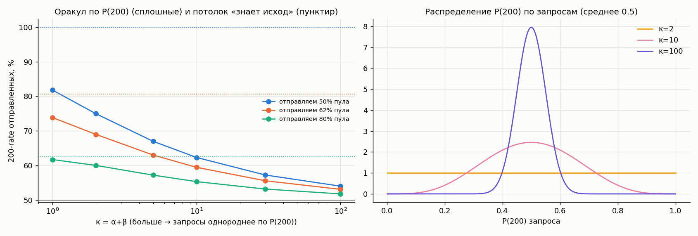

# oracle: how much better 200-rate manager (theoretically)

Theoretical paper: **There are no real answer codes in the logs**, Therefore, the figures below are obtained from the model, rather than data. They’re answering a question «Is there anything to win and what it depends on?». Reproduced by script `oracle_bounds.py`.

## 1.

- There is a pool of requests (traffic that *can* be sent to the manager) size N.
- The manager is a black box: 200 responds to the request *x* with a probability of p(x), otherwise 2 xx; for each 200 we are paid a fixed amount of R, regardless of which internal campaign sold.
- Size agreement: send V = q·N requests (q is pool share).
- Objective: ** with the same V** to increase the share of 200 among the sent.

Basic sellout (random selection of V from the pool): s = E[p] ≈ 50% (according to the customer).

## 2 Three oracles

| oracle | He knows | What’s he doing? | Final 200-rate |
|---|---|---|---|
| **O₀ casual** | nothing | spot-off V | s |
| **O₁ by P(200)** | p(x) every request | flyer V most p | E[p \| top-q by p] |
| **O₂ omniscience** | outcome (200 or not) every request | sends only those, where 200 | min(1, s/q) |

O₂ — ceiling (unrealized: not known beforehand). O₁ — A realistic upper limit for any model, rater p(x); The real algorithm will get less of it-estimation errors p̂.

## 3 : Key facts

1. **If q = 1 (send out the entire pool), There’s no gain at all**: O₀ = O₁ = s. The choice is only possible when the pool is more than the quota.
2 . ** Winning is determined by the spread of p(x)**, not its average. If all queries are similar (p ≈ 0.5 ), there is nothing to choose.
3. The less q (selection is stricter), the higher the ceiling, but the more you need to expand the pool to get the same V.

## 4 Numerical Boundaries (Beta model, mean s = 0.5)

P(200 ) query is modeled as Beta with an average 0.5 and a concentration of κ = α+β: small κ - requests vary greatly (there is something to choose from), large κ - homogeneous.

| κ | q = 50% | q = 62% | q = 80% | q = 100% |
|---|---|---|---|---|
| 1 (very different) | 81.8% | 73.9% | 61.7% | 50% |
| 2 | 75.0% | 69.0% | 60.0% | 50% |
| 5 | 67.0% | 63.0% | 57.2% | 50% |
| 10 | 62.3% | 59.4% | 55.3% | 50% |
| 30 | 57.2% | 55.6% | 53.1% | 50% |
| 100 (nearly identical) | 54.0% | 53.1% | 51.7% | 50% |
| **O₂ omniscience** | 100% | 80.6% | 62.5% | 50% |

q = 62% — share `no_web_mobile` common-flow (12.8 of 20.7 million/days).

Reading: upon q = 80% moderately dispersed (κ ≈ 5–10) oracle ceiling P(200) — roughly **55–57%** against 50%, volt.her. +5…7 p.p. Even the omniscient oracle gives only 62.5%. Purpose «80% sellout» **unselectable q = 80%**: lift up 200-rate until 80%, needle q ≈ 0.5 fluxy (κ ≈ 1) or other modification (centimetre. below).

## 5. What the oracle will give, When the logs arrive

- Measure the real variance p(x): estimate κ by query profiles (`eda_findings.md` profiles, 4 section) and substitute it into a table.
- Count the three oracles on **real** data: O₁ profiled (device×ep×place×region), O₁ profiled + username, O₂.
- For each option, set the “price of information”: how much growth does the addition of regions, channels, user history (diagram “ladder” of oracles).
- Check for two constraints: observability (we only see the outcome for sent requests) and p(x) stability over days.

High-volume profiles (44 `device×ep×place` profile covers 99% traffic) set the lower limit of distinguishability: if P(200) does not differ between them, optimization at this level is impossible and you need to go deeper (regions, channels, users).
