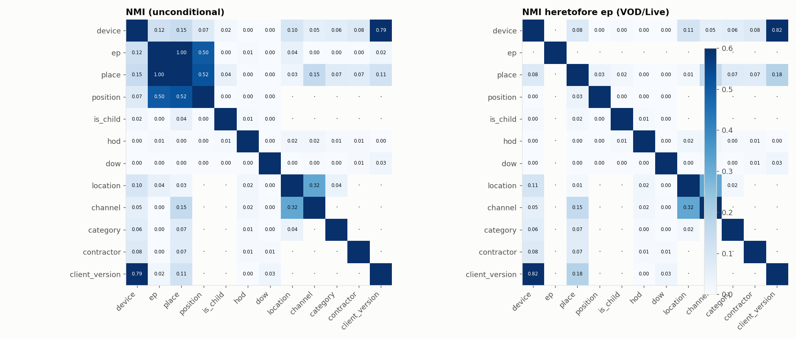
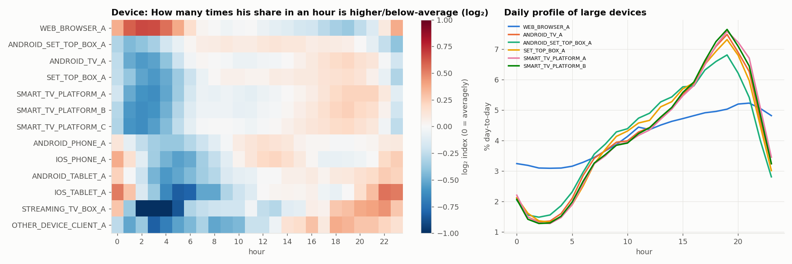
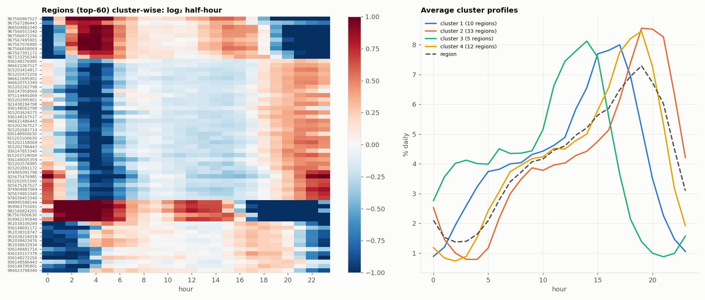
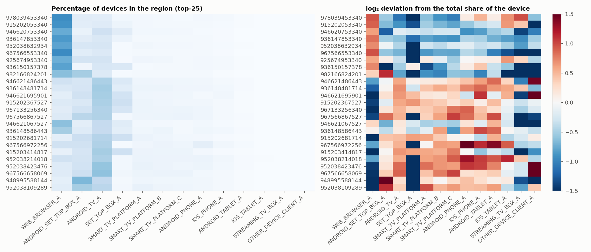
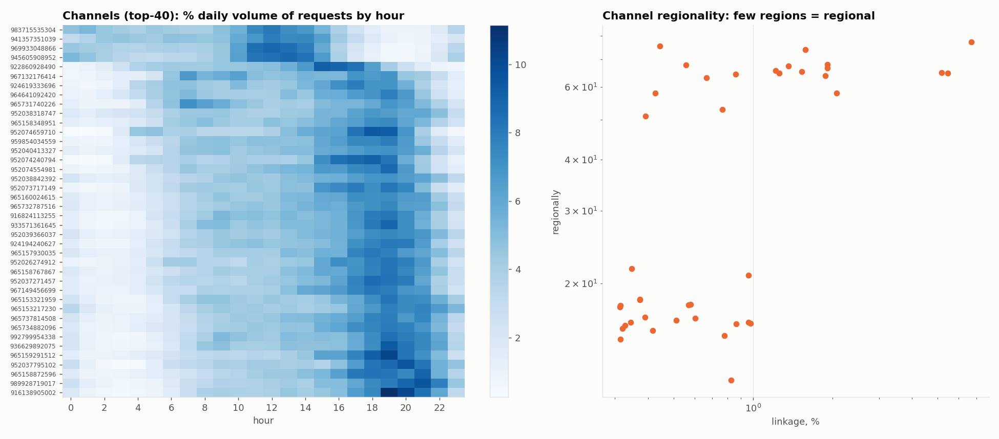

# Links Between Tags: What We Found

Full report: `report/relations_report.md` (`tables/r_*.csv` tables, `figs/r*.png` charts). Script: `eda_relations.py` (after `aggregate.py`).
Segment: `no_web_mobile`, where not specified; period: 7 days, time MSC.
**This is a connection in the incoming stream, not a connection with the sale**: there are no manager response codes in the logs.

Measures: NMI ∈ [0,1] (0 — independent) unconditional **heretofore ep** (VOD/Live), volt.toward. Much of the flow is defined by the type of traffic. We consider it to be practically significant NMI ≳ 0.05.

## 1 .Rating of links (NMI at this ep)

| Couple | NMI | Meaning |
|---|---|---|
| device ↔ client_version | **0.82** | Application version is tied to the platform |
| location ↔ channel | **0.32** | regional television: channel «dweller» in their respective regions |
| place ↔ client_version | 0.18 | device |
| place ↔ channel | 0.15 | different sets of channels |
| device ↔ location | 0.11 | The composition of the devices depends on the region |
| device ↔ place | 0.08 | |
| device ↔ contractor / category / channel | 0.08 / 0.06 / 0.05 | weakly |
| **hod ↔ location** | 0.02 | weakly, structured (section 3) |
| hod ↔ channel / category / contractor | 0.021 / 0.005 / 0.006 | weakly |
| **hod ↔ place, dow ↔ device** | ≈ 0.002 / ≈ 0 | **No, no** |

*How to read:* two-square — unconditional NMI (left) and NMI heretofore `ep` (right). Cell color — tag-strength: **darkly-blue = linkage (NMI → 1)**, **white-white = No, no (≈ 0)**; There’s no red here, monochromatic (0–0.6). Number in the cell — himself NMI, point `·` — pairings out. The matrix is symmetrical. Dark-diagonal — self-tag, result. Cells `ep ↔ place` = 1.00 and `device ↔ client_version` = 0.79/0.82 — linkage, not a find.

## 2. Device ↔ time

- All TV-device (SET_TOP_BOX_A, ANDROID_SET_TOP_BOX_A, ANDROID_TV_A, SMART_TV_PLATFORM_A, SMART_TV_PLATFORM_B, SMART_TV_PLATFORM_C) have **same daily profile**: peak 19:00, nightly (00–06) 9–11% traffic, peak/minimum ≈ 5.5×.
- **Web (WEB_BROWSER_A) flat**: peak 21:00, nightly 18.9%, peak/minimum 1.7×. Mobile phones and tablets — midway (nightly 11–12%, peak/mine ≈ 4).
- Evening Share (18–23): STREAMING_TV_BOX_A 42%, OTHER_DEVICE_CLIENT_A 40%, IOS_TABLET_A 39%, TV ≈ 35–37%, WEB_BROWSER_A 30%.
- VOD and Live: Live peak 19:00 (9.7% night), VOD peak 20:00 (16.2% night).
- Weekend/weekday (day-time): ANDROID_SET_TOP_BOX_A **1.26**, TV-platform ≈ 1.16–1.20, SET_TOP_BOX_A 1.20, webpage 1.08, iPhone/Android 1.03–1.06 → On weekends, the weight of consoles in traffic increases, Web and cell phone drops. Share WEB_BROWSER_A: 36.5% vein → 31.3% pop-up.

*How to read:* **left** — heat-map «device × hour». Value — log₂(fraction of the device at this hour / its share per day average): **red = This time the device is more than usual** (+1 = in 2 once), **blue = lesser** (−1 = in 2 once), white-coloured = averagely. Example: WEB_BROWSER_A red-night (0–5 ?), blue-coloured — At night, the Web takes oveŕmost-traffic, daytime; TV-reverse. It’s *share*, It’s not absolute volume. **Right** — absolute daily profile: what % The daily volume of the device falls on every hour (lineage = device, centimetre. legend); tv peak 19:00 and deep night, at WEB_BROWSER_A (blue) flat-line.

## 3. Region ↔ time: time-zone

NMI (region, hour) is just 0.02, but regions ** are divided into the 4 cluster by peak day**:

| cluster | Regions (top-60) | Peak, hour | At night (00–06) | Tonight (18–23) |
|---|---|---|---|---|
| 3 | 5 (`982166824201`, `948995588144`, `919962195848`, `959963755091`, `967567600630`) | **14–15** | 20–23% | ≈ 8% |
| 1 | 10 (all-code `6000xx`) | **15–18** (median 17) | 10–17% | ≈ 20% |
| 4 | 12 (codes `1000xxx`, `300xxx`, `5000xxx`) | 17–19 | 6–9% | ≈ 34% |
| 2 | 33 (codes `100xxx`, `200xxx`, `978039453340` etc.) | **19–21** | 6–10% | ≈ 43% |

Rush hour scattering between regions is 7 hours; the proportion of night traffic from 5.8% to 23.4%. "" It's almost certainly **time zones**: all peak regions are on "local evening." It's a hypothesis: region codes are not deciphered, zone references need to be confirmed.

**Inquest:** For any signs of time instead of an hour on the MSC you need **locality** region. Then the behavior, time-bound (Including the possible work of the Flight Manager/budgets), It will stop spreading between regions.

*How to read:* **left** — lines are regions (top-60), grouped 4 cluster; colour — log₂(fraction of an hour in the daily volume of the region / share of this hour in all regions): **red = This time, the region is more active than the average** (dark-filled-red = ≥ in 2 once), **blue = less active**, white-coloured = averagely. Bright red stripe in the MSC night clock at the top lines — regions with a peak earlier in the MSC (time-zone shift). **Right** — The average daily profile of each cluster (% day-to-day); lineage = cluster (blue — 1, orange — 2, green — 3, yellow — 4), dotted = region.

## 4 . Region   Device

NMI = 0.15 on all devices, 0.10 in `no_web_mobile`.

- There are regions almost entirely of one device: `967133361069` — **98.9% SET_TOP_BOX_A**, `966505091798` — 97.4% SET_TOP_BOX_A, `947805196527` — 71% SET_TOP_BOX_A (share SET_TOP_BOX_A in `no_web_mobile` 21%). It looks like a region with its own operator/IPTV: lift (SET_TOP_BOX_A × `broadcast_type=managed_tv_network`) = 4.7.
- ANDROID_SET_TOP_BOX_A is overrepresented in other regions: `982166824201` – 64%, `919962719493` – 62%, `949027844676` – 56%, `925675267527` – 51% (average 26%).
- The Web (WEB_BROWSER_A) is the main component of traffic in the largest regions (on all devices): `967566553340` – 65%, `978039453340` – 64%, `915202053340` – 62%, `936147853340` – 59%, `946620753340` – 51%. Therefore, “all devices” and `no_web_mobile` give different composition by region.

*How to read:* lineage — regions (top-25), column — device. **Left** — Device share in region traffic: more **dark-blue**, then **higher** (luminous = almost); red. You can see, dominant WEB_BROWSER_A, ANDROID_SET_TOP_BOX_A and ANDROID_TV_A. **Right** — log₂(region-share / its share of total traffic): **red = region of the device more, more than average** (+1 = in 2 once), **blue = less** (−1 = in 2 once; darkly-blue ≤ −1.5, volt.her. hardly any), white-coloured = averagely. For example,, SET_TOP_BOX_A in `967133361069`-region — darkly-red. The scale is cut off ±1.5.

## 5 Channels and Categories

- Among 40, there are no major regional channels: the effective number of regions 12 – 21 and more (median 21), the share of the main region 19 – 32%. But NMI (region, channel) to the top 300 = **0.32 **: for smaller channels, the region significantly determines which channel is watched.
- Bright cells: `location=982166824201 × channel=983715535304` lift 12, `location=925674953340 × channel=952037795102` lift 9.6, `location=952038632934`×channels `952074659710`, `924619333696`, `952074240794` lift 8.6–8.7.
- Channels are weakly dependent on device (NMI 0.045) and time (0.018): the profile of the “teleset” on the clock at the channels is almost the same.
- VOD categories are weakly time-dependent (0.007) and device-dependent (0.064). ** Postroll** (`after_content_ad`) is strongly associated with content: `place=after_content_ad × category=998574152217` lift 4.2, `× contractor=904450742687` lift 4.15.

*How to read:* **left** — lines are channels (top-40), column — hour; colour — what % The channel’s daily requests are at this hour: **darkly-blue = high-level (peak)**, **luminous = lowly** (scale 0–10%; red). All channels are darker closer to 17–20 ? — profiles are similar. **Right** — one-point channel: by x flow-rate (%), by y regionally (log-scale); **lowly = regional** (They look at several regions), **high-pitched = federal**. Colour of the point (orange) makes no sense.

## 6. Weekdays/weekends

The composition of tag traffic is virtually unchanged: JSD weekend vs weekdays ≤ 0.017 bit (maximum `client_version`). Notable shifts: `client_version=949521747611` (5.6% → 1.1%) is most likely the rollout of the version, not the weekend effect (7 days is too short to divide); the share of `contractor 75734199` / `904444563676` is growing slightly, `channel 1000069` is falling. One set of weekends – estimates are rough.

## 7. What does it do for a problem?

1 . **Local hour instead of MSC** (in the cluster of the region) is a strong and cheap sign of time for any model P(200).
2. **The device × region-cluster × location of display** is a reasonable rough profile key: there is a structure between these axes, but it does not degenerate into tens of thousands of values.
3 . **Do not use as separate features**: `client_version` (~device, NMI 0.82), `age`, `hod` for `place` /`dow` for `device` (no connections).
4. All in touch «region ↔ channel/device» useful for compression and backoff (Rare profiles replaced by a parent), but **probe P(200) They don’t say anything**: This is checked only on logs with response codes.
5. If it is, managerial P(200) depends on the region/device/timeline, We know in advance about these connections, Which sections correlate with each other, and we may not consider them independent when testing hypotheses.
