# Traffic EDA for the manager (200 / 2 xx black box)

> **Data Limitation.** There are no manager response codes in `janus-*.parquet` logs, and there is no "request left to manager" sign.So this is the EDA of the *incoming* stream in `device_type` markups; everything related to sellout/P (200) is deferred to new logs (9 section).

## 1 : Flow and markup overview

Period: 7 daylight (01.10 Thu … 07.10 Wed), time — MSK. Total valid requests (famous device_type, VOD/Live): **145,024,355** (≈20.7 million/days).

**Markups (to whom the request goes):**

- `all`: WEB_BROWSER_A, ANDROID_SET_TOP_BOX_A, ANDROID_TV_A, SET_TOP_BOX_A, SMART_TV_PLATFORM_A, SMART_TV_PLATFORM_B, SMART_TV_PLATFORM_C, ANDROID_PHONE_A, IOS_PHONE_A, ANDROID_TABLET_A, IOS_TABLET_A, STREAMING_TV_BOX_A, OTHER_DEVICE_CLIENT_A

- `no_web_mobile`: ANDROID_SET_TOP_BOX_A, ANDROID_TV_A, SET_TOP_BOX_A, SMART_TV_PLATFORM_A, SMART_TV_PLATFORM_B, SMART_TV_PLATFORM_C, STREAMING_TV_BOX_A

- `dev:<DEVICE>`: Each type of device is separate (in the tables below).

Detailed graphs are built for `no_web_mobile`, where not otherwise specified.

| device | VOD/days | Live/days | fraction | live-share | no_web_mobile |
|---|---|---|---|---|---|
| WEB_BROWSER_A | 6894930 | 25784 | 0.334 | 0.00373 | — |
| ANDROID_TV_A | 1284781 | 3277843 | 0.22 | 0.718 | ✓ |
| ANDROID_SET_TOP_BOX_A | 82560 | 3263060 | 0.161 | 0.975 | ✓ |
| SET_TOP_BOX_A | 1151945 | 1599113 | 0.133 | 0.581 | ✓ |
| SMART_TV_PLATFORM_A | 214172 | 597086 | 0.0392 | 0.736 | ✓ |
| SMART_TV_PLATFORM_B | 181147 | 557300 | 0.0356 | 0.755 | ✓ |
| SMART_TV_PLATFORM_C | 180690 | 435534 | 0.0297 | 0.707 | ✓ |
| ANDROID_PHONE_A | 434837 | 70166 | 0.0244 | 0.139 | — |
| IOS_PHONE_A | 296434 | 18706 | 0.0152 | 0.0594 | — |
| ANDROID_TABLET_A | 85094 | 19137 | 0.00503 | 0.184 | — |
| IOS_TABLET_A | 34116 | 3067 | 0.00179 | 0.0825 | — |
| STREAMING_TV_BOX_A | 2515 | 5617 | 0.000392 | 0.691 | ✓ |
| OTHER_DEVICE_CLIENT_A | 1102 | 1030 | 0.000103 | 0.483 | — |

Share of traffic in markup `no_web_mobile`: **61.9%** from all valid requests. If, by agreement, the manager leaves ~50% current volume, The markup is close to reality; noticeably more/less — You need to adjust the list of devices in `config.py`.

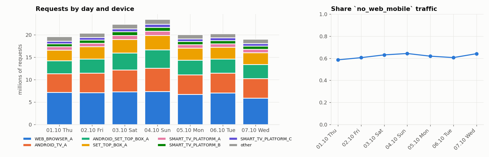

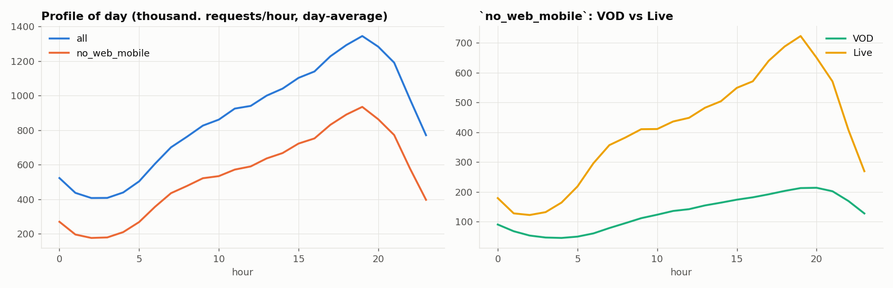

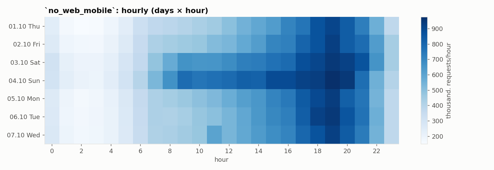

Daily amplitude `no_web_mobile`: peak 19:00 MSK (935 thousand./hour), minimum 2:00 (176 thousand./hour), peak/minimum = 5.3×.

Percentage of requests ** without client_id** (user is replaced by IP - such requests are excluded on user graphs):

| device | shareless client_id |
|---|---|
| SET_TOP_BOX_A | 0.00112 |
| ANDROID_SET_TOP_BOX_A | 0.000145 |
| IOS_TABLET_A | 0 |
| STREAMING_TV_BOX_A | 0 |
| ANDROID_TV_A | 0 |
| ANDROID_PHONE_A | 0 |
| IOS_PHONE_A | 0 |
| SMART_TV_PLATFORM_B | 0 |
| ANDROID_TABLET_A | 0 |
| SMART_TV_PLATFORM_A | 0 |
| WEB_BROWSER_A | 0 |
| SMART_TV_PLATFORM_C | 0 |
| OTHER_DEVICE_CLIENT_A | 0 |

## 2. Tag frequencies

`∅` is a parameter missing from the query. Coverage = fraction of requests where the parameter is.

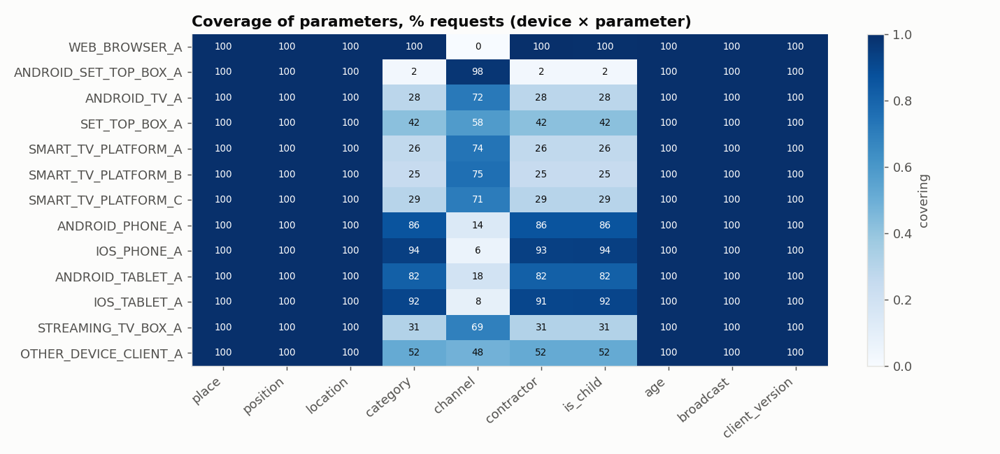

| device | place | position | location | category | channel | contractor | is_child | age | broadcast | client_version |
|---|---|---|---|---|---|---|---|---|---|---|
| WEB_BROWSER_A | 900001200630 | 1 | 900001200630 | 900001200630 | 90.2495192823.413704688 | 900001200630 | 900001200630 | 1 | 900001200630 | 900001200630 |
| ANDROID_SET_TOP_BOX_A | 900001200630 | 1 | 900001200630 | 90.2566703011.430839973 | 90.3100361609.1211587497 | 90.2566703011.430839973 | 90.2566703011.430839973 | 1 | 900001200630 | 900001200630 |
| ANDROID_TV_A | 900001200630 | 1 | 900001200630 | 90.1990571718.849019819 | 90.547134116.1385833855 | 90.1990571718.849019819 | 90.1990571718.849019819 | 1 | 900001200630 | 900001200630 |
| SET_TOP_BOX_A | 900001200630 | 1 | 900001200630 | 90.380443659.3605161542 | 90.1962758641.736242554 | 90.380443659.3605161542 | 90.380443659.3605161542 | 1 | 900001200630 | 900001200630 |
| SMART_TV_PLATFORM_A | 900001200630 | 1 | 900001200630 | 90.1431487304.2616629187 | 90.1590413349.3126597253 | 90.1431487304.2616629187 | 90.1431487304.2616629187 | 1 | 900001200630 | 900001200630 |
| SMART_TV_PLATFORM_B | 900001200630 | 1 | 900001200630 | 90.2735342643.351963433 | 90.3462216359.2598723925 | 90.2735342643.351963433 | 90.2735342643.351963433 | 1 | 900001200630 | 900001200630 |
| SMART_TV_PLATFORM_C | 900001200630 | 1 | 900001200630 | 90.972781768.3219065583 | 90.3331301573.3716979244 | 90.972781768.3219065583 | 90.972781768.3219065583 | 1 | 900001200630 | 900001200630 |
| ANDROID_PHONE_A | 900001200630 | 1 | 900001200630 | 90.2997524123.62110929 | 90.898520379.4098504268 | 90.2997524123.62110929 | 90.2997524123.62110929 | 1 | 900001200630 | 900001200630 |
| IOS_PHONE_A | 900001200630 | 1 | 900001200630 | 90.295597002.4017565900 | 90.1998662194.3801338558 | 90.4210278400.2569533275 | 90.295597002.4017565900 | 1 | 900001200630 | 900001200630 |
| ANDROID_TABLET_A | 900001200630 | 1 | 900001200630 | 90.1540148202.4124221969 | 90.3866377720.366619496 | 90.1540148202.4124221969 | 90.1540148202.4124221969 | 1 | 900001200630 | 900001200630 |
| IOS_TABLET_A | 900001200630 | 1 | 900001200630 | 90.252095613.3102115101 | 90.4096413447.1699654700 | 90.1473322373.156222382 | 90.252095613.3102115101 | 1 | 900001200630 | 900001200630 |
| STREAMING_TV_BOX_A | 900001200630 | 1 | 900001200630 | 90.2746855397.920529803 | 90.417044707.1980671077 | 90.2746855397.920529803 | 90.2746855397.920529803 | 1 | 900001200630 | 900001200630 |
| OTHER_DEVICE_CLIENT_A | 900001200630 | 1 | 900001200630 | 90.1875355614.3298826255 | 90.1052127679.2930298130 | 90.1875355614.3298826255 | 90.1875355614.3298826255 | 1 | 900001200630 | 900001200630 |

### 2.1 Cardinality and Tails (`no_web_mobile`)

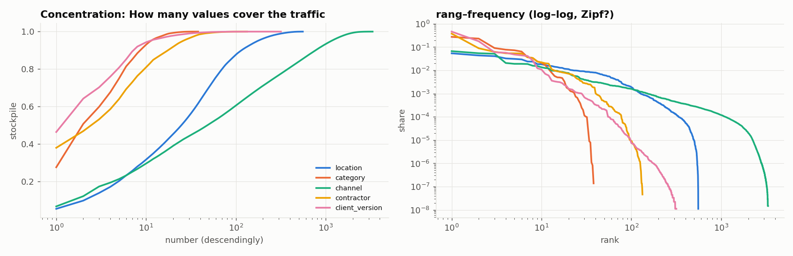

| tag | unique | tagged | top1 | top10 | top100 | valence 50% | on 90% | on 99% |
|---|---|---|---|---|---|---|---|---|
| location | 556 | 89833534 | 0.0542 | 0.317 | 0.877 | 25 | 116 | 321 |
| category | 38 | 21684670 | 0.276 | 0.93 | 1 | 2 | 9 | 19 |
| channel | 3325 | 68148864 | 0.0671 | 0.296 | 0.605 | 49 | 768 | 1847 |
| contractor | 133 | 21674499 | 0.38 | 0.81 | 1 | 3 | 18 | 45 |
| client_version | 317 | 89833534 | 0.464 | 0.943 | 1 | 2 | 8 | 31 |

### 2.2 Top values (`no_web_mobile`)

**ad_place_type** (`place`) — top-12:

| place | requests/days | share |
|---|---|---|
| session_start_ad | 6102860 | 0.476 |
| channel_change_ad | 3632685 | 0.283 |
| in_content_ad | 1704090 | 0.133 |
| before_content_ad | 1093215 | 0.0852 |
| after_content_ad | 172492 | 0.0134 |
| pause_screen_ad | 128020 | 0.00998 |

**ad_position** (`position`) — top-12:

| position | requests/days | share |
|---|---|---|
| 1 | 10875952 | 0.847 |
| 2 | 981391 | 0.0765 |
| 3 | 972747 | 0.0758 |
| ∅ | 3272 | 0.000255 |

**Region** (`location` ) — top-12:

| location | requests/days | share |
|---|---|---|
| 978039453340 | 695526 | 0.0542 |
| 915202053340 | 562011 | 0.0438 |
| 946620753340 | 524860 | 0.0409 |
| 952038632934 | 419345 | 0.0327 |
| 925674953340 | 399117 | 0.0311 |
| 936147853340 | 380764 | 0.0297 |
| 967566553340 | 308070 | 0.024 |
| 946621486443 | 305123 | 0.0238 |
| 982166824201 | 237929 | 0.0185 |
| 936148481714 | 235176 | 0.0183 |
| 946621695901 | 217974 | 0.017 |
| 915202367527 | 199857 | 0.0156 |

**Channel** (`channel` ) - top-12:

| channel | requests/days | share |
|---|---|---|
| ∅ | 3097810 | 0.241 |
| 952037271457 | 653109 | 0.0509 |
| 965158348951 | 530854 | 0.0414 |
| 952026274912 | 504192 | 0.0393 |
| 952038842392 | 201901 | 0.0157 |
| 965160024615 | 186038 | 0.0145 |
| 952038318747 | 185891 | 0.0145 |
| 965157930035 | 182733 | 0.0142 |
| 952039366037 | 153798 | 0.012 |
| 952040413327 | 148631 | 0.0116 |
| 965732787516 | 132362 | 0.0103 |
| 967149456699 | 122226 | 0.00952 |

**Category** (`category` ) - top-12 :

| category | requests/days | share |
|---|---|---|
| ∅ | 9735552 | 0.759 |
| 937456303809 | 854618 | 0.0666 |
| 937473479365 | 718620 | 0.056 |
| 998574152217 | 282071 | 0.022 |
| 935221236911 | 241316 | 0.0188 |
| 937473688823 | 226378 | 0.0176 |
| 961393278034 | 199875 | 0.0156 |
| 909258896386 | 114245 | 0.0089 |
| 937474003010 | 104641 | 0.00815 |
| 961390240893 | 74904 | 0.00584 |
| 937461435530 | 65362 | 0.00509 |
| 937707653409 | 51669 | 0.00403 |

**Contractor** (`contractor` ) - top-12:

| contractor | requests/days | share |
|---|---|---|
| ∅ | 9737005 | 0.759 |
| 904440479245 | 1176334 | 0.0917 |
| 904450742687 | 276297 | 0.0215 |
| 995461317774 | 194152 | 0.0151 |
| 904470222281 | 168606 | 0.0131 |
| 904460901400 | 166601 | 0.013 |
| 904452523080 | 164129 | 0.0128 |
| 904446134611 | 113082 | 0.00881 |
| 904439850871 | 105480 | 0.00822 |
| 969881041781 | 73371 | 0.00572 |
| 904450428500 | 68603 | 0.00535 |
| 969880727594 | 62411 | 0.00486 |

**Client version** (`client_version`) — top-12:

| client_version | requests/days | share |
|---|---|---|
| 2.312.9 | 5955806 | 0.464 |
| 948474457611 | 2291083 | 0.179 |
| 6.78.1-250 | 770203 | 0.06 |
| 6.76.2-250 | 735934 | 0.0573 |
| 6.78.9-250 | 615748 | 0.048 |
| 948474876527 | 567306 | 0.0442 |
| 949521747611 | 532976 | 0.0415 |
| 948474771798 | 339726 | 0.0265 |
| 947427167611 | 157686 | 0.0123 |
| 946379877611 | 139648 | 0.0109 |
| 940200971340 | 90922 | 0.00708 |
| 940200866611 | 77322 | 0.00603 |

**Child** (`is_child`) — top-12:

| is_child | requests/days | share |
|---|---|---|
| ∅ | 9735552 | 0.759 |
| false | 2706572 | 0.211 |
| true | 391238 | 0.0305 |

**Age ** (`age`) - top-12 :

| age | requests/days | share |
|---|---|---|
| 18 | 12771711 | 0.995 |
| 12 | 44327 | 0.00345 |
| 16 | 13866 | 0.00108 |
| 6 | 1989 | 0.000155 |
| 0 | 1302 | 0.000101 |
| 952050257853 | 166 | 1.3e-05 |
| ∅ | 0 | 1.11e-08 |

**broadcast_type** (`broadcast`) — top-12:

| broadcast | requests/days | share |
|---|---|---|
| internet_streaming | 10839136 | 0.845 |
| managed_tv_network | 1992504 | 0.155 |
| ∅ | 1722 | 0.000134 |

### 2.3 ad_place_type and ad_position

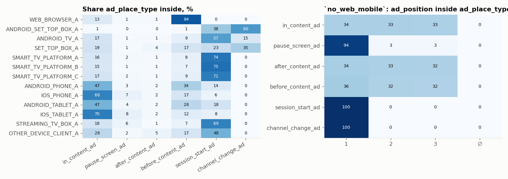

| device | in_content_ad | pause_screen_ad | after_content_ad | before_content_ad | session_start_ad | channel_change_ad |
|---|---|---|---|---|---|---|
| WEB_BROWSER_A | 0.127 | 0.0144 | 0.0103 | 0.844 | 0.00373 | 0 |
| ANDROID_SET_TOP_BOX_A | 0.0121 | 0.000715 | 0.00143 | 0.0104 | 0.379 | 0.596 |
| ANDROID_TV_A | 0.173 | 0.0116 | 0.0093 | 0.0881 | 0.569 | 0.15 |
| SET_TOP_BOX_A | 0.192 | 0.014 | 0.0374 | 0.175 | 0.235 | 0.347 |
| SMART_TV_PLATFORM_A | 0.157 | 0.0156 | 0.0115 | 0.0797 | 0.736 | 0.000213 |
| SMART_TV_PLATFORM_B | 0.149 | 0.0134 | 0.00928 | 0.0732 | 0.754 | 0.000271 |
| SMART_TV_PLATFORM_C | 0.175 | 0.0182 | 0.00975 | 0.0905 | 0.707 | 0 |
| ANDROID_PHONE_A | 0.474 | 0.0298 | 0.0195 | 0.337 | 0.139 | 0 |
| IOS_PHONE_A | 0.681 | 0.0692 | 0.0203 | 0.171 | 0.0589 | 0 |
| ANDROID_TABLET_A | 0.474 | 0.0389 | 0.0186 | 0.285 | 0.184 | 0 |
| IOS_TABLET_A | 0.702 | 0.0829 | 0.0183 | 0.116 | 0.0812 | 0 |
| STREAMING_TV_BOX_A | 0.177 | 0.061 | 0.00689 | 0.0655 | 0.687 | 0.00334 |
| OTHER_DEVICE_CLIENT_A | 0.278 | 0.0193 | 0.0529 | 0.166 | 0.483 | 0 |

### 2.4 Category and Channel: Mutually Exclusion

| ep | cat=0,ch=1 | cat=1,ch=0 |
|---|---|---|
| Live | 1 | 0 |
| VOD | 0 | 1 |

If the `cat=1,ch=1` ≈ 0 category and channel do not occur in the same query (VOD is a category, Live is a channel): a campaign targeting both will not receive traffic.

## 3: Tag Dependencies (NMI) and the verdict on ad_place_type

NMI = MI / min(H) ∈ [0,1]: 0 — independent, 1 — One tag clearly defines the other. Threshold of practical significance adopted **0.05** (on tens of millions of lines, any MI statistically «meaningfully», magnitude of effect).

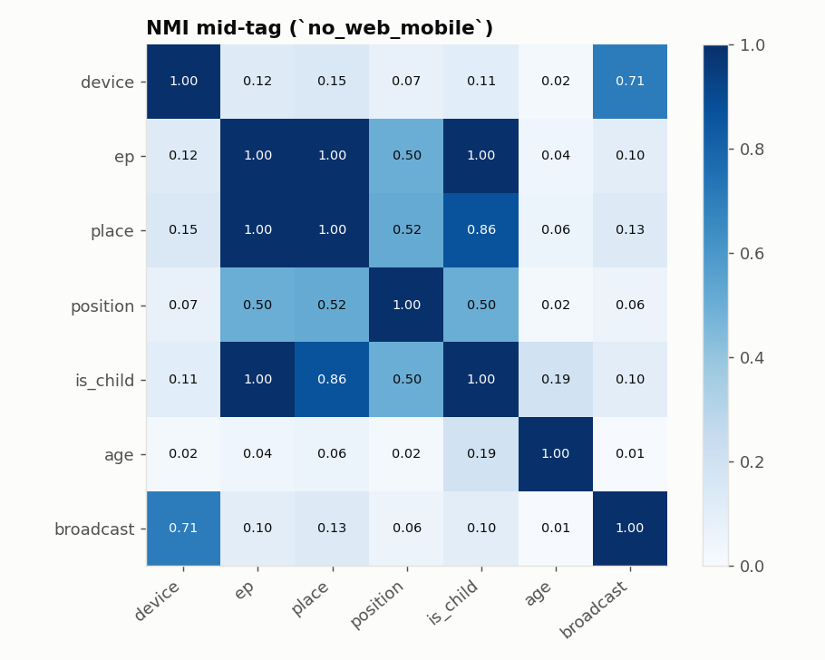

How much information about `ad_place_type` is already contained in the bundle *device × type (VOD/Live )*: I(place; device,ep) = 0.97 bit from H(place) = 1.86 bit (**52.1% **).

| with | NMI unconditional | I(place;X | device,ep), bit | share H(place | device,ep) |
|---|---|---|---|
| channel | 0.153 | 0.135 | 0.184 |
| category | 0.0709 | 0.0871 | 0.0621 |
| contractor | 0.0688 | 0.0858 | 0.0611 |
| client_version | 0.115 | 0.0223 | 0.0249 |
| is_child | 0.864 | 0.00695 | 0.0205 |
| position | 0.516 | 0.0123 | 0.019 |
| location | 0.027 | 0.00811 | 0.00908 |
| hour | 0.00357 | 0.00163 | 0.00182 |
| age | 0.062 | 0.00112 | 0.00125 |
| broadcast | 0.131 | 0.000221 | 0.000432 |

“H(place | device,ep)” – what part of the residual uncertainty `ad_place_type` (after the device and VOD/Live are known) explains the tag X. This is the test for hidden patterns: unconditional NMIs are overstated by the flow structure.

Verdict: after accounting for the device and VOD/Live, the `ad_place_type` remains dependent (≥ 0.05 on residual entropy): `channel` (0.18), `category` (0.06), `contractor` (0.06). These are the structural connections of the flow; you cannot tell about the connection with P(200) without the answer codes.

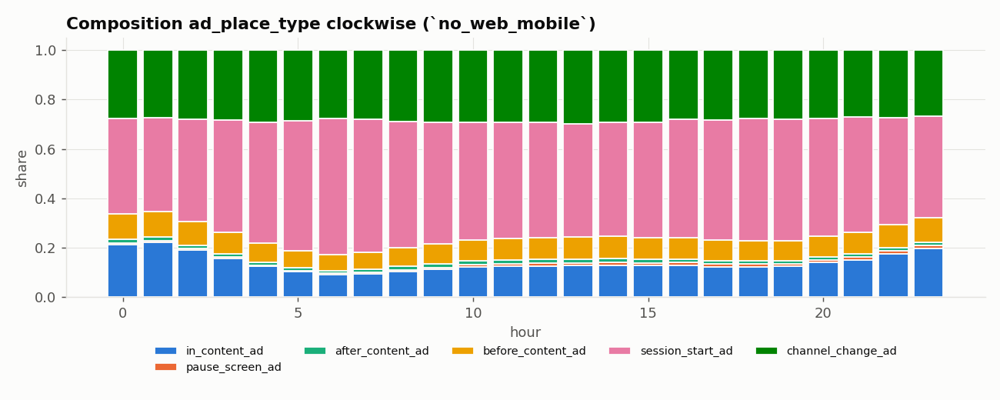

NMI high-cardinal tags with device / ep / place (higher, more tagged «determined» device/type):

| tag | device | ep | place |
|---|---|---|---|
| category | 90.154962309.3520966050 | 900001095901 | 90.311249459.1822166131 |
| channel | 90.4278763850.114853166 | 900001095901 | 90.2033361018.2361133189 |
| client_version | 90.2271346421.2569599565 | 90.1673484251.218042166 | 90.928544841.2659429793 |
| contractor | 90.2848288237.1203856163 | 900001095901 | 90.1169762268.3226628786 |
| location | 90.2078906948.798667549 | 90.761953225.2272912697 | 90.1149854353.2182774800 |
| ua | 900001200630 | 90.1411416704.3394008897 | 90.1147795255.3000860736 |

## 4: Day-to-day stability and predictability

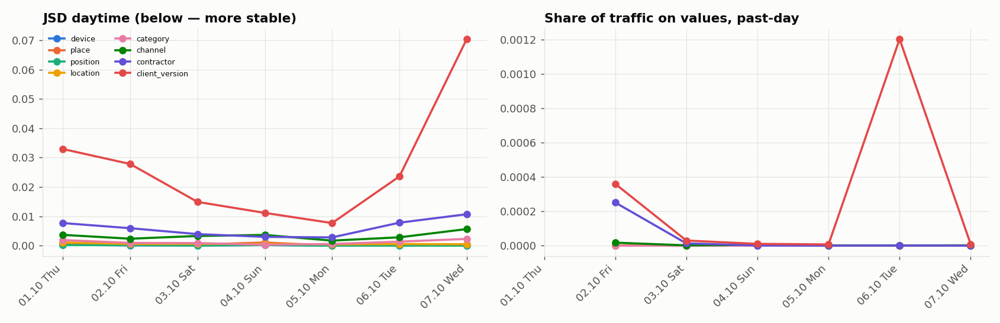

| tag | middle-class JSD, bit | middle-weight «new» value |
|---|---|---|
| category | 0.00119 | 9.82e-08 |
| channel | 0.00332 | 4.57e-06 |
| client_version | 0.0269 | 0.00027 |
| contractor | 0.00599 | 4.45e-05 |
| device | 0.000112 | 0 |
| location | 0.000623 | 2.25e-07 |
| place | 0.000475 | 0 |
| position | 8.83e-05 | 0 |

### 4.1 Hourly Volume Predictability

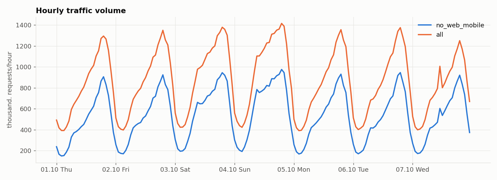

| segment | MAPE «yesterday» | MAPE «past-day average» | MAPE «yesterday» (days 3..) |
|---|---|---|---|
| no_web_mobile | 0.0964 | 0.108 | 0.0994 |
| all | 0.0753 | 0.0878 | 0.0826 |

MAPE — Error of the simplest forecasts of hourly volume. Importance of order 5–10% signifier, quota «80% traffic manager» You can plan on the profile of the past days without a complex model; weekend/holiday profile (in 7 day only one weekend — roughing-up).

## 5 Query Profiles (Tag Combinations): How Many and How Stable Are They?

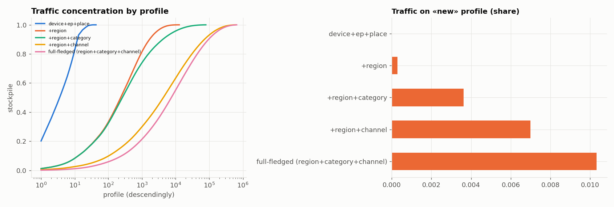

| key | weekly | on 50% traffic | on 90% | on 99% | Wed. traffic «new» profile (days 2+) |
|---|---|---|---|---|---|
| device+ep+place | 43 | 4 | 13 | 24 | 5.41e-08 |
| +region | 12850 | 233 | 1677 | 5068 | 0.000285 |
| +region+category | 79315 | 260 | 4142 | 25385 | 0.00362 |
| +region+channel | 587916 | 4306 | 71728 | 290800 | 0.007 |
| full-fledged (region+category+channel) | 654381 | 7452 | 95244 | 344436 | 0.0103 |

The fewer profiles are covered 90% traffic and less traffic «new» profile, The better the training works «probability 200 profiled» history (bandit/profilesheet). Big tail of new profiles — needed backoff coarsely.

## 6 .Users (only queries with client_id )

`no_web_mobile`, user/days (s client_id): 01.10 Thu: 1,272,801, 02.10 Fri: 1,313,548, 03.10 Sat: 1,360,347, 04.10 Sun: 1,409,569, 05.10 Mon: 1,321,769, 06.10 Tue: 1,350,097, 07.10 Wed: 1,348,582.

Per-user requests per day: average 9.58.

| device | benefit.-days | mean | p50 | p90 | p99 | max | share. s 1 request | session/days (mean) |
|---|---|---|---|---|---|---|---|---|
| ANDROID_TV_A | 4836988 | 6.6 | 2 | 13 | 76 | 11918 | 0.321 | 2.27 |
| SET_TOP_BOX_A | 1193262 | 16.1 | 3 | 42 | 184 | 2268 | 0.265 | 2.39 |
| ANDROID_SET_TOP_BOX_A | 1147066 | 20.4 | 6 | 48 | 231 | 3325 | 0.138 | 3.25 |
| SMART_TV_PLATFORM_A | 856079 | 6.64 | 3 | 14 | 65 | 695 | 0.291 | 2.38 |
| SMART_TV_PLATFORM_B | 759052 | 6.81 | 3 | 15 | 67 | 1497 | 0.29 | 2.41 |
| SMART_TV_PLATFORM_C | 574338 | 7.51 | 3 | 16 | 75 | 605 | 0.277 | 2.42 |
| STREAMING_TV_BOX_A | 9928 | 5.73 | 3 | 12 | 45 | 578 | 0.293 | 2.09 |

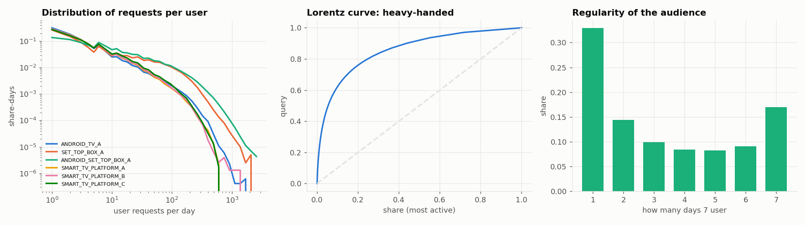

Concentration of queries: top 0.1% users give 5.0% queries, top 1% users give 21.9% queries, top 10% users give 62.3% queries.

Unique users per week: **2,758,986 **; of these active 1 days: 32.9% , ≥5 days: 34.3% .Requests from users active ≥5 days: 76.6% .

Suspicion of bots/general client_id: user-days ≥2000 day-by-day — 24 (0.1% requests).

Users using >1 `device_type` per day: 0.0% user-days.

### 6.1 Returns: “We’ve already seen this user”

| day | user | share. seen before | Percentage of requests from previously seen |
|---|---|---|---|
| 02.10 Fri | 1313548 | 0.674 | 0.808 |
| 03.10 Sat | 1360347 | 0.742 | 0.851 |
| 04.10 Sun | 1409569 | 0.815 | 0.894 |
| 05.10 Mon | 1321769 | 0.875 | 0.916 |
| 06.10 Tue | 1350097 | 0.89 | 0.924 |
| 07.10 Wed | 1348582 | 0.902 | 0.932 |

The high proportion of queries from already seen users means that user features can be used online (the history of requests, how many times the user has already been sent to the manager) - this is the basis for frequency strategies.

### 6.2 Intervals between queries and ranks in a day

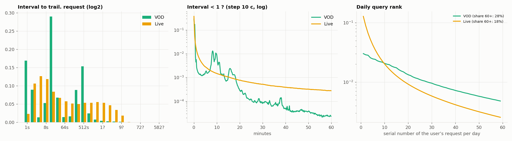

| type | ≤1 c | 1–15 c | 16–63 c | 1–17 mine | 17 mine–1.2 ? | > 1.2 ? |
|---|---|---|---|---|---|---|
| VOD | 0.169 | 0.156 | 0.357 | 0.273 | 0.0327 | 0.012 |
| Live | 0.023 | 0.351 | 0.151 | 0.213 | 0.109 | 0.153 |

VOD: pronounced interval peaks (min): 8.2, 9.7, 15.7, 28.3, 38.0.

Live: Severe peaks of intervals (min): not detected.

| type | rank=1 (first-day) | rank 2–5 | rank 6–20 | rank 21+ |
|---|---|---|---|---|
| VOD | 0.0301 | 0.107 | 0.278 | 0.584 |
| Live | 0.128 | 0.25 | 0.262 | 0.36 |

Session = series of user requests with pauses ≤ 30 min.

| type | 1 request | 2–3 | 4–10 | 11+ |
|---|---|---|---|---|
| VOD | 0.0735 | 0.14 | 0.286 | 0.501 |
| Live | 0.586 | 0.256 | 0.111 | 0.0472 |

## 7: Restoring “companies”: what is possible with these logs

Manager companies (targeting, price, limit) **Query Logs cannot be Recovered**: The request does not contain information about, Which company won it and whether it won it at all?. Maximum, What’s driving traffic?, — find out *natural segments*: tag-pair, which are more frequent, more independent than (lift > 1). It is under such segments that targeting is usually written. Actual recovery is only possible with response codes (centimetre. section 9).

| A | B | support | lift |
|---|---|---|---|
| device=ANDROID_SET_TOP_BOX_A | client_version=2.312.9 | 0.257 | 2.13 |
| ep=on_demand_video | is_child=false | 0.211 | 4.14 |
| device=SET_TOP_BOX_A | client_version=2.312.9 | 0.207 | 2.08 |
| device=ANDROID_TV_A | client_version=948474457611 | 0.179 | 2.81 |
| device=ANDROID_SET_TOP_BOX_A | place=channel_change_ad | 0.156 | 2.11 |
| device=SET_TOP_BOX_A | broadcast=managed_tv_network | 0.155 | 4.66 |
| ep=on_demand_video | place=in_content_ad | 0.133 | 4.14 |
| place=in_content_ad | is_child=false | 0.123 | 4.38 |
| device=SET_TOP_BOX_A | ep=on_demand_video | 0.0898 | 1.73 |
| ep=on_demand_video | position=1 | 0.089 | 0.435 |
| ep=on_demand_video | broadcast=managed_tv_network | 0.0869 | 2.32 |
| ep=on_demand_video | place=before_content_ad | 0.0852 | 4.14 |
| position=1 | is_child=false | 0.0777 | 0.435 |
| ep=on_demand_video | position=2 | 0.0765 | 4.14 |
| ep=on_demand_video | position=3 | 0.0758 | 4.14 |
| device=SET_TOP_BOX_A | is_child=false | 0.0748 | 1.65 |
| is_child=false | broadcast=managed_tv_network | 0.0726 | 2.22 |
| place=before_content_ad | is_child=false | 0.0701 | 3.9 |
| position=2 | is_child=false | 0.0668 | 4.14 |
| position=3 | is_child=false | 0.0662 | 4.14 |
| device=SMART_TV_PLATFORM_A | client_version=6.78.1-250 | 0.06 | 15.8 |
| device=SET_TOP_BOX_A | broadcast=internet_streaming | 0.059 | 0.326 |
| device=SMART_TV_PLATFORM_B | client_version=6.76.2-250 | 0.0573 | 17.4 |
| device=SET_TOP_BOX_A | place=session_start_ad | 0.0503 | 0.493 |
| device=SMART_TV_PLATFORM_C | client_version=6.78.9-250 | 0.048 | 20.8 |

_(shown by 25 from 60; full table: `tables/lift_pairs.csv`)_

`lift > 1` is more common than random, `< 1` is less common (nearly incompatible).

## 8 . Markup comparison (for each device)

| marking | requests/days (million) | share | live-share | fraction place | fraction client_id | peak/day-by-day |
|---|---|---|---|---|---|---|
| all | 20.7 | 1 | 0.477 | 1 | 1 | 3.3 |
| no_web_mobile | 12.8 | 0.619 | 0.759 | 1 | 1 | 5.31 |
| dev:WEB_BROWSER_A | 6.92 | 0.334 | 0.00373 | 1 | 1 | 1.69 |
| dev:ANDROID_SET_TOP_BOX_A | 3.35 | 0.161 | 0.975 | 1 | 1 | 4.58 |
| dev:ANDROID_TV_A | 4.56 | 0.22 | 0.718 | 1 | 1 | 5.62 |
| dev:SET_TOP_BOX_A | 2.75 | 0.133 | 0.581 | 1 | 0.999 | 5.52 |
| dev:SMART_TV_PLATFORM_A | 0.811 | 0.0392 | 0.736 | 1 | 1 | 5.93 |
| dev:SMART_TV_PLATFORM_B | 0.738 | 0.0356 | 0.755 | 1 | 1 | 5.97 |
| dev:SMART_TV_PLATFORM_C | 0.616 | 0.0297 | 0.707 | 1 | 1 | 5.83 |
| dev:ANDROID_PHONE_A | 0.505 | 0.0244 | 0.139 | 1 | 1 | 4.14 |
| dev:IOS_PHONE_A | 0.315 | 0.0152 | 0.0594 | 1 | 1 | 4.06 |
| dev:ANDROID_TABLET_A | 0.104 | 0.00503 | 0.184 | 1 | 1 | 4.89 |
| dev:IOS_TABLET_A | 0.0372 | 0.00179 | 0.0825 | 1 | 1 | 5.23 |
| dev:STREAMING_TV_BOX_A | 0.00813 | 0.000392 | 0.691 | 1 | 1 | 9.94 |
| dev:OTHER_DEVICE_CLIENT_A | 0.00213 | 0.000103 | 0.483 | 1 | 1 | 7.35 |

The manager’s quota is given in the share (for example 80%) or absolutely — chart, how many requests/day gives every markup, to compare with the arrangement.

## 9: What else to do / what data you need

**You need data (blocks the main thing):**
1. HTTP-managerial-code (200 / 2xx) on every request, gone + response time/timeout. It’s impossible without it: rate P(200) segmentally, predictor 200, reinstate the behavior of companies, oracle.
2. "" Identifier left to the manager/stayed with us to avoid guessing `device_type`.
3. If possible: price/CPM The winning company (If the manager gives it away) and any titles of the answer.

**What can be added to the EDA when there are codes:**
- Calibration curve P(200) on the query profile (device×place×region×hour); confidence intervals, cross-day stability.
- Addiction P(200) frequencywise: serial number of the user’s request per day/weekday, interval from the previous request, past 200 user (campaign-fulfillment/frequency limit of the manager).
- drift P(200) day-by-day/weekdays; bursts (Manager’s Flight Campaigns Included/turn off — You can see it like steps P(200) segmentally).
- Oracle: See separate document.
- Couples (tagging → 200) tree/GBM interpretively (SHAP), find «targeting» company manager.
- Experiment: a small randomized holdout (1-2% segment traffic) without optimization is the only way to get an unbiased P(200) score after running the optimizer.
