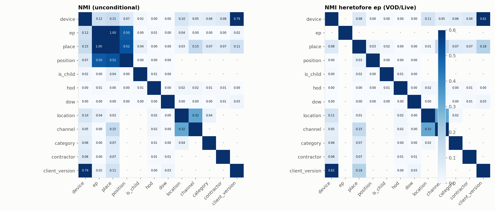
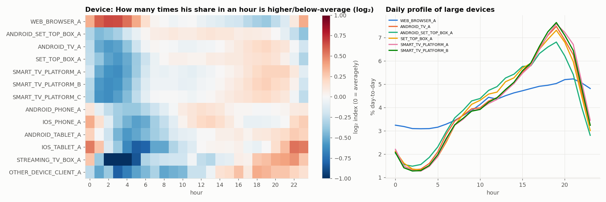
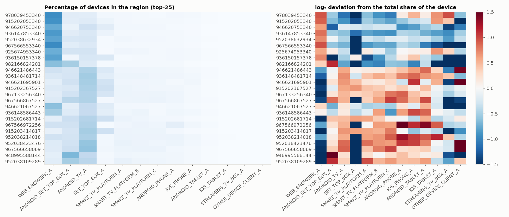
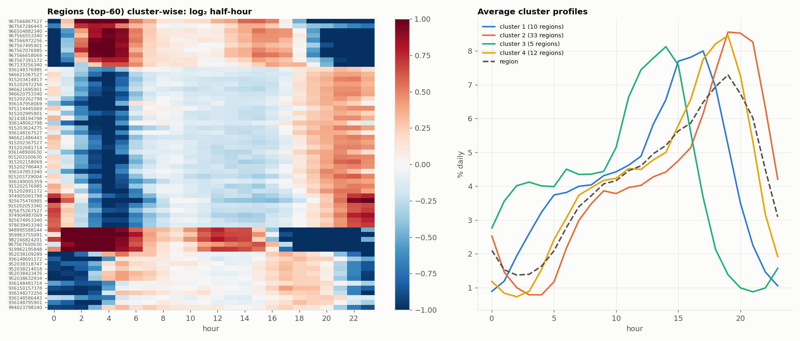
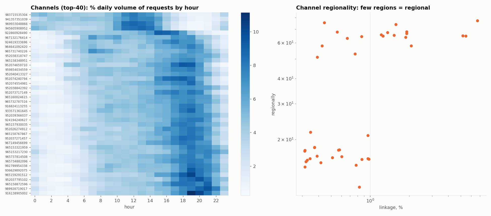
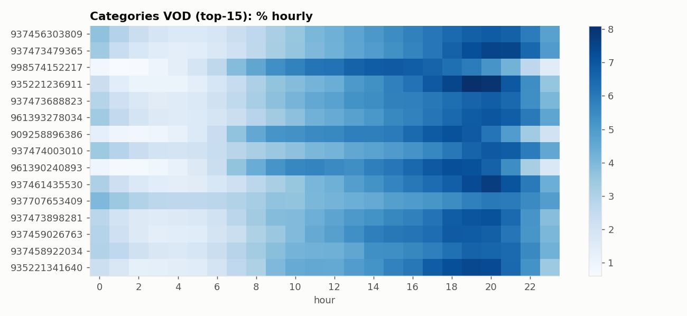

# Links between tags: region, device, time, channels

> It’s about finding connections **downstream** (traffic), It’s not about selling: There are no manager response codes in the logs. But it is these connections that determine, What profiles exist at all and how distinguishable they are by behavior.

## 1: Matrix of links between all tags

Segment `no_web_mobile`. Axes: device, ep, place, position, is_child, hod, dow, location, channel, category, contractor, client_version (`hod` is the hour of the day of the MSC, `dow` is the day of the week). Two matrices: **unconditional NMI** and **conditional for this ep (VOD/Live )** - the second removes structural connections (the category is only VOD, channel only Live, etc.). Pairs for which do not have a joint table (for example, the counterparty × region), are not counted.

| A | B | NMI | NMI upon ep | query |
|---|---|---|---|---|
| device | client_version | 0.792 | 0.824 | 89833534 |
| location | channel | 0.317 | 0.317 | 68148864 |
| place | client_version | 0.115 | 0.183 | 89833534 |
| place | channel | 0.153 | 0.153 | 68148864 |
| device | location | 0.097 | 0.107 | 89833534 |
| device | place | 0.145 | 0.0817 | 89833534 |
| device | contractor | 0.0765 | 0.0765 | 21674499 |
| place | category | 0.0709 | 0.0709 | 21684670 |
| place | contractor | 0.0688 | 0.0688 | 21674499 |
| device | category | 0.0638 | 0.0638 | 21684670 |
| device | channel | 0.0534 | 0.0534 | 68148864 |
| place | position | 0.518 | 0.0333 | 89810628 |
| dow | client_version | 0.0269 | 0.0271 | 89833534 |
| hod | location | 0.0201 | 0.022 | 89833534 |
| hod | channel | 0.0209 | 0.0209 | 68148864 |
| location | category | 0.0391 | 0.0179 | 21684670 |
| place | is_child | 0.0439 | 0.0169 | 21684670 |
| place | location | 0.027 | 0.0138 | 89833534 |
| is_child | hod | 0.00862 | 0.00862 | 21684670 |
| dow | contractor | 0.00622 | 0.00622 | 21674499 |
| hod | contractor | 0.00687 | 0.00583 | 21674499 |
| device | is_child | 0.0175 | 0.00491 | 21684670 |
| hod | category | 0.00672 | 0.00489 | 21684670 |
| dow | channel | 0.0035 | 0.0035 | 68148864 |
| place | hod | 0.00357 | 0.00174 | 89833534 |

_(shown by 25 from 48; full table: `tables/r_pairs_nmi.csv`)_

## 2. Device ↔ time (hour, weekday)

| device | peak, hour | night 00–06, % | evening 18–23, % | peak/mine | weekend/weekday |
|---|---|---|---|---|---|
| STREAMING_TV_BOX_A | 20 | 8.69 | 42.1 | 9.94 | 1.19 |
| OTHER_DEVICE_CLIENT_A | 19 | 9.22 | 40.4 | 7.35 | 1.28 |
| IOS_TABLET_A | 21 | 12.2 | 38.8 | 5.23 | 1.1 |
| SMART_TV_PLATFORM_A | 19 | 9.66 | 37.2 | 5.93 | 1.19 |
| ANDROID_TABLET_A | 19 | 11.3 | 37.1 | 4.89 | 1.12 |
| SMART_TV_PLATFORM_B | 19 | 9.58 | 36.5 | 5.97 | 1.19 |
| ANDROID_TV_A | 19 | 10 | 35.7 | 5.62 | 1.16 |
| SMART_TV_PLATFORM_C | 19 | 9.68 | 35.4 | 5.83 | 1.19 |
| SET_TOP_BOX_A | 19 | 9.83 | 34.5 | 5.52 | 1.2 |
| IOS_PHONE_A | 19 | 12.2 | 33.7 | 4.06 | 1.03 |
| ANDROID_PHONE_A | 19 | 11.4 | 33.7 | 4.14 | 1.06 |
| ANDROID_SET_TOP_BOX_A | 19 | 10.8 | 31.9 | 4.58 | 1.26 |
| WEB_BROWSER_A | 21 | 18.9 | 30.3 | 1.69 | 1.08 |

The daily profiles of VOD and Live are markedly different: Live – peak 19:00, at night (00 – 06) 9.7%, VOD – peak 20:00, at night (00 – 06) 16.2%.

The share of the device in traffic by days of the week (in percent, 7 days - one day of each type):

| device | Thu | Fri | Sat | Sun | Mon | Tue | Wed |
|---|---|---|---|---|---|---|---|
| WEB_BROWSER_A | 36.5 | 34.8 | 32.6 | 31.3 | 33.5 | 34.7 | 30.9 |
| ANDROID_SET_TOP_BOX_A | 14.5 | 15.6 | 16.8 | 17.5 | 16.2 | 15.6 | 16.5 |
| ANDROID_TV_A | 21.6 | 21.4 | 22 | 22.3 | 22 | 21.8 | 23.1 |
| SET_TOP_BOX_A | 12.3 | 13.5 | 13.7 | 13.6 | 13.3 | 12.8 | 13.6 |
| SMART_TV_PLATFORM_A | 3.79 | 3.76 | 3.95 | 4.05 | 3.88 | 3.89 | 4.08 |
| SMART_TV_PLATFORM_B | 3.45 | 3.44 | 3.62 | 3.68 | 3.52 | 3.51 | 3.72 |
| SMART_TV_PLATFORM_C | 2.9 | 2.88 | 3.01 | 3.05 | 2.95 | 2.93 | 3.09 |
| ANDROID_PHONE_A | 2.66 | 2.4 | 2.33 | 2.28 | 2.41 | 2.42 | 2.61 |
| IOS_PHONE_A | 1.63 | 1.51 | 1.39 | 1.42 | 1.55 | 1.54 | 1.65 |
| ANDROID_TABLET_A | 0.51 | 0.51 | 0.49 | 0.5 | 0.49 | 0.5 | 0.54 |
| IOS_TABLET_A | 0.18 | 0.17 | 0.16 | 0.18 | 0.19 | 0.18 | 0.2 |
| STREAMING_TV_BOX_A | 0.04 | 0.04 | 0.04 | 0.04 | 0.04 | 0.04 | 0.04 |
| OTHER_DEVICE_CLIENT_A | 0.01 | 0.01 | 0.01 | 0.01 | 0.01 | 0.01 | 0.01 |

## 3 . Region   Device

`all`: NMI (region, device) = **0.150 ** (MI 0.391 bit; H(device) = 2.61).

Regions with the most atypical device composition (`all`, ≥0.2% traffic):

| location | traffic | JSD generically, bit | most «excess» device | its share in the region | it’s |
|---|---|---|---|---|---|
| 947805196527 | 0.00243 | 0.355 | SET_TOP_BOX_A | 0.707 | 0.133 |
| 994023798340 | 0.00389 | 0.266 | SET_TOP_BOX_A | 0.524 | 0.133 |
| 966819069340 | 0.0021 | 0.259 | SET_TOP_BOX_A | 0.498 | 0.133 |
| 920705615443 | 0.00208 | 0.249 | OTHER_DEVICE_CLIENT_A | 0.000599 | 0.000103 |
| 993919383527 | 0.00217 | 0.24 | SET_TOP_BOX_A | 0.432 | 0.133 |
| 974904987069 | 0.00619 | 0.224 | STREAMING_TV_BOX_A | 0.00185 | 0.000392 |
| 939928946256 | 0.00245 | 0.221 | STREAMING_TV_BOX_A | 0.00147 | 0.000392 |
| 994233256340 | 0.00263 | 0.217 | STREAMING_TV_BOX_A | 0.00155 | 0.000392 |
| 921438194798 | 0.00297 | 0.212 | SMART_TV_PLATFORM_A | 0.0951 | 0.0392 |
| 967567181714 | 0.00209 | 0.211 | ANDROID_SET_TOP_BOX_A | 0.413 | 0.161 |
| 967028527340 | 0.00294 | 0.211 | SMART_TV_PLATFORM_A | 0.104 | 0.0392 |
| 966504882340 | 0.0065 | 0.204 | SET_TOP_BOX_A | 0.259 | 0.133 |

`no_web_mobile`: NMI (region, device) = **0.097 ** (MI 0.215 bit; H(device) = 2.22).

Regions with the most atypical device composition (`no_web_mobile`, ≥0.2% traffic):

| location | traffic | JSD generically, bit | most «excess» device | its share in the region | it’s |
|---|---|---|---|---|---|
| 967133361069 | 0.00204 | 0.561 | SET_TOP_BOX_A | 0.989 | 0.214 |
| 966505091798 | 0.00259 | 0.533 | SET_TOP_BOX_A | 0.974 | 0.214 |
| 947805196527 | 0.00389 | 0.193 | SET_TOP_BOX_A | 0.712 | 0.214 |
| 982166824201 | 0.0185 | 0.137 | ANDROID_SET_TOP_BOX_A | 0.638 | 0.261 |
| 967238090069 | 0.00247 | 0.126 | SET_TOP_BOX_A | 0.602 | 0.214 |
| 948433570527 | 0.00207 | 0.123 | SET_TOP_BOX_A | 0.599 | 0.214 |
| 919962719493 | 0.00444 | 0.122 | ANDROID_SET_TOP_BOX_A | 0.622 | 0.261 |
| 949027844676 | 0.00396 | 0.117 | ANDROID_SET_TOP_BOX_A | 0.56 | 0.261 |
| 925675267527 | 0.0087 | 0.105 | ANDROID_SET_TOP_BOX_A | 0.513 | 0.261 |
| 952038004560 | 0.00276 | 0.104 | ANDROID_SET_TOP_BOX_A | 0.507 | 0.261 |
| 948995588144 | 0.0115 | 0.102 | ANDROID_SET_TOP_BOX_A | 0.533 | 0.261 |
| 919962195848 | 0.00759 | 0.102 | ANDROID_SET_TOP_BOX_A | 0.501 | 0.261 |

## 4 . Region   time of day

NMI (region, hour of day) = **0.0201 ** (MI 0.0893 bit): the day profile of the regions is almost the same if you look at everything at once; below - which regions are still different. (Region codes are not deciphered - these are the identifiers from `location`.)

| location | traffic | cluster | peak, hour | night 00–06, % | evening 18–23, % | JSD generically, bit |
|---|---|---|---|---|---|---|
| 982166824201 | 0.0185 | 3 | 14 | 23.4 | 7.46 | 0.119 |
| 959963755091 | 0.0073 | 3 | 14 | 22.8 | 6.7 | 0.115 |
| 948995588144 | 0.0115 | 3 | 14 | 23.3 | 8.16 | 0.11 |
| 919962195848 | 0.00759 | 3 | 15 | 22.5 | 7.21 | 0.108 |
| 967567600630 | 0.00529 | 3 | 15 | 20.2 | 10.2 | 0.0788 |
| 967566867527 | 0.0142 | 1 | 15 | 16.8 | 12.6 | 0.0667 |
| 967566658069 | 0.0117 | 1 | 17 | 13.6 | 17.8 | 0.0496 |
| 966504882340 | 0.0104 | 1 | 17 | 13.4 | 18.2 | 0.0464 |
| 967566972256 | 0.00985 | 1 | 17 | 14.1 | 19.1 | 0.0396 |
| 967567076985 | 0.00803 | 1 | 17 | 14.8 | 19.3 | 0.0396 |
| 967566553340 | 0.024 | 1 | 17 | 13 | 19.8 | 0.0394 |
| 967567495901 | 0.00488 | 1 | 17 | 14.1 | 21.9 | 0.0285 |
| 925675476985 | 0.00558 | 2 | 21 | 10.1 | 45.6 | 0.0274 |
| 967133256340 | 0.0153 | 1 | 18 | 10.2 | 26.5 | 0.0217 |
| 967567391172 | 0.0059 | 1 | 17 | 12.3 | 24 | 0.0214 |

_(shown by 15 from 60; full table: `tables/r_location_time.csv`)_

Spread of peak hour between regions: 7 h; share of night (00 –06) traffic – from 5.8% to 23.4%.

## 5 Channels and categories: time, device, region

NMI (channel, hour) on top-300 channels = **0.018 ** (MI 0.078 bit).

| channel | traffic | share-1 region | efficient regions (exp H) | dominant | share |
|---|---|---|---|---|---|
| 952037795102 | 0.00824 | 0.32 | 11.6 | ANDROID_TV_A | 0.378 |
| 941357351039 | 0.00315 | 0.265 | 14.7 | ANDROID_SET_TOP_BOX_A | 0.541 |
| 983715535304 | 0.00779 | 0.264 | 15 | ANDROID_SET_TOP_BOX_A | 0.598 |
| 959854034559 | 0.00417 | 0.313 | 15.4 | ANDROID_SET_TOP_BOX_A | 0.371 |
| 952074554981 | 0.0032 | 0.314 | 15.6 | ANDROID_SET_TOP_BOX_A | 0.376 |
| 952073717149 | 0.00328 | 0.311 | 15.8 | ANDROID_SET_TOP_BOX_A | 0.373 |
| 952074659710 | 0.00861 | 0.309 | 15.9 | ANDROID_TV_A | 0.368 |
| 924619333696 | 0.00977 | 0.306 | 16 | ANDROID_SET_TOP_BOX_A | 0.455 |
| 964641092420 | 0.00345 | 0.3 | 16.1 | ANDROID_SET_TOP_BOX_A | 0.358 |
| 952074240794 | 0.00961 | 0.304 | 16.1 | ANDROID_TV_A | 0.386 |
| 945605908952 | 0.00512 | 0.231 | 16.3 | ANDROID_SET_TOP_BOX_A | 0.423 |
| 969933048866 | 0.00605 | 0.232 | 16.5 | ANDROID_SET_TOP_BOX_A | 0.44 |
| 989928719017 | 0.00389 | 0.218 | 16.6 | ANDROID_SET_TOP_BOX_A | 0.388 |
| 933571361645 | 0.00313 | 0.197 | 17.5 | ANDROID_TV_A | 0.392 |
| 916824113255 | 0.00315 | 0.194 | 17.7 | ANDROID_TV_A | 0.397 |

Of the top 40 channels, the “regional” (effective number of regions < 5) was 0; the median number of effective regions was 21.

NMI (channel, device) = **0.045 **; NMI (region, channel) (Live, complete combinations) = **0.263 **.

### 5.1 Categories (VOD) ↔ time and arrangement

NMI (category, hour) = **0.007 **, NMI (category, device) = **0.064 **.

## 6. Weekdays and weekends: What is changing in the composition of traffic

Weekends in logs are 03.10 and all 04.10 (2 days), weekdays are the rest of 5.

| tag | JSD weekend vs weekday, bit |
|---|---|
| client_version | 0.0169 |
| channel | 0.00443 |
| contractor | 0.00402 |
| place | 0.00104 |
| location | 0.000594 |
| category | 0.000578 |
| device | 0.000191 |
| position | 0.00013 |

Values whose place in traffic changes the most over the weekend (share ≥0.5% in at least one group):

| tag | value | weekend | weekday | attitude |
|---|---|---|---|---|
| client_version | 949521747611 | 0.011 | 0.0562 | 0.195 |
| contractor | 925203085828 | 0.00262 | 0.0131 | 0.2 |
| channel | 965159291512 | 0.00906 | 0.0137 | 0.66 |
| channel | 952026274912 | 0.0415 | 0.0568 | 0.73 |
| contractor | 904466975682 | 0.00923 | 0.00679 | 1.36 |
| contractor | 904444563676 | 0.00964 | 0.00714 | 1.35 |
| channel | 945605908952 | 0.00425 | 0.00555 | 0.765 |
| channel | 952039366037 | 0.0186 | 0.0144 | 1.28 |
| channel | 916138905002 | 0.00679 | 0.0053 | 1.28 |
| contractor | 969879261388 | 0.00776 | 0.00606 | 1.28 |
| channel | 952074659710 | 0.00725 | 0.00928 | 0.782 |
| channel | 924194240627 | 0.0066 | 0.00525 | 1.26 |
| contractor | 904443202199 | 0.0103 | 0.00816 | 1.26 |
| client_version | 948474457611 | 0.206 | 0.165 | 1.25 |
| channel | 965732787516 | 0.0157 | 0.0126 | 1.25 |

## 7: Specific “cells”: the strongest value relationships

For pairs with the highest NMI at ep, cells are written out (value A × value B) with support for ≥ 0.2% segment traffic and the largest |log lift|. lift > 1 - the pair occurs more often random, < 1 - less often.

| A | B | support | lift | NMI pair |
|---|---|---|---|---|
| device=SMART_TV_PLATFORM_C | client_version=6.78.9-250 | 0.048 | 20.8 | 0.824 |
| device=SMART_TV_PLATFORM_B | client_version=6.76.2-250 | 0.0573 | 17.4 | 0.824 |
| device=SMART_TV_PLATFORM_A | client_version=6.78.1-250 | 0.06 | 15.8 | 0.824 |
| location=982166824201 | channel=983715535304 | 0.00206 | 12.3 | 0.317 |
| device=ANDROID_SET_TOP_BOX_A | place=in_content_ad | 0.00316 | 0.0913 | 0.0817 |
| location=925674953340 | channel=952037795102 | 0.00263 | 9.62 | 0.317 |
| location=952038632934 | channel=952074659710 | 0.00266 | 8.72 | 0.317 |
| location=952038632934 | channel=924619333696 | 0.00299 | 8.63 | 0.317 |
| location=952038632934 | channel=952074240794 | 0.00292 | 8.58 | 0.317 |
| device=ANDROID_SET_TOP_BOX_A | place=before_content_ad | 0.00271 | 0.122 | 0.0817 |
| location=925674953340 | channel=965153321959 | 0.00245 | 7.67 | 0.317 |
| place=in_content_ad | category=909258896386 | 0.00278 | 0.137 | 0.0709 |
| place=after_content_ad | contractor=922624868277 | 0.00203 | 5.08 | 0.0688 |
| device=SET_TOP_BOX_A | client_version=2.316.5 | 0.00336 | 4.66 | 0.824 |
| device=SET_TOP_BOX_A | location=967133361069 | 0.00201 | 4.62 | 0.107 |
| device=SET_TOP_BOX_A | location=966505091798 | 0.00252 | 4.55 | 0.107 |
| place=after_content_ad | category=998574152217 | 0.0212 | 4.17 | 0.0709 |
| place=after_content_ad | contractor=904450742687 | 0.0206 | 4.15 | 0.0688 |
| device=ANDROID_TV_A | category=998574152217 | 0.00928 | 0.246 | 0.0638 |
| device=ANDROID_TV_A | contractor=904450742687 | 0.00916 | 0.247 | 0.0765 |
| place=channel_change_ad | channel=952026274912 | 0.00499 | 0.258 | 0.153 |
| device=ANDROID_SET_TOP_BOX_A | client_version=2.310.5 | 0.00311 | 3.84 | 0.824 |
| place=after_content_ad | category=937473479365 | 0.0038 | 0.294 | 0.0709 |
| device=SET_TOP_BOX_A | location=947805196527 | 0.00277 | 3.32 | 0.107 |
| place=after_content_ad | contractor=904440479245 | 0.00643 | 0.304 | 0.0688 |

_(shown by 25 from 40; full table: `tables/r_cells.csv`)_
