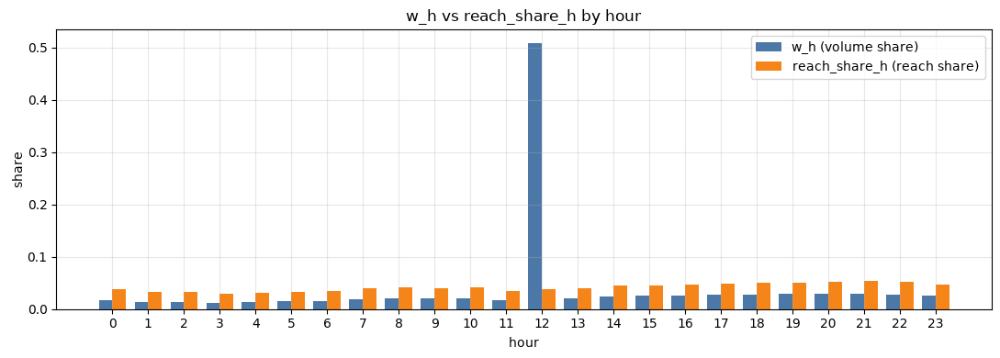
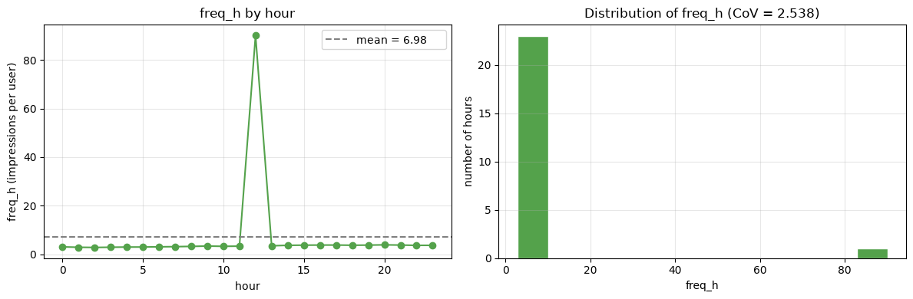
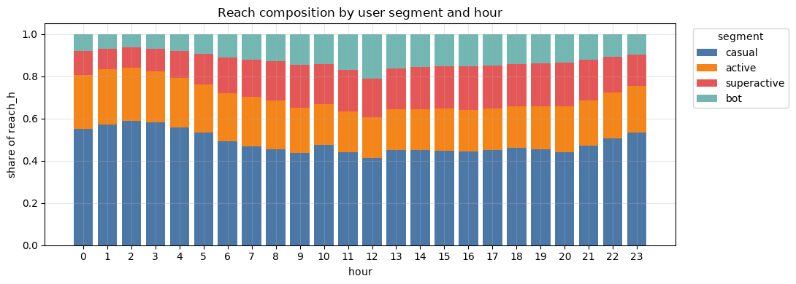
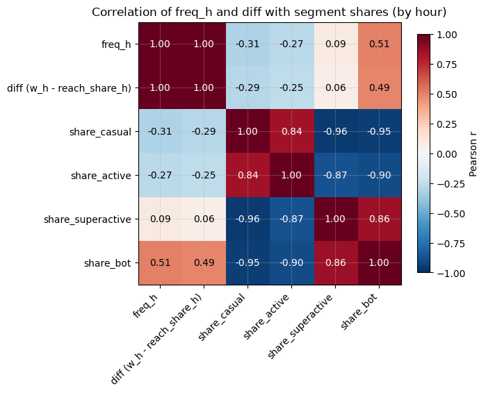
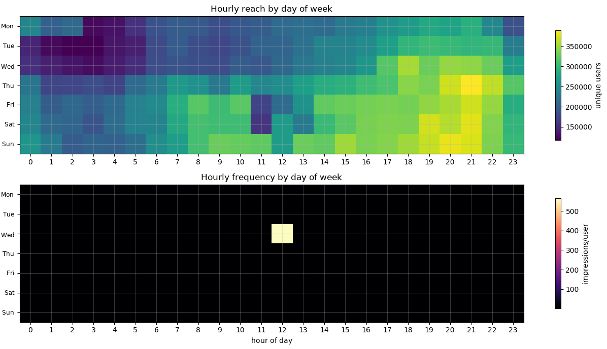

# Reach vs Volume — weekly report `2026-06-08`

A check of the hypothesis from [`../hypothesis.md`](../hypothesis.md): does the hourly weight `w_h` (the share of **volume**, used in `build_seasonal_context`) mix reach (`reach_h` — the number of distinct users) and frequency (`freq_h` — impressions per user), and does the composition of user segments change across hours?

> **Verdict (primary rule of hypothesis.md, step 5): H1** — `w_h` is insufficient. The cumulative systematic bias shifts **47.12%** (or 47.11% on daily reach) of a campaign's impressions between morning and evening — check the stability on other weeks before closing the question.

---

## 1. Experiment conditions

| Parameter | Value |
|---|---|
| Source | `E:/Logs/report-20260608.parquet` |
| Period (after `AT TIME ZONE`) | `2026-06-08 03:00:00+03:00` — `2026-06-15 02:59:59+03:00` |
| `MODE` | `hour_of_day` |
| `TIMEZONE` | `Europe/Moscow` |
| Total events | **237,938,183** |
| Hour buckets with data | 24 |
| `EmptyUser` (no `client_id`) | 2,639 events = 0.0011% → segment `bot` (negligible, does **not** distort reach/segments) |
| Thresholds | `COV_THRESHOLD = 0.15`, `DIFF_THRESHOLD = 0.05` |
| `CAMPAIGN_VOLUME` | 100,000 impressions |
| Segments (appearance percentiles) | casual 0–60% · active 60–90% · superactive 90–98% · bot 98–100% |

**Method (briefly).** In a single pass we materialize `(h, uid, ts)` and compute `counts[h]`, `reach[h] = COUNT(DISTINCT uid)`, `freq[h] = counts/reach`. We compare `w_h = normalize(counts)` (the current model) and `reach_share_h = normalize(reach)` (needed for user-capped campaigns). Hour bucketing uses the same `_get_h_type` logic as production.

---

## 2. Key results

### 2.1 Primary verdict (rule declared in advance)

| Metric | Value | Threshold | Outcome |
|---|---|---|---|
| `CoV(freq_h)` | **2.5380** | 0.15 | H1 |
| `max\|w_h − reach_share_h\|` | **0.4712** | 0.05 | H1 |
| `Pearson(w_h, reach_share_h)` | -0.053 | — | — |
| `Spearman(w_h, reach_share_h)` | 0.870 | — | — |
| **Verdict** | | | **H1 (the decomposition is needed)** |

### 2.2 Magnitude of the divergence in impressions

> **TV (Total Variation distance)** = `½·Σ_h |w_h − reach_share_h|` — a single number from 0 to 1: **the share of a campaign's impressions that lie "in the wrong hour"** if the weights are switched from volume-based (`w_h`) to reach-based (`reach_share_h`). 0 = the distributions coincide. The factor ½ is there so as not to count each moved impression twice (it left one hour and arrived in another).

The sign of the bias is **systematic and monotone** (the morning under-collects reach, the evening over-collects), so hourly errors add up rather than cancel out. Therefore the real scale is TV (the sum of all divergences), not the single worst hour (`max|diff|`):

| Reach denominator | `max\|diff\|` | TV | Impressions per 100,000 campaign | For which limit |
|---|---|---|---|---|
| Weekly-unique (`reach_share_h`) | 0.4712 | **0.4712 (47.12%)** | 47,120 | weekly `'w'` |
| Daily-averaged (`reach_share_daily`) | 0.4711 | **0.4711 (47.11%)** | 47,107 | **daily `'d'`** |

→ ~0% of the weekly divergence is an artifact of the denominator (weekly-unique reach understates reach in the evening hours because of regular visitors). For the daily `user_frequency_limit` the real bias is **47.11%**, for the weekly one **47.12%**.

### 2.3 Hourly peaks

| Metric | Peak | Trough |
|---|---|---|
| counts (volume) | hour 12 — 121,127,945 | hour 3 — 3,016,272 |
| reach (uniques) | hour 21 — 1,889,486 | hour 3 — 1,051,448 |
| freq (per user) | hour 12 — 90.10 | hour 2 — 2.78 |

---

## 3. Charts

### 3.1 `w_h` (volume) vs `reach_share_h` (reach) by hour

Pearson -0.05 — the divergence is small in every hour, but systematic: in the morning reach is slightly higher than volume, in the evening the opposite.

### 3.2 `freq_h` by hour + distribution

`CoV(freq_h) = 2.5380` (above the 0.15 threshold).

### 3.3 Composition of reach by segment, by hour

The share of `superactive` grows 0.097 (hour 2) → 0.207 (hour 20), ×2.1; `bot` 0.062 → 0.211, ×3.4.

### 3.4 Correlation of `freq_h`/`diff` with segment shares

The growth in frequency is explained by **a change in audience composition**:

| | `freq_h` | `diff` |
|---|---|---|
| `share_superactive` | **+0.09** | +0.06 |
| `share_bot` | +0.51 | +0.49 |
| `share_casual` | -0.31 | -0.29 |
| `freq_h ↔ diff` | +1.00 | — |

### 3.5 Weekdays vs weekends (day of week × hour)

Within a fixed day of the week frequency is more stable: `CoV(freq_h)` = 3.0483 (weekdays) / 0.0697 (weekends) vs 2.5380 in `hour_of_day` — part of the `hour_of_day` spread is a mixture of weekday and weekend profiles.

---

## 4. Conclusions

1. **The primary rule gave H1** — at least one of the metrics (`CoV(freq)=2.5380`, `max|diff|=0.4712`) is above the threshold. See which one exactly, and whether it holds on other weeks.

2. **The cumulative bias of 47.11%–47.12% — to be assessed separately.** It is systematic (morning −, evening +) and accumulates; the real scale is TV, not max.

3. **Audience composition by hour (CoV(superactive)=0.2160, CoV(bot)=0.2971).** An exploratory signal (not an artifact (`EmptyUser` ≈ 0%)); it was not part of the declared rule, and the 0.15 threshold is not calibrated for small segments.

4. **For the daily limit — `reach_share_daily`, not weekly reach** (weekly overstates the evening skew).

**Next steps:** check the stability of `TV ≈ 47.11%–47.12%` on 1–2 other weeks; compare the daily denominator and watch `EmptyUser`; if stable — weigh the cost of the `reach`/`freq` decomposition (by analogy with `HourShares` from [`../../../frequency_accounting_improvements.md`](../../../../frequency_accounting_improvements.md), section 0) against the accuracy gain for user-capped campaigns.

---

## 5. How to update for another week

1. In [`../check_reach_vs_volume.ipynb`](../check_reach_vs_volume.ipynb) change `PARQUET_FILE`, run **Run All** (including the metrics export cell), save the notebook.
2. `python make_report.py` — generates `reports/<week>.md` and `reports/<week>/img/` automatically.
3. Compare with this report: are the sign and magnitude of `TV`, the share of `EmptyUser`, and the segment composition stable?
