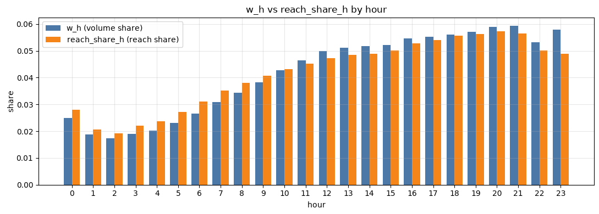
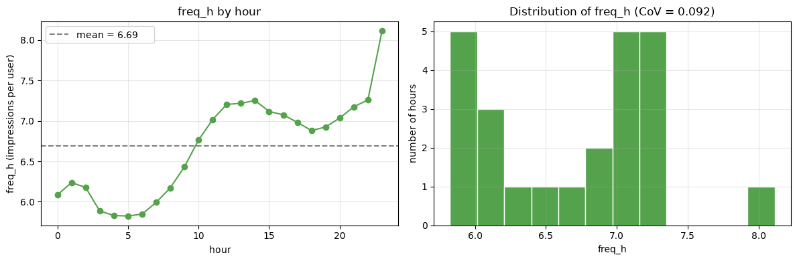
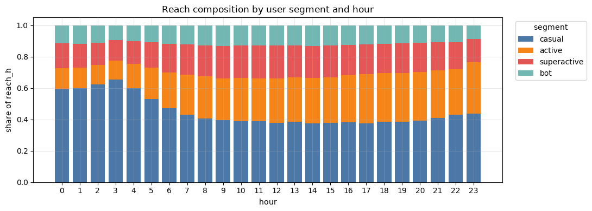
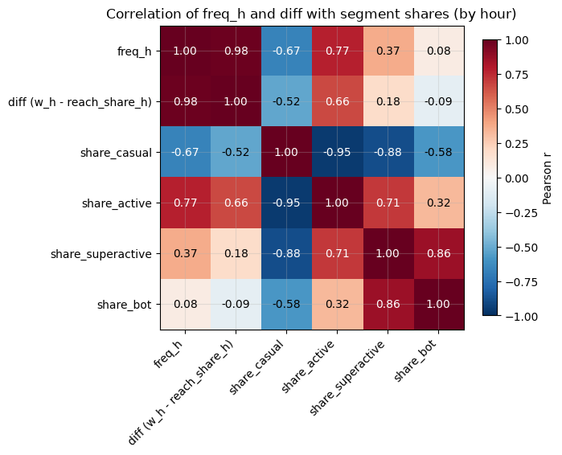
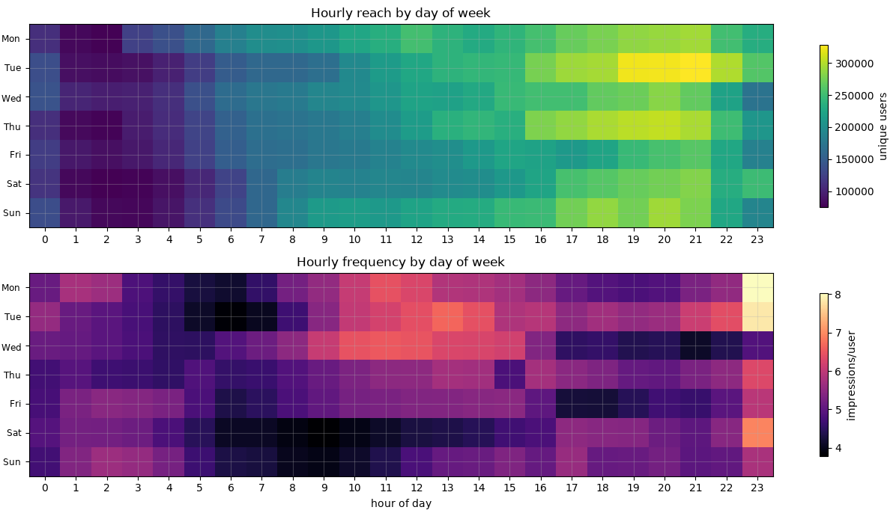

# Reach vs Volume — weekly report `2026-06-22`

A check of the hypothesis from [`../hypothesis.md`](../hypothesis.md): does the hourly weight `w_h` (the share of **volume**, used in `build_seasonal_context`) mix reach (`reach_h` — the number of distinct users) and frequency (`freq_h` — impressions per user), and does the composition of user segments change across hours?

> **Verdict (primary rule of hypothesis.md, step 5): H0** — `w_h` is sufficient as a proxy for reach. The cumulative systematic bias shifts **3.26%** (or 3.25% on daily reach) of a campaign's impressions between morning and evening — check the stability on other weeks before closing the question.

---

## 1. Experiment conditions

| Parameter | Value |
|---|---|
| Source | `E:/Logs/report-20260622.parquet` |
| Period (after `AT TIME ZONE`) | `2026-06-22 03:00:00+03:00` — `2026-06-29 02:59:59+03:00` |
| `MODE` | `hour_of_day` |
| `TIMEZONE` | `Europe/Moscow` |
| Total events | **172,638,062** |
| Hour buckets with data | 24 |
| `EmptyUser` (no `client_id`) | 1,665 events = 0.0010% → segment `bot` (negligible, does **not** distort reach/segments) |
| Thresholds | `COV_THRESHOLD = 0.15`, `DIFF_THRESHOLD = 0.05` |
| `CAMPAIGN_VOLUME` | 100,000 impressions |
| Segments (appearance percentiles) | casual 0–60% · active 60–90% · superactive 90–98% · bot 98–100% |

**Method (briefly).** In a single pass we materialize `(h, uid, ts)` and compute `counts[h]`, `reach[h] = COUNT(DISTINCT uid)`, `freq[h] = counts/reach`. We compare `w_h = normalize(counts)` (the current model) and `reach_share_h = normalize(reach)` (needed for user-capped campaigns). Hour bucketing uses the same `_get_h_type` logic as production.

---

## 2. Key results

### 2.1 Primary verdict (rule declared in advance)

| Metric | Value | Threshold | Outcome |
|---|---|---|---|
| `CoV(freq_h)` | **0.0919** | 0.15 | H0 |
| `max\|w_h − reach_share_h\|` | **0.0091** | 0.05 | H0 |
| `Pearson(w_h, reach_share_h)` | 0.988 | — | — |
| `Spearman(w_h, reach_share_h)` | 0.981 | — | — |
| **Verdict** | | | **H0 (the current `w_h` is sufficient)** |

### 2.2 Magnitude of the divergence in impressions

> **TV (Total Variation distance)** = `½·Σ_h |w_h − reach_share_h|` — a single number from 0 to 1: **the share of a campaign's impressions that lie "in the wrong hour"** if the weights are switched from volume-based (`w_h`) to reach-based (`reach_share_h`). 0 = the distributions coincide. The factor ½ is there so as not to count each moved impression twice (it left one hour and arrived in another).

The sign of the bias is **systematic and monotone** (the morning under-collects reach, the evening over-collects), so hourly errors add up rather than cancel out. Therefore the real scale is TV (the sum of all divergences), not the single worst hour (`max|diff|`):

| Reach denominator | `max\|diff\|` | TV | Impressions per 100,000 campaign | For which limit |
|---|---|---|---|---|
| Weekly-unique (`reach_share_h`) | 0.0091 | **0.0326 (3.26%)** | 3,257 | weekly `'w'` |
| Daily-averaged (`reach_share_daily`) | 0.0125 | **0.0325 (3.25%)** | 3,252 | **daily `'d'`** |

→ ~0% of the weekly divergence is an artifact of the denominator (weekly-unique reach understates reach in the evening hours because of regular visitors). For the daily `user_frequency_limit` the real bias is **3.25%**, for the weekly one **3.26%**.

### 2.3 Hourly peaks

| Metric | Peak | Trough |
|---|---|---|
| counts (volume) | hour 21 — 10,247,348 | hour 2 — 3,005,723 |
| reach (uniques) | hour 20 — 1,446,891 | hour 2 — 486,623 |
| freq (per user) | hour 23 — 8.11 | hour 5 — 5.82 |

---

## 3. Charts

### 3.1 `w_h` (volume) vs `reach_share_h` (reach) by hour

Pearson 0.99 — the divergence is small in every hour, but systematic: in the morning reach is slightly higher than volume, in the evening the opposite.

### 3.2 `freq_h` by hour + distribution

`CoV(freq_h) = 0.0919` (below the 0.15 threshold).

### 3.3 Composition of reach by segment, by hour

The share of `superactive` grows 0.130 (hour 3) → 0.211 (hour 12), ×1.6; `bot` 0.088 → 0.131, ×1.5.

### 3.4 Correlation of `freq_h`/`diff` with segment shares

The growth in frequency is explained by **a change in audience composition**:

| | `freq_h` | `diff` |
|---|---|---|
| `share_superactive` | **+0.37** | +0.18 |
| `share_bot` | +0.08 | -0.09 |
| `share_casual` | -0.67 | -0.52 |
| `freq_h ↔ diff` | +0.98 | — |

### 3.5 Weekdays vs weekends (day of week × hour)

Within a fixed day of the week frequency is more stable: `CoV(freq_h)` = 0.1068 (weekdays) / 0.1213 (weekends) vs 0.0919 in `hour_of_day` — part of the `hour_of_day` spread is a mixture of weekday and weekend profiles.

---

## 4. Conclusions

1. **Formally H0.** `max|diff| = 0.0091` (threshold 0.05), `CoV(freq) = 0.0919` (threshold 0.15), Pearson 0.99.

2. **The cumulative bias of 3.25%–3.26% — to be assessed separately.** It is systematic (morning −, evening +) and accumulates; the real scale is TV, not max.

3. **Audience composition by hour (CoV(casual)=0.2084, CoV(active)=0.2713).** An exploratory signal (not an artifact (`EmptyUser` ≈ 0%)); it was not part of the declared rule, and the 0.15 threshold is not calibrated for small segments.

4. **For the daily limit — `reach_share_daily`, not weekly reach** (weekly overstates the evening skew).

**Next steps:** check the stability of `TV ≈ 3.25%–3.26%` on 1–2 other weeks; compare the daily denominator and watch `EmptyUser`; if stable — weigh the cost of the `reach`/`freq` decomposition (by analogy with `HourShares` from [`../../../frequency_accounting_improvements.md`](../../../../frequency_accounting_improvements.md), section 0) against the accuracy gain for user-capped campaigns.

---

## 5. How to update for another week

1. In [`../check_reach_vs_volume.ipynb`](../check_reach_vs_volume.ipynb) change `PARQUET_FILE`, run **Run All** (including the metrics export cell), save the notebook.
2. `python make_report.py` — generates `reports/<week>.md` and `reports/<week>/img/` automatically.
3. Compare with this report: are the sign and magnitude of `TV`, the share of `EmptyUser`, and the segment composition stable?
