# Sequence Chart: Hierarchy of Calls of a Simulation Run

```mermaid
sequenceDiagram
    participant Script as exec script
    participant DL as data_loader/loaders
    participant Builder as driver/builder
    participant Driver as driver/driver
    participant Stats as mock_statistics
    participant Counter as counter
    participant Filters as filters/*
    participant Auction as auction
    participant Report as report/report_creation

    %% ══════════════════════════════════════════════════════
    Note over Script: ── Initialization ──

    Script->>DL: load_ads_from_json(path)
    Note right of DL: → load_ad_raw() per record (without __type)
    DL-->>Script: AdsDict

    Script->>DL: load_vocabs_from_json(path)
    DL-->>Script: dict[VocabName, list[RawTag]]

    Script->>DL: load_requests_from_json(path)
    Note right of DL: → create_request() per record
    DL-->>Script: list[Request]

    alt request JSON
        Script->>DL: sort_request(requests)
        DL-->>Script: list[Request] (date-sorting)
    else request CSV
        Script->>DL: load_requests_from_csv(path, vocabs)
        Note right of DL: wide format: client_id,date,vocab1,...
        DL-->>Script: list[Request]
        Script->>DL: sort_request(requests)
        DL-->>Script: list[Request] (date-sorting)
    end

    Script->>Builder: create_mock_driver(ads, vocabs)
    Builder->>Stats: create_mock_statistics()
    Stats-->>Builder: MockStatistics (idle)
    Builder-->>Script: MockDriver

    Script->>Report: get_vocab_stats(vocabs, requests)
    Report-->>Script: vocab_stats

    Script->>Report: create_report_dict(ads, flow_size, vocab_stats, name)
    Report-->>Script: ReportDict (hollow header, periods=[])

    %% ══════════════════════════════════════════════════════
    loop for each request flowing

        Note over Script: ── Step 1: drop-off ──

        Script->>Driver: reset_statistics_if_needed(driver, request)
        Driver->>Stats: reset_ad_stats_if_needed(stats, current_time)
        loop each ad_id
            Stats->>Counter: append_timestamp cut off MAX_WINDOW_SECONDS
        end
        Driver->>Stats: reset_user_ad_stats_if_needed(stats, user_id, current_time)
        loop each ad_id user
            Stats->>Counter: append_timestamp cut off MAX_WINDOW_SECONDS
        end
        Driver-->>Script: —

        Note over Script: ── Step 2: data acquisition MockDriver ──

        Script->>Driver: get_ads(driver)
        Driver-->>Script: AdsDict

        Script->>Driver: get_ad_timestamps(driver)
        Driver->>Stats: get_ad_timestamps(stats)
        Note right of Stats: dict[AdId, list[datetime]]
        Stats-->>Driver: AdTimestamps
        Driver-->>Script: AdTimestamps

        Script->>Driver: get_ad_total_counts(driver)
        Driver->>Stats: get_ad_total_counts(stats)
        Note right of Stats: dict[AdId, dict[AuctionTypeId, int]]
        Stats-->>Driver: AdTotalCounts
        Driver-->>Script: AdTotalCounts

        Script->>Driver: get_user_ad_timestamps(driver, user_id)
        Driver->>Stats: get_user_ad_timestamps(stats, user_id)
        Note right of Stats: dict[AdId, list[datetime]]
        Stats-->>Driver: dict
        Driver-->>Script: dict

        Script->>Driver: get_user_ad_show_times(driver, user_id)
        Driver->>Stats: get_user_ad_show_times(stats, user_id)
        Note right of Stats: dict[AdId, datetime]
        Stats-->>Driver: dict
        Driver-->>Script: dict

        Note over Script: ── Step 3: filterchain ──

        Script->>Filters: filter_by_active(ads, current_time)
        Note right of Filters: active==True and start_date ≤ now ≤ end_date
        Filters-->>Script: AdsDict

        Script->>Filters: filter_by_ad_frequency(filtered, ad_timestamps, current_time)
        Note right of Filters: tag-list (PRECISE+FUZZY) < ad_frequency_limit
        Filters-->>Script: AdsDict

        Script->>Filters: filter_by_user_frequency(filtered, user_ad_timestamps, current_time)
        Note right of Filters: single-list < user_frequency_limit
        Filters-->>Script: AdsDict

        Script->>Filters: filter_by_min_interval(filtered, user_ad_show_times, current_time)
        Note right of Filters: now ≥ last_show + min_interval
        Filters-->>Script: AdsDict

        Note over Script: ── Step 4: matching and auction ──

        Script->>Filters: filter_by_precise_match(request, filtered)
        Filters-->>Script: precise_ads

        alt precise_ads flat-footed  →  PRECISE path
            Script->>Driver: get_ad_stats(driver, ad_ids, current_time)
            Driver->>Stats: get_ad_stats(stats, ad_ids, current_time)
            Stats->>Counter: timestamps_to_granulated_counter
            Counter-->>Stats: GranulatedCounter
            Stats-->>Driver: AdStats
            Driver-->>Script: AdStats
            Script->>Auction: auction(precise_ads, params[BEST_VELOCITY])
            Auction-->>Script: winner Ad
        else precise_ads hollow  →  FUZZY fallback
            Script->>Filters: filter_by_fuzzy_targeting_frequency(filtered, ad_total_counts)
            Note right of Filters: ad_total_counts[FUZZY] < parasitic_freq_limit
            Filters-->>Script: AdsDict

            Script->>Filters: filter_by_fuzzy_match(request, fuzzy_targeting_filtered, strict_vocabs=[...])
            Note right of Filters: distance ≤ max_distance (weighted Jaccard)
            Note right of Filters: strict_vocabs require precise intersection
            Filters-->>Script: fuzzy_ads

            alt fuzzy_ads flat-footed
                Script->>Driver: get_ad_stats(driver, ad_ids, current_time)
                Driver->>Stats: get_ad_stats(stats, ad_ids, current_time)
                Stats->>Counter: timestamps_to_granulated_counter
                Counter-->>Stats: GranulatedCounter
                Stats-->>Driver: AdStats
                Driver-->>Script: AdStats
                Script->>Auction: auction(fuzzy_ads, params[BEST_PRICE])
                Auction-->>Script: winner Ad
            else fuzzy_ads hollow
                Note over Script: MISS — winner = None
            end
        end

        Note over Script: ── Step 5: statistics ──

        Script->>Driver: update_statistics(driver, request, auction_type, winner_id)
        alt HIT — winner_id not None
            Driver->>Stats: update_ad_stats(stats, ad_id, auction_type, current_time)
            Stats->>Counter: append_timestamp → list (oldest first)
            Note right of Stats: ad_total_counts[ad_id][auction_type] += 1
            Driver->>Stats: update_user_ad_stats(stats, user_id, ad_id, auction_type, current_time)
            Stats->>Counter: append_timestamp → list
        else MISS — Nothing changes
        end
        Driver-->>Script: —

        Note over Script: ── Step 6: update ──

        loop for each ad in AdsDict
            Script->>Report: update_report_with_request_tags(report, ad, request)
            Note right of Report: increment target_requests_in_flow
        end

        opt every N requests (checkpoint)
            Script->>Report: update_report(driver, report, shown, date)
            Note right of Report: snapshot stats → report[periods]
        end

    end

    %% ══════════════════════════════════════════════════════
    Note over Script: ── Finalization ──

    Script->>Report: update_report(driver, report, shown, date)
    Note right of Report: finale

    Script->>Report: finish_report(driver, report, uniq_users)
    Note right of Report: disposal, fuzzy-share, sellout → header
    Note right of Report: exploit get_ad_total_counts(driver)

    Script->>Report: save_report(report, output_dir)
    Note right of Report: → report.json

    Script->>Report: save_logs(request_to_ad, output_dir)
    Note right of Report: → logs.csv (request_id → ad_id)

    Script->>Report: make_gisto(uniq_users, output_dir)
    Note right of Report: → requests_distribution.csv + .png
```



## Brief summary of the hierarchy

```
exec script
├── data_loader                         (initialization)
│   ├── load_ads_from_json              (exploit helpers.load_ad_raw)
│   ├── load_vocabs_from_json
│   ├── load_requests_from_json
│   ├── load_requests_from_csv          (wide CSV format)
│   └── sort_request
│
├── driver/builder → mock_statistics    (initialization)
│   └── create_mock_driver
│       └── create_mock_statistics
│
├── report/report_creation              (initialization)
│   ├── get_vocab_stats
│   └── create_report_dict → ReportDict
│
└── [loop] for each request
    │
    ├── driver → mock_statistics → counter   (step 1: tagging)
    │   └── reset_statistics_if_needed
    │       ├── reset_ad_stats_if_needed
    │       │   └── append_timestamp (pruning MAX_WINDOW_SECONDS)
    │       └── reset_user_ad_stats_if_needed
    │           └── append_timestamp (pruning MAX_WINDOW_SECONDS)
    │
    ├── driver → mock_statistics            (step 2: reading)
    │   ├── get_ads
    │   ├── get_ad_timestamps              → dict[AdId, list[datetime]]
    │   ├── get_ad_total_counts            → dict[AdId, dict[AuctionTypeId, int]]
    │   ├── get_user_ad_timestamps         → dict[AdId, list[datetime]]
    │   └── get_user_ad_show_times         → dict[AdId, datetime]
    │
    ├── filters/*                           (step 3: filtering)
    │   ├── filter_by_active
    │   ├── filter_by_ad_frequency          (ad_timestamps: flat list)
    │   ├── filter_by_user_frequency        (user_ad_timestamps: flat list)
    │   └── filter_by_min_interval          (user_ad_show_times: dict[AdId, datetime])
    │
    ├── filters/* + auction                 (step 4: matching + auctioneer)
    │   ├── filter_by_precise_match
    │   │   └── [HIT] auction(BEST_VELOCITY)
    │   └── [fallback] filter_by_fuzzy_targeting_frequency (ad_total_counts)
    │       └── filter_by_fuzzy_match(strict_vocabs=[...])
    │           └── [HIT] auction(BEST_PRICE)
    │
    ├── driver → mock_statistics → counter  (step 5: statistics)
    │   └── update_statistics
    │       ├── update_ad_stats
    │       │   ├── append_timestamp → ad_timestamps
    │       │   └── ad_total_counts[ad_id][auction_type] += 1
    │       └── update_user_ad_stats
    │           └── append_timestamp → user_ad_timestamps
    │
    └── report/report_creation              (step 6: update)
        ├── update_report_with_request_tags  (per ad)
        └── [checkpoint] update_report

    [afterward loop]
    ├── update_report (final)
    ├── finish_report (get_ad_total_counts → precise/fuzzy counts)
    ├── save_report   → report.json
    ├── save_logs     → logs.csv
    └── make_gisto    → .csv + .png
```
