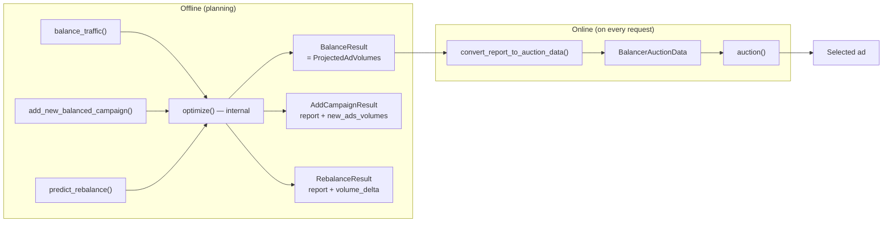
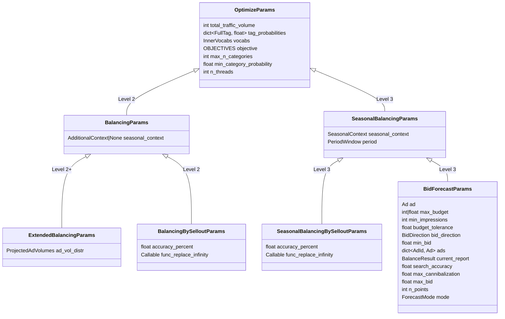
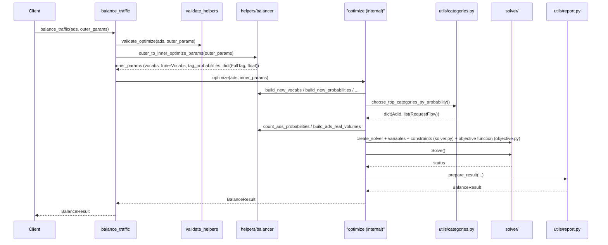
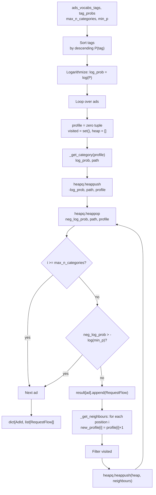
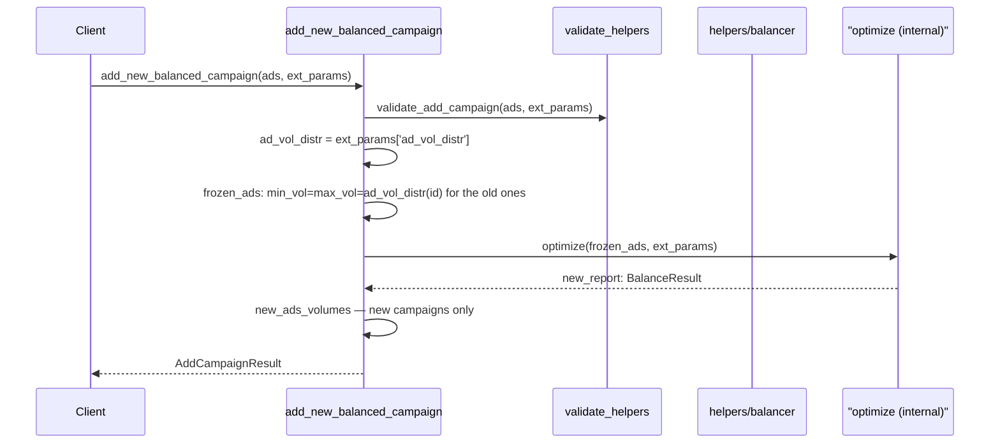
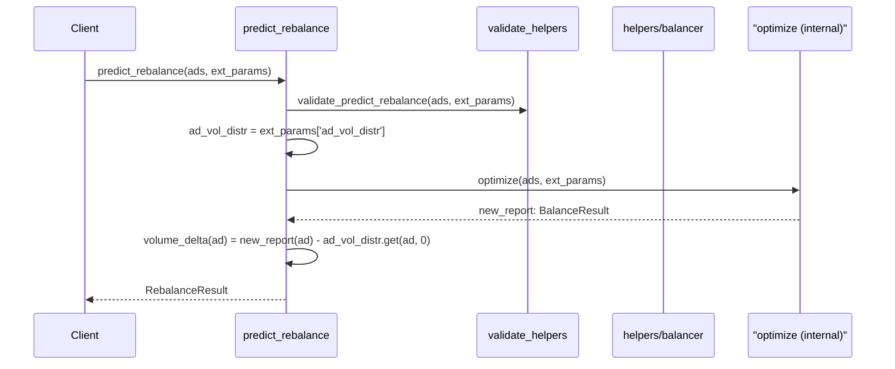
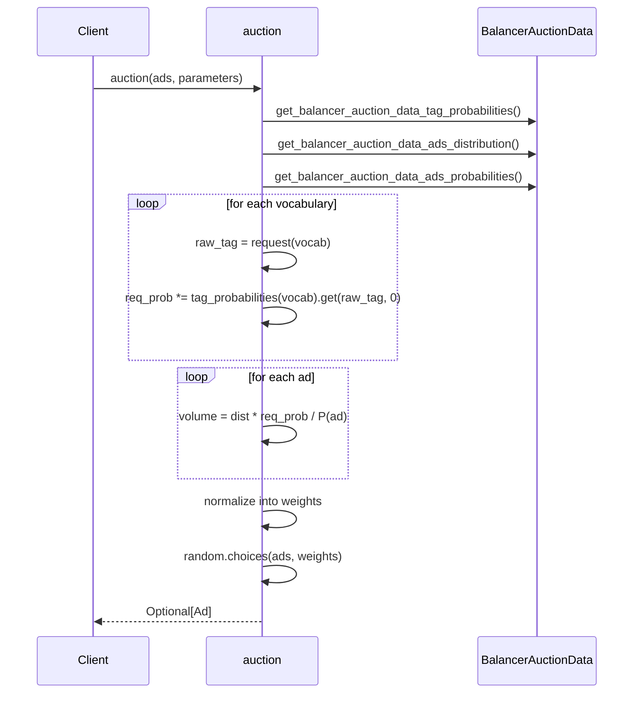
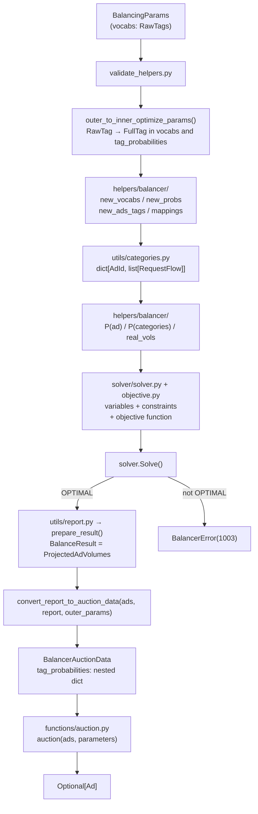
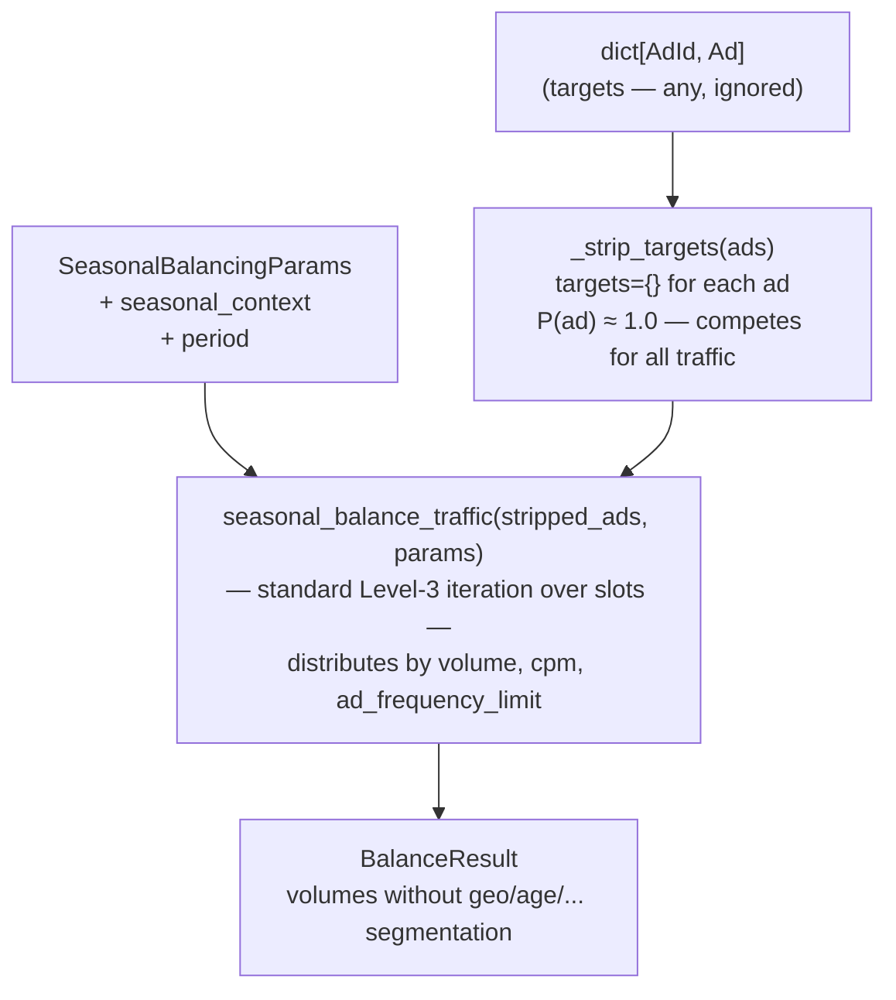
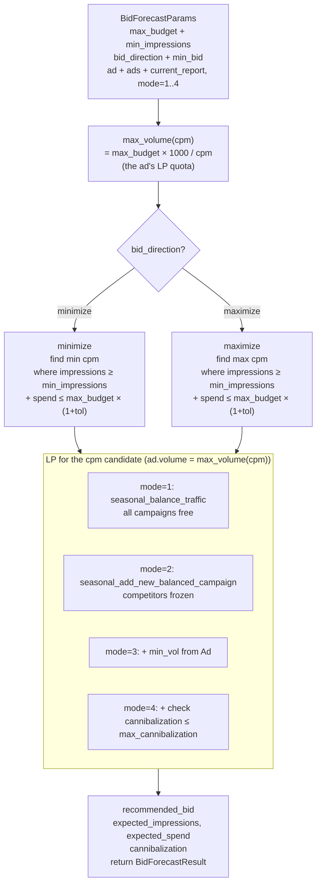

# Traffic Balancer

## Table of contents

- [Traffic Balancer](#traffic-balancer)
  - [Table of contents](#table-of-contents)
  - [Quick start](#quick-start)
  - [Concept](#concept)
    - [What the balancer does](#what-the-balancer-does)
    - [Public functions](#public-functions)
    - [Boundary between external and internal representation](#boundary-between-external-and-internal-representation)
    - [RequestFlow](#requestflow)
    - [Rebuilding vocabularies](#rebuilding-vocabularies)
    - [LP problem formulation](#lp-problem-formulation)
  - [Module structure](#module-structure)
  - [Data types](#data-types)
    - [Base aliases](#base-aliases)
    - [Vocabs](#vocabs)
    - [Ad](#ad)
    - [OptimizeParams](#optimizeparams)
    - [BalancingParams](#balancingparams)
    - [ExtendedBalancingParams](#extendedbalancingparams)
    - [BalancingBySelloutParams](#balancingbyselloutparams)
    - [SeasonalBalancingParams](#seasonalbalancingparams)
    - [BidForecastParams](#bidforecastparams)
    - [OptimizeParams inheritance hierarchy](#optimizeparams-inheritance-hierarchy)
    - [ProjectedAdVolumes](#projectedadvolumes)
    - [BalanceResult](#balanceresult)
    - [AddCampaignResult](#addcampaignresult)
    - [RebalanceResult](#rebalanceresult)
    - [BalancingBySelloutResult](#balancingbyselloutresult)
    - [CannibalizationReport](#cannibalizationreport)
    - [BidForecastResult](#bidforecastresult)
    - [OpportunityResult](#opportunityresult)
    - [DeliveryPoint](#deliverypoint)
    - [DeliveryResult](#deliveryresult)
    - [BalancerAuctionData](#balancerauctiondata)
    - [AuctionParamsBalanced](#auctionparamsbalanced)
    - [AggregationMode and HourType](#aggregationmode-and-hourtype)
    - [PeriodWindow](#periodwindow)
    - [AdditionalContext](#additionalcontext)
    - [SeasonalContext](#seasonalcontext)
    - [HistoricalLogsConfig](#historicallogsconfig)
  - [Constants](#constants)
    - [Objective functions (OBJECTIVES)](#objective-functions-objectives)
    - [MIN\_CATEGORY\_PROBABILITY](#min_category_probability)
    - [LP\_LOWER\_BOUND and LP\_UNIT\_COEFF](#lp_lower_bound-and-lp_unit_coeff)
    - [Special tags](#special-tags)
    - [ErrorCodes](#errorcodes)
  - [Public functions](#public-functions-1)
    - [balance\_traffic](#balance_traffic)
    - [add\_new\_balanced\_campaign](#add_new_balanced_campaign)
    - [predict\_rebalance](#predict_rebalance)
    - [balance\_by\_sellout](#balance_by_sellout)
    - [convert\_report\_to\_auction\_data](#convert_report_to_auction_data)
    - [auction](#auction)
  - [Internal function optimize](#internal-function-optimize)
    - [Data preparation](#data-preparation)
    - [Category selection](#category-selection)
    - [Probability computation](#probability-computation)
    - [Building the LP problem](#building-the-lp-problem)
    - [Objective functions](#objective-functions)
    - [Forming the result](#forming-the-result)
  - [Input data validation](#input-data-validation)
  - [Call diagrams](#call-diagrams)
    - [balance\_traffic — full flow](#balance_traffic--full-flow)
    - [Category selection algorithm](#category-selection-algorithm)
    - [add\_new\_balanced\_campaign — flow](#add_new_balanced_campaign--flow)
    - [predict\_rebalance — flow](#predict_rebalance--flow)
    - [auction — online selection](#auction--online-selection)
    - [Full Data Flow](#full-data-flow)
  - [Third level: forecasters](#third-level-forecasters)
    - [Three-level architecture](#three-level-architecture)
    - [3a. Forecaster of campaign results without targeting](#3a-forecaster-of-campaign-results-for-a-given-budget-period-and-bid)
      - [`open_balance_traffic`](#open_balance_traffic)
    - [3b. Forecaster of campaign results with targeting](#3b-forecaster-of-campaign-results-for-a-given-budget-period-bid-and-targeting)
      - [SeasonalBalancingParams](#seasonalbalancingparams)
      - [`seasonal_balance_traffic`](#seasonal_balance_traffic)
      - [`build_seasonal_context`](#build_seasonal_context)
    - [3c. Forecaster of the recommended bid](#3c-forecaster-of-the-recommended-bid-for-a-given-budget-period-and-targeting)
      - [BidForecastParams](#bidforecastparams)
      - [`forecast_bid`](#forecast_bid)
      - [Result type](#result-type)
  - [Testing](#testing)
  - [Examples](#examples)
    - [Preparing input data](#preparing-input-data)
    - [Basic traffic distribution](#basic-traffic-distribution)
    - [Adding new campaigns without rebalancing](#adding-new-campaigns-without-rebalancing)
    - [Rebalancing when adding a campaign](#rebalancing-when-adding-a-campaign)
    - [Maximizing the minimum sellout (balance\_by\_sellout)](#maximizing-the-minimum-sellout-balance_by_sellout)
    - [Full cycle: optimization → auction](#full-cycle-optimization--auction)

---

## Quick start

The balancer solves one problem: **in advance**, before impressions start, decide how much traffic to give each ad campaign so as to fulfill contracts and maximize revenue. This is offline planning — the result is computed once per period (hour, day) and then used by the online auction on every request.

Common data for all the examples below. `ads` — campaigns with targeting and constraints. `params` — characteristics of the traffic stream: total volume, tag probabilities, and the objective function.

```python
import rtb_sdk.balancer.balancer as sdk
from rtb_sdk.schemas import Ad, AdId, BalancingParams
from rtb_sdk.helpers import create_ad, create_target_vector, create_frequency_limits

ads: dict[AdId, Ad] = {
    'banner_1': create_ad(
        id='banner_1',
        # Target: Moscow or St. Petersburg, audience 18–24
        targets=create_target_vector({'geo': ['msk', 'spb'], 'age': ['18-24']}),
        volume=6000,  # upper limit of impressions per contract
        cpm=15.0,     # CPM: revenue per 1000 impressions
        ad_frequency_limit=create_frequency_limits(day=500),  # no more than 500 impressions per day
    ),
    'banner_2': create_ad(
        id='banner_2',
        # Target: Moscow only, audience 25–34 — a more expensive campaign
        targets=create_target_vector({'geo': ['msk'], 'age': ['25-34']}),
        volume=4000,
        cpm=25.0,
        ad_frequency_limit=create_frequency_limits(day=500),
    ),
}

from rtb_sdk.helpers.balancer import create_balancing_params

params = create_balancing_params(
    total_traffic_volume=10000,   # expected number of requests for the period
    tag_probabilities_outer={
        # real traffic statistics: 55% of requests from Moscow, 45% from St. Petersburg
        'geo': {'msk': 0.55, 'spb': 0.45},
        # 30% of requests are audience 18–24, 70% are 25–34
        'age': {'18-24': 0.3, '25-34': 0.7},
    },
    vocabs_outer={'geo': ['msk', 'spb'], 'age': ['18-24', '25-34']},
    objective='maximize_money',   # maximize revenue
)
```

---

### 1. balance\_traffic — plan traffic from scratch

The main function. Takes a list of campaigns and traffic parameters, solves a linear programming problem, and returns how many impressions each campaign will get over the period.

Used at the start of each planning period — when all the traffic needs to be distributed among active campaigns.

```python
report = sdk.balance_traffic(ads, params)
# {'banner_1': 4823, 'banner_2': 3201}

print(f"banner_1: {report['banner_1']} impressions")
print(f"banner_2: {report['banner_2']} impressions")
print(f"Total:    {sum(report.values())} impressions")
```

---

### 2. add\_new\_balanced\_campaign — add a campaign without revisiting agreements

A client bought a placement in the middle of the period. The volumes of the existing campaigns are already fixed by contract — they must not be touched. The new campaign must take up only the capacity they do not use.

The function freezes `min_vol = max_vol` for each campaign from `report`, so the optimizer cannot change their volume. The new campaign takes part in the optimization without restrictions.

```python
ads_with_new: dict[AdId, Ad] = {
    **ads,
    'banner_3': create_ad(
        id='banner_3',
        targets=create_target_vector({'geo': ['spb'], 'age': ['18-24', '25-34']}),
        volume=3000,
        cpm=20.0,
        ad_frequency_limit=create_frequency_limits(day=1000),
    ),
}

from rtb_sdk.helpers.balancer import create_extended_balancing_params

ext_params = create_extended_balancing_params(
    **params,  # parameters from create_balancing_params
    ad_vol_distr=report,  # freeze the current volumes
)
result = sdk.add_new_balanced_campaign(ads_with_new, ext_params)

# The old campaigns are guaranteed not to have changed
assert result['report']['banner_1'] == report['banner_1']
assert result['report']['banner_2'] == report['banner_2']

# How many impressions the new campaign got from the remaining traffic
print(f"banner_3 (new): {result['new_ads_volumes']['banner_3']} impressions")
```

---

### 3. predict\_rebalance — estimate the losses of existing campaigns when a new one is added

Before adding a campaign via `add_new_balanced_campaign`, it is useful to understand: if the optimizer were free to redistribute all the traffic anew, how would the volumes of the existing campaigns change? This helps to assess competition for the audience and to explain possible changes to clients.

Unlike `add_new_balanced_campaign`, volumes are not frozen here — the optimizer does a full recomputation. The result is a delta for each campaign.

```python
ext_params = create_extended_balancing_params(**params, ad_vol_distr=report)
rebalance = sdk.predict_rebalance(ads_with_new, ext_params)

print("How traffic would change under a full recomputation:")
for ad_id, delta in rebalance['volume_delta'].items():
    sign = '+' if delta >= 0 else ''
    print(f"  {ad_id}: {sign}{delta}")

# banner_1: -312   — would lose 312 impressions due to competition with banner_3
# banner_2: -89    — a small decrease (different geo targets)
# banner_3: +401   — the new campaign
```

---

### 4. balance\_by\_sellout — raise the sellout of the least-sold campaign

A different question instead of revenue: can traffic be distributed so that **no campaign remains badly undersold**? `balance_by_sellout` maximizes the **minimum sellout percentage** — it raises the "worst" campaign (the smallest `volume / max_vol`) as high as possible — and returns this percentage together with the distribution.

```python
sellout_params: BalancingBySelloutParams = {**params, 'accuracy_percent': 0.1}
result = sdk.balance_by_sellout(ads, sellout_params)

print(f"Minimum sellout: {result['sellout_percent']:.1f}%")
for ad_id, vol in result['report'].items():
    print(f"  {ad_id}: {vol} impressions ({vol / ads[ad_id]['volume'] * 100:.1f}% of contract)")

# Minimum sellout: 8.3%
#   banner_1: 500 impressions (8.3% of contract)    — the "worst", sets the bound
#   banner_2: 500 impressions (12.5% of contract)
```

Here both campaigns hit the daily limit of 500 impressions, but `banner_1` is sold less fully (500 of 6000 = 8.3% vs 500 of 4000 = 12.5% for `banner_2`), so the guaranteed minimum is 8.3%. `sellout_percent` is precisely the smallest `volume / max_vol` share in the final distribution.

---

## Concept

### What the balancer does

The balancer solves the problem of **offline planning**: splitting a given total traffic volume among several ad campaigns, taking into account:

- the **targeting** of each ad;
- **tag probabilities** — the statistical share of each tag in the overall stream;
- **volume constraints** — minimum and maximum traffic volume constraints per campaign;
- **frequency constraints** — the maximum number of impressions of an ad campaign;
- the **price** of the ad campaign;
- the **time factor** — a volume adjustment coefficient.

The result is a `BalanceResult`: a dictionary `ad_id → volume`.

---

### Public functions

The balancer provides offline planning functions and one for the online auction. The offline functions take a `dict[AdId, Ad]` and parameters in inner (FullTag) format. To create parameters from the outer (RawTag) format, use the builders: `create_balancing_params`, `create_extended_balancing_params`, `create_seasonal_balancing_params`. The `Ad → InnerAd` conversion is performed inside the functions.

| Function | Purpose |
|----------|---------|
| [`balance_traffic`](#balance_traffic) | Compute the optimal traffic distribution |
| [`add_new_balanced_campaign`](#add_new_balanced_campaign) | Add new campaigns without changing the volumes of existing ones |
| [`predict_rebalance`](#predict_rebalance) | Predict the change in traffic of all campaigns when a new one is added |
| [`balance_by_sellout`](#balance_by_sellout) | Maximize the minimum sellout percentage among campaigns (max-min) |
| [`auction`](#auction) | Select an ad for a specific request (online) |

A helper function for the transition from offline to online:
- [`convert_report_to_auction_data`](#convert_report_to_auction_data) — converts `BalanceResult` into `BalancerAuctionData`



---

### Boundary between external and internal representation

The balancer uses two tag formats:

| Format | Example | Where it is used |
|--------|---------|------------------|
| `RawTag` | `'msk'` | `Ad.targets`, `BalancerAuctionData.vocabs`, `AuctionParamsBalanced.request` |
| `FullTag` | `'geo:msk'` | `BalancingParams.vocabs`, `BalancingParams.tag_probabilities`, `InnerAd.targets`, all internal computations |

Starting with the current version, **all public offline functions take parameters in inner (FullTag) format**:
- `vocabs: InnerVocabs` — FullTags, for example `{"geo": ["geo:msk", "geo:spb"]}`
- `tag_probabilities: dict[FullTag, float]` — flat format, for example `{"geo:msk": 0.6, "geo:spb": 0.4}`

Conversion from the outer format (RawTag) to inner (FullTag) is performed by the calling code through the builders:
- `create_balancing_params(total, tag_probs_outer, vocabs_outer, ...)` → `BalancingParams` in inner format
- `create_extended_balancing_params(...)` → `ExtendedBalancingParams`
- `create_seasonal_balancing_params(...)` → `SeasonalBalancingParams`

The only field that stays in outer (RawTag) format is `Ad.targets`: ads still use raw tags.

---

### RequestFlow

A **RequestFlow** is a specific combination of tags, one from each vocabulary. It describes an audience segment that simultaneously falls into an ad's targeting.

**Example.** Vocabularies: `geo = [msk, spb]`, `age = [18-24, 25-34]`. The ad targets `geo = [msk, spb]`, `age = [18-24]`. Its flows:

| RequestFlow | Probability |
|-------------|-------------|
| `(geo:msk, age:18-24)` | `P(geo:msk) × P(age:18-24) = 0.55 × 0.3 = 0.165` |
| `(geo:spb, age:18-24)` | `P(geo:spb) × P(age:18-24) = 0.45 × 0.3 = 0.135` |

For each `RequestFlow` the LP solver defines a variable `x_flow` — the traffic volume through this flow. The balancer greedily selects the `max_n_categories` flows with the highest probability via a min-heap (see [Category selection](#category-selection)).

---

### Rebuilding vocabularies

Before building categories, the balancer **narrows the vocabularies** to the tags actually used by ads. Tags not used by any ad are merged under `TAG_OTHER`.

**Algorithm (`build_new_vocabs`):**

1. Collect all FullTags from `InnerAd.targets` — the tags used by at least one ad.
2. For each vocabulary, find the tags that are **not** in any ad.
3. If there are such tags, create `TAG_OTHER`; its probability:
   ```
   P(OTHER) = 1.0 − Σ P(used tags of the vocabulary)
   ```
4. Build the bidirectional mappings `new_to_old` and `old_to_new`.
5. Return the compressed vocabularies (`new_vocabs`) and the mappings.

---

### LP problem formulation

The linear programming problem (Google OR-Tools GLOP solver):

**Variables:** `x_category ≥ 0` — the traffic volume through a category, `x ≤ total × P(category)`.

**Constraints:**

| Type | Formula | Meaning |
|------|---------|---------|
| Ad constraint | `min_vol ≤ Σ k·x_category ≤ max_vol` | The ad's total traffic is within the allowed bounds |
| Tag constraint | `Σ k·x_category ≤ total × P(tag)` | Traffic through a tag does not exceed its volume |
| Total constraint | `Σ k·x_category ≤ total_volume` | Total traffic does not exceed the given one |

The normalization coefficient is `k = P(ad) / Σ_categories P(category)`.

**Objective functions:**
- `MAX_MONEY` — maximize revenue: `max Σ price[ad] · x_category`
- `MAX_VOLUME` — maximize total traffic: `max Σ x_category`

---

## Module structure

```
src/rtb_sdk/
│
├── constants/
│   └── balancer_constants.py      # MAX_MONEY, MAX_VOLUME, MIN_CATEGORY_PROBABILITY, OBJECTIVES,
│                                  # LP_LOWER_BOUND, LP_UNIT_COEFF
│
├── errors/
│   └── balancer.py                # BalancerError, ErrorCodes
│
├── schemas/
│   └── balancer_schemas.py        # InnerAd, BalancingParams, OptimizeParams,
│                                  # RequestFlow, RequestFlowWithAd, InnerVocabs, OuterVocabs,
│                                  # ProjectedAdVolumes, BalanceResult,
│                                  # AddCampaignResult, RebalanceResult,
│                                  # BalancerAuctionData, AuctionParamsBalanced,
│                                  # AggregationMode, HourType, PeriodWindow, HourlyWeights,
│                                  # AdditionalContext, SeasonalContext, HistoricalLogsConfig
│
└── helpers/balancer/              # Getters, validation, data preparation utilities
    ├── __init__.py
    ├── balancer_auction_data_helpers.py  # BalancerAuctionData getters
    ├── request_flow_helpers.py           # RequestFlow / RequestFlowWithAd getters
    ├── full_tag_helpers.py               # build_full_tag, raw_tag_dict_to_full_tag_dict,
    │                                     # build_new_vocabs utilities, build_tag_to_vocab_hash
    ├── inner_ad_helpers.py               # InnerAd getters
    ├── optimize_params_helpers.py        # OptimizeParams getters,
    │                                     # outer_to_inner_optimize_params,
    │                                     # build_new_vocabs, count_ads_probabilities,
    │                                     # build_ads_real_volumes
    ├── auction_params_balanced_helpers.py  # AuctionParamsBalanced getters
    ├── seasonal_helpers.py               # creators and getters of the seasonal types:
    │                                     # AdditionalContext, SeasonalContext,
    │                                     # PeriodWindow, HourlyWeights, HistoricalLogsConfig
    └── validate_helpers.py               # validate_optimize, validate_add_campaign,
                                          # validate_predict_rebalance


src/rtb_sdk/balancer/
├── __init__.py                    # Public API
├── balancer.py                    # balance_traffic(), add_new_balanced_campaign(),
│                                  # predict_rebalance(), auction(),
│                                  # convert_report_to_auction_data()
│
├── functions/                     # Implementations of the public functions (Level 1 and Level 2)
│   ├── __init__.py
│   ├── _seasonal.py               # Internal helpers of the seasonal mode:
│   │                              # build_inner_ads, build_inner_params, outer_to_inner_probs
│   ├── balance_traffic.py         # balance_traffic() — Level 2 (+ hour_context)
│   ├── add_campaign.py            # add_new_balanced_campaign() — Level 2 (+ hour_context)
│   ├── predict_rebalance.py       # predict_rebalance() — Level 2 (+ hour_context)
│   ├── balance_by_sellout.py      # balance_by_sellout() — Level 2, max-min (+ hour_context)
│   ├── optimize.py                # optimize() — internal LP function (Level 1)
│   └── auction.py                 # auction()
│
├── seasonal/                      # Seasonal mode (Level 3)
│   ├── __init__.py                # Public package export
│   ├── types.py                   # Re-export of public types from schemas; internal:
│   │                              # LogStreamState, TagCountsByHour
│   ├── slots.py                   # compute_hours, hour_type, n_active_hours, resolve_weights
│   ├── corrections.py             # prepare_hour_ads, prepare_slot_ads,
│   │                              # compute_hour_limit, compute_period_limit
│   ├── seasonality.py             # build_seasonality_profile, process_log_chunk, normalize_*
│   └── balance.py                 # seasonal_balance_traffic, seasonal_add_new_balanced_campaign,
│                                  # seasonal_predict_rebalance, seasonal_balance_by_sellout,
│                                  # build_seasonal_context
│
├── solver/                        # Math machinery — the LP problem (Google OR-Tools GLOP)
│   ├── __init__.py
│   ├── solver.py                  # create_solver, create_category_variables,
│   │                              # build_*_constraints
│   └── objective.py               # apply_objective
│
└── utils/                         # Internal utilities
    ├── __init__.py
    ├── categories.py              # choose_top_categories_by_probability,
    │                              # count_ads_by_category_probabilities,
    │                              # build_tag_category_hash
    └── report.py                  # prepare_result, convert_report_to_auction_data
```

---

## Data types

### Base aliases

The aliases are defined in the `rtb_sdk/auction` module and are used in the balancer unchanged.

```python
from rtb_sdk.schemas import AdId, RawTag, FullTag, VocabName
```

| Alias | Base type | Example | Source |
|-------|-----------|---------|--------|
| `AdId` | `str` | `'banner_1'` | [auction/README.md → AdId](../auction/README.md#adid) |
| `RawTag` | `str` | `'msk'` | [auction/README.md → RawTag](../auction/README.md#rawtag) |
| `FullTag` | `str` | `'geo:msk'` | [auction/README.md → FullTag](../auction/README.md#fulltag) |
| `VocabName` | `str` | `'geo'` | [auction/README.md → VocabName](../auction/README.md#vocabname) |

---

### Vocabs

```python
type OuterVocab  = list[RawTag]                   # ['msk', 'spb']
type OuterVocabs = dict[VocabName, OuterVocab]    # {'geo': ['msk', 'spb']}

type InnerVocab  = list[FullTag]                  # ['geo:msk', 'geo:spb']
type InnerVocabs = dict[VocabName, InnerVocab]    # {'geo': ['geo:msk', 'geo:spb']}
```

`BalancingParams.vocabs` — `InnerVocabs` (FullTag format). To create it from OuterVocabs, use `create_balancing_params` or `raw_tag_dict_to_full_tag_dict(vocabs_outer)`.

`Ad.targets.value` is still `OuterVocabs` (RawTag format): `{'geo': ['msk', 'spb']}`.

---

### Ad

The public ad type. Used in all public balancer functions instead of `InnerAd`. Defined in the `rtb_sdk/auction` module — see [auction/README.md → Ad](../auction/README.md#ad).

Fields relevant to the balancer:

| Field | Type | Role in the balancer |
|-------|------|----------------------|
| `id` | `AdId` | Campaign identifier |
| `targets` | [`TargetVector`](../auction/README.md#targetvector) | Targeting in `RawTag` format |
| `volume` | `int` | Upper limit of impressions (`max_vol`) |
| `cpm` | `float` | CPM price (for `MAX_MONEY`) |
| `ad_frequency_limit` | [`FrequencyLimits`](../auction/README.md#frequencylimits) | Impression frequency limit |

```python
from rtb_sdk.schemas import Ad
from rtb_sdk.helpers import create_ad, create_target_vector, create_frequency_limits

ad: Ad = create_ad(
    id='banner_1',
    targets=create_target_vector({'geo': ['msk', 'spb'], 'age': ['18-24']}),
    volume=6000,
    cpm=15.0,
    ad_frequency_limit=create_frequency_limits(day=500),
)
```

---

### OptimizeParams

The **internal** base type (Level 1). All parameters are in FullTag format.

```python
class OptimizeParams(TypedDict, total=False):
    total_traffic_volume:     int                    # Total traffic volume (≥ 0)
    tag_probabilities:        dict[FullTag, float]   # Flat format: {"geo:msk": 0.6}
    vocabs:                   InnerVocabs            # {"geo": ["geo:msk", "geo:spb"]}
    objective:                OBJECTIVES             # Default: MAX_MONEY
    max_n_categories:         int                    # Default: 100
    min_category_probability: float                  # Default: MIN_CATEGORY_PROBABILITY
    n_threads:                int                    # Default: 1
```

### BalancingParams

**Level 2** — inherits `OptimizeParams`. Accepted by `balance_traffic`.

```python
class BalancingParams(OptimizeParams, total=False):
    seasonal_context: AdditionalContext | None   # a single hour (None = base mode)
```

Use the builder to create it from the outer format:

```python
from rtb_sdk.helpers.balancer import create_balancing_params

params = create_balancing_params(
    total_traffic_volume=10000,
    tag_probabilities_outer={
        'geo': {'msk': 0.55, 'spb': 0.45},
        'age': {'18-24': 0.3, '25-34': 0.7},
    },
    vocabs_outer={
        'geo': ['msk', 'spb'],
        'age': ['18-24', '25-34'],
    },
    objective='maximize_money',
)
# params['tag_probabilities'] == {'geo:msk': 0.55, 'geo:spb': 0.45, 'age:18-24': 0.3, 'age:25-34': 0.7}
# params['vocabs']            == {'geo': ['geo:msk', 'geo:spb'], 'age': ['age:18-24', 'age:25-34']}
```

Or directly in inner format:

```python
params: BalancingParams = {
    'total_traffic_volume': 10000,
    'tag_probabilities': {'geo:msk': 0.55, 'geo:spb': 0.45, 'age:18-24': 0.3, 'age:25-34': 0.7},
    'vocabs': {'geo': ['geo:msk', 'geo:spb'], 'age': ['age:18-24', 'age:25-34']},
    'objective': 'maximize_money',
}
```

### ExtendedBalancingParams

**Level 2+** — extends `BalancingParams`. Accepted by `add_new_balanced_campaign` and `predict_rebalance`.

```python
class ExtendedBalancingParams(BalancingParams, total=False):
    ad_vol_distr: ProjectedAdVolumes   # current traffic distribution (the result of balance_traffic)
```

```python
from rtb_sdk.helpers.balancer import create_extended_balancing_params

ext_params = create_extended_balancing_params(
    total_traffic_volume=10000,
    tag_probabilities_outer={'geo': {'msk': 0.6, 'spb': 0.4}},
    vocabs_outer={'geo': ['msk', 'spb']},
    ad_vol_distr={'banner_old_1': 3000, 'banner_old_2': 2000},
)
```

---

### BalancingBySelloutParams

**Level 2** — extends [`BalancingParams`](#balancingparams) with two fields — the binary search accuracy and the strategy for handling unlimited ads.

```python
class BalancingBySelloutParams(BalancingParams, total=False):
    accuracy_percent:      float                                    # Accuracy of the φ* search, a share in percent. Default: DEFAULT_ACCURACY_PERCENT = 0.1 (ε = 0.001)
    func_replace_infinity: Callable[[Iterable[float]], int] | None  # What to replace an unlimited max_vol with. Default: DEFAULT_FUNC_REPLACE_INFINITY = None
```

Both fields are optional:

| Field | Getter | Default value |
|-------|--------|---------------|
| `accuracy_percent` | `get_balance_by_sellout_parameters_accuracy_percent(params)` | `DEFAULT_ACCURACY_PERCENT = 0.1` |
| `func_replace_infinity` | `get_balance_by_sellout_parameters_func_replace_infinity(params)` | `DEFAULT_FUNC_REPLACE_INFINITY = None` |

`func_replace_infinity` is a function of a single iterable argument (the volumes of the limited ads) returning an `int`. It sets a finite upper bound for ads with an unlimited `max_vol` (`volume = 0`). If it is not set (`None`), unlimited ads do not take part in the binary search — see the [algorithm](#balance_by_sellout).

---

### SeasonalBalancingParams

**Level 3** — inherits [`BalancingParams`](#balancingparams). Accepted by [`seasonal_balance_traffic`](#seasonal_balance_traffic), [`open_balance_traffic`](#open_balance_traffic), and other functions of the seasonal package.

```python
class SeasonalBalancingParams(OptimizeParams, total=False):
    seasonal_context: SeasonalContext   # hourly weights and coefficients
    period:           PeriodWindow      # balancing period: {period_start, period_end}
```

All fields of [`OptimizeParams`](#optimizeparams) (including `total_traffic_volume`, `tag_probabilities`, `vocabs`, `objective`) are inherited unchanged.

| Field | Type | Description |
|-------|------|-------------|
| `seasonal_context` | [`SeasonalContext`](#seasonalcontext) | Hourly weights and coefficients, built via [`build_seasonal_context`](#build_seasonal_context) |
| `period` | [`PeriodWindow`](#periodwindow) | `{period_start: datetime, period_end: datetime}` — the balancing range |

Created via the builder:

```python
from rtb_sdk.helpers.balancer import create_seasonal_balancing_params

params = create_seasonal_balancing_params(
    total_traffic_volume=10000,
    tag_probabilities_outer={'geo': {'msk': 0.55, 'spb': 0.45}},
    vocabs_outer={'geo': ['msk', 'spb']},
    seasonal_context=seasonal_ctx,
    period=period,
    objective='maximize_money',
)
```

Or directly (inner format):

```python
params: SeasonalBalancingParams = {
    'total_traffic_volume': 10000,
    'tag_probabilities': {'geo:msk': 0.55, 'geo:spb': 0.45},
    'vocabs': {'geo': ['geo:msk', 'geo:spb']},
    'objective': 'maximize_money',
    'seasonal_context': seasonal_ctx,
    'period': {
        'period_start': datetime(2024, 5, 1),
        'period_end':   datetime(2024, 5, 2),
    },
}
```

---

### BidForecastParams

**Level 3c** — inherits [`SeasonalBalancingParams`](#seasonalbalancingparams). Accepted by [`forecast_bid`](#forecast_bid). All fields are optional (`total=False`); the required minimum depends on the selected `mode`.

```python
BidDirection = Literal['minimize', 'maximize']
ForecastMode = Literal[1, 2, 3, 4]

class BidForecastParams(SeasonalBalancingParams, total=False):
    ad:                  Ad                # our ad
    max_budget:          int | float       # maximum campaign budget (money)
    min_impressions:     int               # minimum required number of impressions
    budget_tolerance:    float             # allowed budget overrun, % (default 0)
    bid_direction:       BidDirection      # 'minimize' | 'maximize'
    min_bid:             float             # lower CPM bound for the search
    ads:                 dict[AdId, Ad]    # competitors (modes 1–4)
    current_report:      BalanceResult     # current distribution (the base for the cannibalization Δ)
    search_accuracy:     float             # accuracy of the binary search over CPM
    max_cannibalization: float             # cannibalization threshold (mode 4 only)
    mode:                ForecastMode      # 1..4
```

| Field | Type | Modes | Description |
|-------|------|-------|-------------|
| `ad` | [`Ad`](#ad) | all | Our ad |
| `max_budget` | `int \| float` | all | Maximum campaign budget (money) |
| `min_impressions` | `int` | all | Minimum required number of impressions |
| `budget_tolerance` | `float` | all | Allowed budget overrun, % (default `0`) |
| `bid_direction` | `BidDirection` | all | `'minimize'` — find the minimum CPM; `'maximize'` — the maximum |
| `min_bid` | `float` | all | Lower CPM bound for the binary search |
| `ads` | `dict[AdId, Ad]` | all | Competitors |
| `current_report` | [`BalanceResult`](#balanceresult) | 2, 4 | Current distribution — the base for computing cannibalization |
| `search_accuracy` | `float` | all | Accuracy of the binary search over CPM |
| `max_cannibalization` | `float` | 4 | Maximum allowed loss of **each** competitor individually (% of its previous volume) |
| `mode` | `ForecastMode` | — | Forecast mode `1..4` (see [Four modes](#four-modes-via-mode14)) |

There is no separate builder; it is created as a dictionary directly:

```python
params: BidForecastParams = {
    # SeasonalBalancingParams fields (required):
    'total_traffic_volume': 100000,
    'tag_probabilities':    {'geo:msk': 0.6, 'geo:spb': 0.4},
    'vocabs':               {'geo': ['geo:msk', 'geo:spb']},
    'objective':            'maximize_money',
    'seasonal_context':     seasonal_ctx,
    'period': {
        'period_start': datetime(2024, 5, 1),
        'period_end':   datetime(2024, 5, 8),
    },
    # Own fields:
    'ad':              my_ad,
    'max_budget':      50000.0,
    'min_impressions': 10000,
    'budget_tolerance': 5.0,
    'bid_direction':   'minimize',
    'min_bid':         5.0,
    'ads':             competitor_ads,
    'current_report':  {'banner_1': 12000, 'banner_2': 8000},
    'search_accuracy': 0.5,
    'mode':            2,
}
```

---

### OptimizeParams inheritance hierarchy

> Only the **new fields** added at each level are shown. All fields of the parent class are inherited implicitly.



---

### ProjectedAdVolumes

A dictionary `ad_id → impression volume`. Used as an input parameter (`ad_vol_distr`) of functions that need to know the current traffic distribution.

```python
type ProjectedAdVolumes = dict[AdId, int]
```

---

### BalanceResult

The return value of `balance_traffic()`.

```python
type BalanceResult = ProjectedAdVolumes   # ad_id → computed impression volume
```

> If the LP problem fails, the function raises `BalancerError` rather than returning an empty result.

---

### AddCampaignResult

The result of `add_new_balanced_campaign()`.

```python
class AddCampaignResult(TypedDict):
    report:          BalanceResult          # Full result: all campaigns (old + new)
    new_ads_volumes: ProjectedAdVolumes  # Volumes of the new campaigns only
```

---

### RebalanceResult

The result of `predict_rebalance()`.

```python
class RebalanceResult(TypedDict):
    report:       BalanceResult         # The new full result
    volume_delta: ProjectedAdVolumes # Volume change: > 0 gain, < 0 decrease
```

---

### BalancingBySelloutResult

The result of `balance_by_sellout()`.

```python
class BalancingBySelloutResult(TypedDict):
    report:          BalanceResult  # Distribution at the maximum share φ* found
    sellout_percent: float          # The maximized minimum sellout among campaigns, in percent (0..100)
```

`sellout_percent` is `min_ad (volume[ad] / max_vol[ad]) · 100` over the final `report`, **over the ads that took part in the binary search**: the percentage guaranteed to the worst of them. Unlimited ads (`volume = 0` → `max_vol = MAX_VOL_UNLIMITED`) excluded from the search when `func_replace_infinity = None` are **not included** in this minimum — their sellout share is undefined, so an ad with `volume = 0` does not drag `sellout_percent` down to zero.

> **Degenerate case.** If **all** ads are unlimited, no binary search takes place and `sellout_percent ≈ 0.0`: formally it is `min_ad (volume / MAX_VOL_UNLIMITED) · 100`, which is close to zero for any distribution (a share of "infinite" demand is undefined). In this case, rely on `report` rather than on `sellout_percent`.

---

### CannibalizationReport

A nested type in [`BidForecastResult`](#bidforecastresult). Contains the competitors' losses in impressions when our ad's bid changes.

```python
class CannibalizationReport(TypedDict):
    per_ad:   dict[AdId, int]    # each campaign's loss in impressions (> 0 = loss)
    relative: dict[AdId, float]  # share of loss relative to current_report[ad_id] (0..1)
    total:    int                # total loss across all competitors
```

| Field | Type | Description |
|-------|------|-------------|
| `per_ad` | `dict[AdId, int]` | Each competitor's loss in absolute impressions |
| `relative` | `dict[AdId, float]` | Relative loss: `per_ad[id] / current_report[id]` |
| `total` | `int` | The sum of `per_ad.values()` |

```python
{
    'per_ad':   {'banner_1': 500, 'banner_2': 300},
    'relative': {'banner_1': 0.042, 'banner_2': 0.038},
    'total':    800,
}
```

---

### BidForecastResult

The result of [`forecast_bid`](#forecast_bid) for modes 1–4.

```python
class BidForecastResult(TypedDict):
    recommended_bid:      float                         # the CPM found (min or max per bid_direction)
    expected_impressions: int                           # impressions at recommended_bid
    expected_spend:       float                         # expected_impressions × recommended_bid / 1000
    cannibalization:      CannibalizationReport | None  # None if there are no competitors (mode 2: cannibalization = 0)
```

| Field | Type | Description |
|-------|------|-------------|
| `recommended_bid` | `float` | The CPM found — minimum or maximum depending on `bid_direction` |
| `expected_impressions` | `int` | Expected impressions at `recommended_bid` |
| `expected_spend` | `float` | Expected spend: `expected_impressions × recommended_bid / 1000` |
| `cannibalization` | [`CannibalizationReport`](#cannibalizationreport) `\| None` | Competitors' losses; `None` if `ads` was not passed |

```python
{
    'recommended_bid':      12.5,
    'expected_impressions': 10800,
    'expected_spend':       135.0,
    'cannibalization': {
        'per_ad':   {'banner_1': 500, 'banner_2': 300},
        'relative': {'banner_1': 0.042, 'banner_2': 0.038},
        'total':    800,
    },
}
```

---

### OpportunityResult

The theoretical impression ceiling without competitors. Used by the internal function `_mode1_opportunity`.

```python
class OpportunityResult(TypedDict):
    max_impressions: int    # impression ceiling (targeting + limits + traffic volume)
    max_spend:       float  # max_impressions × min_bid / 1000
```

| Field | Type | Description |
|-------|------|-------------|
| `max_impressions` | `int` | Maximum achievable impressions: determined by targeting, frequency limits, and `total_traffic_volume` |
| `max_spend` | `float` | Spend at `max_impressions` and the lower bid `min_bid` |

```python
{
    'max_impressions': 18500,
    'max_spend':       92.5,   # 18500 × 5.0 / 1000
}
```

---

### DeliveryPoint

A single point of the delivery curve in [`DeliveryResult`](#deliveryresult). Used by the internal function `_mode6_curve`.

```python
class DeliveryPoint(TypedDict):
    bid:         float  # CPM at this point
    impressions: int    # impressions at this CPM
    spend:       float  # bid × impressions / 1000
```

```python
{'bid': 10.0, 'impressions': 9200, 'spend': 92.0}
```

---

### DeliveryResult

The delivery curve over the CPM range `[min_bid, max_bid]`. Used by the internal function `_mode6_curve`.

```python
class DeliveryResult(TypedDict):
    curve:       list[DeliveryPoint]  # curve points (cpm → impressions, spend)
    opportunity: int                  # absolute ceiling from mode 1
```

| Field | Type | Description |
|-------|------|-------------|
| `curve` | `list[`[`DeliveryPoint`](#deliverypoint)`]` | Curve points sorted by `bid`, `n_points` of them |
| `opportunity` | `int` | Impression ceiling without competitors (from `_mode1_opportunity`) |

```python
{
    'curve': [
        {'bid':  5.0, 'impressions':  5200, 'spend':  26.0},
        {'bid': 10.0, 'impressions':  9200, 'spend':  92.0},
        {'bid': 20.0, 'impressions': 14100, 'spend': 282.0},
    ],
    'opportunity': 18500,
}
```

---

### BalancerAuctionData

The structure for the online auction. A single type: both the public input and the internal representation. `tag_probabilities` are stored in nested format `vocab → raw_tag → float`.

```python
class BalancerAuctionData(TypedDict):
    vocabs:            OuterVocabs                           # Vocabularies in RawTag format
    tag_probabilities: dict[VocabName, dict[RawTag, float]] # {'geo': {'msk': 0.6, ...}}
    ads_distribution:  ProjectedAdVolumes                   # Traffic volume per ad
    ads_probabilities: dict[AdId, float]                    # P(ad)
    ads_total:         int                                  # Total volume
```

> **Open question.** The need for the `vocabs` field requires a separate assessment: the dictionary keys are already present as a structure in `tag_probabilities`. The field may be redundant, or its type should be reconsidered (see [INTERNALS.md](INTERNALS.md)).

---

### AuctionParamsBalanced

A container of parameters for calling `auction()`.

```python
class AuctionParamsBalanced(TypedDict):
    request:       dict[VocabName, RawTag]   # Tags of the current request
    vocabs:        OuterVocabs               # Vocabularies in RawTag format
    balancer_data: BalancerAuctionData | None
```

```python
params: AuctionParamsBalanced = {
    'request':       {'geo': 'msk', 'age': '25-34'},
    'vocabs':        {'geo': ['msk', 'spb'], 'age': ['18-24', '25-34']},
    'balancer_data': auction_data,
}
```

---

### AggregationMode and HourType

Used in the seasonal mode.

```python
AggregationMode = Literal['hour_of_day', 'hour_of_week']
HourType = int
```

| Value | Description |
|-------|-------------|
| `'hour_of_day'` | 24 values (0–23) — a profile by hour of day, applied cyclically |
| `'hour_of_week'` | 168 values (0–167 = 7 days × 24) — distinguishes weekdays and weekends |

`HourType` is the index of the hourly slot in the corresponding range.

---

### PeriodWindow

A validated start/end pair of the balancing period.

```python
class PeriodWindow(TypedDict):
    period_start: datetime    # start of the period (inclusive)
    period_end:   datetime    # end of the period (exclusive)
```

Created via `create_period_window(period_start, period_end)` from `helpers/balancer`.

---

### AdditionalContext

Data for a single hourly slot within `SeasonalContext`. Created by `build_seasonal_context` for each `HourType`.

```python
class AdditionalContext(TypedDict):
    weight:               float                                        # Share of traffic for this hour (sum over all hours ≈ 1.0)
    user_activity_ratio:  dict[AdId, float]                           # Per-ad saturation coefficient (0..1)
    tags_probability:     dict[VocabName, dict[RawTag, float]] | None # Hourly tags; None → global ones from params
```

`user_activity_ratio[ad_id]` = `Σ min(r_i, user_hour_limit) / Σ r_i`, where `r_i` is the number of requests of the i-th user in the given hour from the log.

Getters from `helpers/balancer`:

```python
get_additional_context_weight(ctx)                # → float
get_additional_context_user_activity_ratio(ctx)   # → dict[AdId, float]
get_additional_context_tags_probability(ctx)      # → dict[...] | None
```

Creator: `create_additional_context(weight, user_activity_ratio, tags_probability=None)`.

---

### SeasonalContext

A package of hourly data prepared before calling `seasonal_balance_traffic`. Built by `build_seasonal_context` from CSV logs. Embedded into `BalancingParams['seasonal_context']`.

```python
class SeasonalContext(TypedDict):
    mode:    AggregationMode                      # 'hour_of_day' (0-23) or 'hour_of_week' (0-167)
    context: dict[HourType, AdditionalContext]    # data for each active hourly slot
```

Getters from `helpers/balancer`:

```python
get_seasonal_context_mode(ctx)     # → AggregationMode
get_seasonal_context_context(ctx)  # → dict[HourType, AdditionalContext]
```

Creator: `create_seasonal_context(mode, context)`.

---

### HistoricalLogsConfig

The configuration of streaming CSV log loading for `build_seasonal_context`.

```python
class HistoricalLogsConfig(TypedDict, total=False):
    path:             str              # Path to the CSV file (required)
    timestamp_col:    str              # Column with an ISO-8601 timestamp (required)
    count_col:        str | None       # Column with the event count; None = each row = 1
    user_id_col:      str | None       # Column with user_id; None → user_activity_ratio = 1.0
    chunk_size:       int              # Rows per chunk. Default: 10_000
    aggregation_mode: AggregationMode  # Aggregation mode. Default: 'hour_of_day'
    timezone:         str              # IANA timezone. Default: 'UTC'
```

Creator: `create_historical_logs_config(path, timestamp_col, *, count_col=None, user_id_col=None, chunk_size=10_000, aggregation_mode='hour_of_day', timezone='UTC')`.

---

## Constants

### Objective functions (OBJECTIVES)

```python
type OBJECTIVES = Literal['maximize_money', 'maximize_volume']

MAX_MONEY  = 'maximize_money'   # maximize revenue
MAX_VOLUME = 'maximize_volume'  # maximize traffic
```

Default: `MAX_MONEY`.

---

### MIN\_CATEGORY\_PROBABILITY

```python
MIN_CATEGORY_PROBABILITY: float = 1e-6
```

The category probability threshold. Categories below the threshold are cut off. Can be overridden via `min_category_probability`.

---

### LP\_LOWER\_BOUND and LP\_UNIT\_COEFF

```python
LP_LOWER_BOUND: float = 0.0   # lower bound of LP variables and constraints
LP_UNIT_COEFF:  float = 1.0   # variable coefficient in MAX_VOLUME mode
```

Named numeric constants used when building the LP problem in `solver/` to eliminate magic literals.

---

### Special tags

| Constant | Value (raw) | FullTag example | Purpose |
|----------|-------------|-----------------|---------|
| `TAG_OTHER` | `'_other'` | `'geo:_other'` | Merges the vocabulary tags not used by any ad |
| `TAG_EMPTY` | `'_'` | `'geo:_'` | Substituted if the request tag is not found in the vocabulary during the auction |

---

### ErrorCodes

```python
class BalancerError(Exception):
    error_code: int
    message:    str
```

| Code | Constant | Cause |
|------|----------|-------|
| `1001` | `ErrorCodes.COMPUTATION_ERROR` | Failed to create the GLOP LP solver |
| `1002` | `ErrorCodes.INPUT_VALIDATION_ERROR` | Invalid input data |
| `1003` | `ErrorCodes.NO_SOLUTION` | The LP problem has no solution (infeasible) |

---

## Public functions

### balance\_traffic

The base traffic distribution function. Validates the input data (in inner/FullTag format) and calls the internal `optimize`.

```python
def balance_traffic(
    ads:    dict[AdId, Ad],
    params: BalancingParams,
) -> BalanceResult
```

**Parameters:**

| Parameter | Type | Description |
|-----------|------|-------------|
| `ads` | `dict[AdId, Ad]` | Ads with targeting, volumes, price, and frequency limit |
| `params` | [`BalancingParams`](#balancingparams) | Global parameters: traffic, tag probabilities, vocabularies (RawTags), objective function |

**Returns:** [`BalanceResult`](#balanceresult) — a dictionary `ad_id → volume`.

**Exceptions:** [`BalancerError`](#errorcodes):
- code `1002` — validation error;
- code `1001` — LP solver creation failure;
- code `1003` — the LP problem has no solution.

---

### add\_new\_balanced\_campaign

Adds one or more new campaigns **without changing the volumes of the existing ones**.

Internally it freezes the volumes of the existing campaigns (`min_vol = max_vol = ad_vol_distr[ad_id]`), then calls `optimize`.

```python
def add_new_balanced_campaign(
    ads:    dict[AdId, Ad],
    params: ExtendedBalancingParams,   # contains ad_vol_distr
) -> AddCampaignResult
```

**Parameters:**

| Parameter | Type | Description |
|-----------|------|-------------|
| `ads` | `dict[AdId, Ad]` | All ads: existing (present in `params['ad_vol_distr']`) and new |
| `params` | [`ExtendedBalancingParams`](#extendedbalancingparams) | Parameters with `ad_vol_distr` — the result of the previous `balance_traffic()` |

**Returns:** [`AddCampaignResult`](#addcampaignresult)

**Algorithm:**

1. For ads present in `ad_vol_distr`, sets `min_vol = max_vol = ad_vol_distr[ad_id]`.
2. Calls `optimize(frozen_ads, inner_params)`.
3. From the result, selects the volumes of the campaigns absent from `ad_vol_distr` → `new_ads_volumes`.
4. Returns `AddCampaignResult`.

---

### predict\_rebalance

Predicts how the traffic of **all** campaigns will change when a new one is added. A full recomputation without freezing.

```python
def predict_rebalance(
    ads:    dict[AdId, Ad],
    params: ExtendedBalancingParams,   # contains ad_vol_distr
) -> RebalanceResult
```

**Parameters:**

| Parameter | Type | Description |
|-----------|------|-------------|
| `ads` | `dict[AdId, Ad]` | All ads: existing and new |
| `params` | [`ExtendedBalancingParams`](#extendedbalancingparams) | Parameters with `ad_vol_distr` — the base for computing the delta |

**Returns:** [`RebalanceResult`](#rebalanceresult)

**Algorithm:**

1. Calls `optimize(ads, inner_params)` — a full recomputation.
2. Computes the delta: `volume_delta[ad] = new_report[ad] − ad_vol_distr.get(ad, 0)`.
3. Returns `RebalanceResult`.

---

### balance\_by\_sellout

**Maximizes the minimum sellout percentage** among campaigns. After balancing, each campaign has a sellout share `volume / max_vol`; the function looks for a distribution in which the **smallest** of these shares is maximal (maximin). Mechanically this reduces to finding the largest common share φ that can be guaranteed to **each** ad **simultaneously**.

> **Import.** `from rtb_sdk.balancer import balance_by_sellout` (implementation — `functions/balance_by_sellout.py`).

```python
def balance_by_sellout(
    ads:    dict[AdId, Ad],
    params: BalancingBySelloutParams,
) -> BalancingBySelloutResult
```

**Parameters:**

| Parameter | Type | Description |
|-----------|------|-------------|
| `ads` | `dict[AdId, Ad]` | Ads to be sold out |
| `params` | [`BalancingBySelloutParams`](#balancingbyselloutparams) | `BalancingParams` + `accuracy_percent` (search accuracy, default `0.1`) + `func_replace_infinity` (what to replace an unlimited `max_vol` with, default `None`) |

**Returns:** [`BalancingBySelloutResult`](#BalancingBySelloutResult) — the distribution `report` and the achieved percentage `sellout_percent`.

**Algorithm:**

1. The accuracy `accuracy_percent` is read via `get_balance_by_sellout_parameters_accuracy_percent(params)`; `ε = accuracy_percent / 100`. The strategy for unlimited ads — via `get_balance_by_sellout_parameters_func_replace_infinity(params)`.

2. **Handling unlimited ads** (`volume = 0` → `max_vol = MAX_VOL_UNLIMITED`). The share `min_vol / max_vol` is undefined for them, so the path depends on the input data:

   | Case | Behavior |
   |------|----------|
   | **All** ads are unlimited | A binary search makes no sense — `optimize` over all ads is returned right away. |
   | Not all are unlimited, `func_replace_infinity` is **set** | The unlimited `max_vol` is replaced by `func_replace_infinity(volumes_of_limited)`; then the search and the final `optimize` run over all ads. |
   | Not all are unlimited, `func_replace_infinity` = `None` | Unlimited ads are **excluded** from the binary search (it runs only over the limited ones), but are returned to the **final** `optimize` with their original `min_vol`. |

3. **Binary search** over φ ∈ [0, 1] (over the ads taking part in the search): on each probe they are forced `min_vol[ad] = ⌊max_vol[ad] · φ⌋` and `optimize` is called. Feasibility is monotone in φ, so the feasible shares form an interval `[0, φ*]`; the search narrows the interval to a width < `ε`.

4. If φ is unreachable (`optimize` → `BalancerError`, or an `empty_ad` ad failed to reach its minimum) → lower the right bound; if reachable → remember the distribution and raise the left one.

5. **Final `optimize`:** at the φ* found, the limited ads are taken with the forced `min_vol` floor, and the excluded unlimited ones are added with their original `min_vol`; the result is the `report`. If there are no unlimited ads (or they were substituted via `func_replace_infinity`), the `report` is the distribution found on the last successful probe.

6. **Fallback case:** if no share φ > 0 fit, a plain `optimize` without forced minimums is called over the search participants.

7. In all outcomes, `sellout_percent` is the minimum share actually achieved, `min_ad(volume[ad] / max_vol[ad]) · 100`, over the ads that took part in the search.

The detailed derivation (monotonicity, max-min, handling of unlimited ads) is in [Science.md](Science.md#balance_by_sellout--maximizing-the-minimum-sellout-of-campaigns).

---

### convert\_report\_to\_auction\_data

Converts the result of `balance_traffic()` into the structure for the online auction. Repeats the vocabulary narrowing steps from `optimize()` to obtain the same `new_vocabs` and `new_tag_probs`.

```python
def convert_report_to_auction_data(
    ads:    dict[AdId, Ad],
    report: ProjectedAdVolumes,
    params: BalancingParams,
) -> BalancerAuctionData
```

Returns `BalancerAuctionData` with `vocabs` in `OuterVocabs` format (RawTags) and `tag_probabilities` in nested format.

---

### auction

> **Ownership.** The function logically belongs to the `rtb_sdk/auction` module. It is placed in the balancer temporarily because it uses `AuctionParamsBalanced` and `BalancerAuctionData`. In a refactoring it is to be moved to the auction module as a separate selection strategy — see [auction/README.md](../auction/README.md).

Selects an ad for a specific request based on the balancer data.

```python
def auction(
    ads:        dict[AdId, Ad],
    parameters: AuctionParamsBalanced,
) -> Optional[Ad]
```

**Algorithm:**

1. For each vocabulary in `vocabs`, takes the request's `raw_tag` and looks up its probability in `tag_probabilities[vocab][raw_tag]`. If the tag is not found, `tag_probabilities[vocab].get(TAG_EMPTY, 0)` is used.

2. The request probability:
   ```
   req_prob = Π_vocab P(raw_tag[vocab])
   ```

3. The conditional volume of each ad:
   ```
   volume[ad] = ads_distribution[ad] × (req_prob / P(ad))
   ```

4. If `Σ volume[ad] ≤ 0`, `None` is returned.

5. The volumes are normalized into weights, and the ad is selected via `random.choices`.

---

## Internal function optimize

`optimize` is an internal function; it is called by `balance_traffic`, `add_new_balanced_campaign`, and `predict_rebalance`. It is not exported from the public API.

```python
def optimize(
    ads:    dict[AdId, InnerAd],   # Ad already converted by the public functions
    params: OptimizeParams,        # already with InnerVocabs (FullTags)
) -> BalanceResult
```

Takes `InnerAd` (the result of converting from `Ad`) and `OptimizeParams` with `vocabs: InnerVocabs`. Performs no validation — it is done by the calling function.

---

### Data preparation

Before categories are built, a series of steps is performed:

**`build_new_vocabs(ads, params)`** — builds narrowed vocabularies from the tags actually used by ads. Adds `TAG_OTHER` if a vocabulary is incomplete.

**`build_new_old_tags_hashes(vocabs_full, new_vocabs)`** — a bidirectional mapping. Tags that did not make it into the new vocabulary are mapped to `OTHER`.

**`build_new_probabilities(new_vocabs, vocabs_full, new_to_old, tag_probs)`** — recomputes the probabilities: `P(OTHER) = P(ekb) + P(nsk)`.

**`build_new_ads_tags(ads_vocabs_tags, vocabs_full, new_vocabs)`** — rebuilds the ads' tags for the new vocabularies.

**`build_tag_to_vocab_hash(new_vocabs)`** — the reverse index `FullTag → VocabName`.

---

### Category selection

**`choose_top_categories_by_probability(ads_vocabs_tags, new_vocabs, tag_probs, max_n_categories, min_category_probability)`** — a greedy selection of the `max_n_categories` categories with the highest probability for each ad via a min-heap.

Complexity: `O(max_n_categories × n_vocabs × log(max_n_categories))`.

**Algorithm:**

1. The tags of each vocabulary are sorted by descending `P(tag)`, and the vocabularies by descending number of tags.
2. The probabilities are logarithmized: `log_p[tag]`.
3. For each ad, a heap is initialized with the profile `(0, 0, ..., 0)` (the first tags of each vocabulary).
4. At each step: the category with the maximum probability is extracted; for each profile position a neighbor is generated (the next tag by descending probability); unvisited neighbors are added to the heap.
5. Stop: `max_n_categories` reached or `-log(p) > -log(min_category_probability)`.

---

### Probability computation

**`count_ads_probabilities(ads_vocabs_tags, new_vocabs, new_tag_probs)`** — the probability of falling into an ad's targeting:
```
P(ad) = Π_vocab ( Σ_{tag ∈ ad_targets[vocab]} P(tag) )
```

**`count_ads_by_category_probabilities(ad_categories)`** — the total probability of the ad's selected categories:
```
P_cat_sum(ad) = Σ_{cat ∈ ad_categories} P(cat)
```

**Normalization coefficient:**
```
k(ad) = P(ad) / P_cat_sum(ad)
```
The sum `Σ k · x_category` gives the real traffic volume of the ad.

**`build_ads_real_volumes(ads, total, ads_probs)`** — the real maximum volume taking into account the probability, the seasonal factor, and the frequency:
```
real_max[ad] = min(max_vol[ad], total × P(ad) × date_factor[ad], freq[ad])
```

---

### Building the LP problem

1. **`create_solver(n_threads)`** — initializes GLOP. (`solver.py`)
2. **`create_category_variables(solver, ad_categories, total)`** — a variable `x ∈ [LP_LOWER_BOUND, total × P(category)]` for each category. (`solver.py`)
3. **`build_ad_constraints(...)`** — `min_vol ≤ Σ(k · x) ≤ real_max_vol`. (`solver.py`)
4. **`build_tag_constraints(...)`** — `Σ k · x ≤ total × P(tag)` for each tag. (`solver.py`)
5. **`build_total_volume_constraint(...)`** — `Σ k · x ≤ total_volume`. (`solver.py`)
6. **`apply_objective(...)`** — the objective function. (`objective.py`)
7. **`solver.Solve()`** — if the status ≠ `OPTIMAL`, `BalancerError(1003)` is raised.

---

### Objective functions

```
MAX_MONEY:  max Σ_ad Σ_category price[ad] × x_category
MAX_VOLUME: max Σ_all_categories x_category
```

---

### Forming the result

**`prepare_result(solver, status, ad_categories, cat_to_x, ads_probs, ads_by_cat_probs)`**:

1. If `status != OPTIMAL` — `BalancerError(1003)`.
2. For each ad: `k = P(ad) / Σ P(categories)`; `volume = Σ k · x.solution_value()`.
3. Returns `{ad_id: int(round(volume))}`.

---

## Input data validation

All checks are performed in `validate_helpers.py` at the start of each public function. On violation — `BalancerError(1002)`.

**`ads: dict[AdId, InnerAd]`:**

| `InnerAd` field | Condition |
|-----------------|-----------|
| `min_vol` | Integer; `≥ 0` |
| `max_vol` | Integer; `≥ 0`; `min_vol ≤ max_vol` |
| `price` | Number; `≥ 0` |
| `date_factor` | Number; `> 0` |
| `freq` | Integer; `> 0` |

**`params: BalancingParams`:**

| Parameter | Condition |
|-----------|-----------|
| `total_traffic_volume` | Integer; `≥ 0` |
| `vocabs` | `dict[VocabName, list[str]]` |
| `tag_probabilities` | `dict[VocabName, dict[RawTag, float/int]]` |
| `max_n_categories` | Integer; `> 0` |
| `min_category_probability` | `float ≥ 0` |
| `n_threads` | Integer; `≥ 1` |

Additionally for `add_new_balanced_campaign` and `predict_rebalance`:

| Condition | Description |
|-----------|-------------|
| `ad_vol_distr` is a dictionary | Not a list or another type |
| `ad_vol_distr` values | Non-negative integers |

---

## Call diagrams

### balance\_traffic — full flow



---

### Category selection algorithm



---

### add\_new\_balanced\_campaign — flow



---

### predict\_rebalance — flow



---

### auction — online selection



---

### Full Data Flow



---

## Testing

The tests are located in `tests/balancer/`. `pytest-describe` is used for nested `describe` blocks. Test cases are loaded from JSON files in `tests/balancer/cases/`.

| Case file | Function |
|-----------|----------|
| `balance_traffic.json` | `balance_traffic` |
| `add_new_balanced_campaign.json` | `add_new_balanced_campaign` |
| `predict_rebalance.json` | `predict_rebalance` |
| `convert_report_to_auction_data.json` | `convert_report_to_auction_data` |
| `balancer_auction.json` | `auction` |
| `choose_top_categories_by_probability.json` | `choose_top_categories_by_probability` |

Fixtures (`ads`, `params`) are placed in `tests/balancer/fixtures/`. The parameters in the `params` fixtures are `BalancingParams` (vocabs in RawTag format).

---

## Examples

### Preparing input data

```python
import rtb_sdk.balancer.balancer as sdk
from rtb_sdk.schemas import Ad, AdId, BalancingParams
from rtb_sdk.helpers import create_ad, create_target_vector, create_frequency_limits

total_traffic = 50_000

# Ads — targets in RawTag format (as in the auction)
ads: dict[AdId, Ad] = {
    'promo_1': create_ad(
        id='promo_1',
        targets=create_target_vector({'geo': ['msk'], 'age': ['18-24', '25-34']}),
        volume=20000,
        cpm=30.0,
        ad_frequency_limit=create_frequency_limits(day=10000),
    ),
    'promo_2': create_ad(
        id='promo_2',
        targets=create_target_vector({'geo': ['msk', 'spb'], 'age': ['25-34']}),
        volume=15000,
        cpm=20.0,
        ad_frequency_limit=create_frequency_limits(day=8000),
    ),
    'promo_3': create_ad(
        id='promo_3',
        targets=create_target_vector({}),  # empty = all tags
        volume=10000,
        cpm=10.0,
        ad_frequency_limit=create_frequency_limits(day=5000),
    ),
}

# Parameters — vocabs and tag_probabilities in RawTag format (nested)
params = {
    'total_traffic_volume':     total_traffic,
    'tag_probabilities': {
        'geo': {'msk': 0.50, 'spb': 0.30, 'ekb': 0.20},
        'age': {'18-24': 0.25, '25-34': 0.45, '35-44': 0.30},
    },
    'vocabs': {
        'geo': ['msk', 'spb', 'ekb'],
        'age': ['18-24', '25-34', '35-44'],
    },
    'objective':                'maximize_money',
    'max_n_categories':         500,
    'min_category_probability': 1e-8,
    'n_threads':                1,
}
```

---

### Basic traffic distribution

```python
report = sdk.balance_traffic(ads, params)
# {'promo_1': 18432, 'promo_2': 12851, 'promo_3': 7200}

print(f"promo_1: {report['promo_1']} impressions")
print(f"promo_2: {report['promo_2']} impressions")
print(f"Total:   {sum(report.values())} impressions")
```

---

### Adding new campaigns without rebalancing

```python
ads_extended: dict[AdId, Ad] = {
    **ads,
    'promo_4': create_ad(
        id='promo_4',
        targets=create_target_vector({'geo': ['spb'], 'age': ['18-24']}),
        volume=5000,
        cpm=40.0,
        ad_frequency_limit=create_frequency_limits(day=3000),
    ),
}

ext_params = create_extended_balancing_params(**params, ad_vol_distr=report)
result = sdk.add_new_balanced_campaign(ads_extended, ext_params)

# The volumes of the existing campaigns have not changed
assert result['report']['promo_1'] == report['promo_1']
assert result['report']['promo_2'] == report['promo_2']
assert result['report']['promo_3'] == report['promo_3']

print(f"New campaign promo_4: {result['new_ads_volumes']['promo_4']} impressions")
```

---

### Rebalancing when adding a campaign

```python
ext_params = create_extended_balancing_params(**params, ad_vol_distr=report)
rebalance = sdk.predict_rebalance(ads_extended, ext_params)

print("Traffic change by campaign:")
for ad_id, delta in rebalance['volume_delta'].items():
    sign = '+' if delta >= 0 else ''
    print(f"  {ad_id}: {sign}{delta}")

new_report = rebalance['report']
```

---

### Maximizing the minimum sellout (balance\_by\_sellout)

```python
# BalancingBySelloutParams = BalancingParams + accuracy_percent
# (binary search accuracy in percent; optional, default 0.1)
sellout_params: BalancingBySelloutParams = {**params, 'accuracy_percent': 0.1}

result = sdk.balance_by_sellout(ads, sellout_params)
# result['report']          = {'promo_1': 10000, 'promo_2': 8000, 'promo_3': 5000}
# result['sellout_percent'] = 50.0

print(f"Minimum sellout among campaigns: {result['sellout_percent']:.1f}%")
for ad_id, vol in result['report'].items():
    max_vol = ads[ad_id]['volume']
    print(f"  {ad_id}: {vol} impressions ({vol / max_vol * 100:.0f}% of max_vol={max_vol})")
# Output:
#   Minimum sellout among campaigns: 50.0%
#   promo_1: 10000 impressions (50% of max_vol=20000)
#   promo_2: 8000 impressions (53% of max_vol=15000)
#   promo_3: 5000 impressions (50% of max_vol=10000)
```

`balance_by_sellout` maximizes the **minimum** sellout among campaigns. Here the "worst" ones are `promo_1` and `promo_3`: their daily frequency limit (10000 and 5000) is exhausted at exactly half of `max_vol`, so the minimum sellout cannot be raised above 50%. `sellout_percent` is the achieved minimum of `volume / max_vol` over the final distribution (`promo_2` is sold out at 53% — above the minimum).

---

### Full cycle: optimization → auction

```python
# --- Offline: run periodically ---
report       = sdk.balance_traffic(ads, params)
auction_data = sdk.convert_report_to_auction_data(ads, report, params)

# --- Online: on every request ---
def serve_ad(user_request: dict):
    """user_request: {'geo': 'msk', 'age': '25-34'}"""
    return sdk.auction(
        ads=ads,
        parameters={
            'request':       user_request,
            'vocabs':        params['vocabs'],
            'balancer_data': auction_data,
        },
    )

best_ad = serve_ad({'geo': 'msk', 'age': '25-34'})
print(best_ad)
```

---

## Third level: forecasters

All three forecasters work over a **date range** — they accept [`SeasonalBalancingParams`](#seasonalbalancingparams) with a ready [`SeasonalContext`](#seasonalcontext) and split the period into hourly slots. Only the public functions of each forecaster are described below; the others (`open_balance_by_sellout`, `seasonal_add_new_balanced_campaign`, `seasonal_predict_rebalance`, and all the individual `forecast_*`) are implemented but will be documented later.

### Three-level architecture

| Level | Task | Function | Period |
|-------|------|----------|--------|
| **1** | Pure LP, a single call | [`optimize`](#internal-function-optimize) | None |
| **2** | A single hour with frequency limits | [`balance_traffic`](#balance_traffic), [`add_new_balanced_campaign`](#add_new_balanced_campaign), [`predict_rebalance`](#predict_rebalance), [`balance_by_sellout`](#balance_by_sellout) | One hour |
| **3a** | Forecaster of results without targeting | [`open_balance_traffic`](#open_balance_traffic) | Date range |
| **3b** | Forecaster of results with targeting | [`seasonal_balance_traffic`](#seasonal_balance_traffic) | Date range |
| **3c** | Forecaster of the recommended bid | [`forecast_bid`](#forecast_bid) | Date range + binary search over CPM |

---

### 3a. Forecaster of campaign results for a given budget, period, and bid

#### Concept

A mirror of [`seasonal_balance_traffic`](#seasonal_balance_traffic) — planning over a date range with an hourly profile — but with one key difference: all ads compete for the **entire traffic** regardless of the targets passed. If `targets` are set, they are replaced with empty ones (`{}`), which means "all tags" in the internal model.

**Practical meaning:** run-of-network campaigns, budget packages without segmentation, inventory capacity forecasting before targeting is introduced.

#### `open_balance_traffic`

```python
from rtb_sdk.balancer.seasonal import open_balance_traffic

def open_balance_traffic(
    ads:    dict[AdId, Ad],
    params: SeasonalBalancingParams,   # seasonal_context, period, total_traffic_volume
) -> BalanceResult
```

The context is built by the same [`build_seasonal_context`](#build_seasonal_context) (without `tag_col_map` — hourly tags are not needed since targeting is not used).

*(The remaining `open_*` functions — `open_balance_by_sellout`, `open_add_new_balanced_campaign`, `open_predict_rebalance` — are implemented and will be documented later.)*

#### Internal helper `_strip_targets`

```python
def _strip_targets(ads: dict[AdId, Ad]) -> dict[AdId, Ad]:
    """Replaces each ad's targets with empty ones (= all traffic)."""
    return {
        ad_id: {**ad, 'targets': create_target_vector({})}
        for ad_id, ad in ads.items()
    }
```

**Consequence for the LP:** with empty `targets` the ad covers all categories ([`RequestFlow`](#requestflow)). `P(ad) ≈ 1.0`, `k ≈ 1`, and the constraints `min_vol ≤ Σ x ≤ max_vol` apply to the entire traffic stream.

#### General scheme



#### Usage example

```python
from rtb_sdk.balancer.seasonal import build_seasonal_context, open_balance_traffic
from rtb_sdk.helpers.balancer import create_period_window, create_seasonal_balancing_params

# The context is built the same way — tag_col_map is not needed
seasonal_ctx = build_seasonal_context(config, ads, period)

seasonal_params = create_seasonal_balancing_params(
    total_traffic_volume=10000,
    tag_probabilities_outer={'geo': {'msk': 0.55, 'spb': 0.45}},
    vocabs_outer={'geo': ['msk', 'spb']},
    seasonal_context=seasonal_ctx,
    period=period,
    objective='maximize_money',
)

# targets in ads are ignored — all ads compete for the entire traffic
report = open_balance_traffic(ads, seasonal_params)
```

---

### 3b. Forecaster of campaign results for a given budget, period, bid, and targeting

#### SeasonalBalancingParams

Level-3 parameters for [`seasonal_balance_traffic`](#seasonal_balance_traffic). Inherits `OptimizeParams` directly (not [`BalancingParams`](#balancingparams)).

```python
class SeasonalBalancingParams(OptimizeParams, total=False):
    seasonal_context: SeasonalContext   # hourly weights and coefficients (built via build_seasonal_context)
    period:           PeriodWindow      # balancing period: {period_start, period_end}
```

Inside `_iter_slots`, a [`BalancingParams`](#balancingparams) with `seasonal_context=`[`AdditionalContext`](#additionalcontext) is built for each hourly slot — Level-2 functions receive an already single-slot context.

| Field | Type | Description |
|-------|------|-------------|
| `seasonal_context` | [`SeasonalContext`](#seasonalcontext) | Hourly weights and coefficients (built via [`build_seasonal_context`](#build_seasonal_context)) |
| `period` | [`PeriodWindow`](#periodwindow) | `{period_start: datetime, period_end: datetime}` |

#### `seasonal_balance_traffic`

Imported from `rtb_sdk.balancer.seasonal`:

```python
from rtb_sdk.balancer.seasonal import (
    build_seasonal_context,
    seasonal_balance_traffic,
)
```

```python
def seasonal_balance_traffic(
    ads:    dict[AdId, Ad],
    params: SeasonalBalancingParams,   # required: seasonal_context, period, total_traffic_volume
) -> BalanceResult
```

Mirrors [`balance_traffic`](#balance_traffic), adding the split of the period into hourly slots. Sums the volumes over all slots.

#### `build_seasonal_context`

Builds a [`SeasonalContext`](#seasonalcontext) in a single streaming pass over CSV logs. Called once before balancing.

```python
def build_seasonal_context(
    config:      HistoricalLogsConfig,
    ads:         dict[AdId, Ad],
    period:      PeriodWindow,
    *,
    tag_col_map: dict[str, str] | None = None,
) -> SeasonalContext
```

`tag_col_map` is a mapping `{VocabName: column_in_csv}`; if set, the hourly tag probabilities from the log are embedded into [`AdditionalContext.tags_probability`](#additionalcontext).

*(The remaining `seasonal_*` functions — `seasonal_balance_by_sellout`, `seasonal_add_new_balanced_campaign`, `seasonal_predict_rebalance` — are implemented and will be documented later.)*

#### Helper functions of the seasonal package

Imported from `rtb_sdk.balancer.seasonal`:

| Function | Purpose |
|----------|---------|
| `prepare_hour_ads(ads, hour_context)` | Applies hourly limits and `user_activity_ratio` to ads |
| `prepare_slot_ads(ads, slot_dt, n_active, remaining=None, slot_weight=None, active_weight=None)` | Divides volumes per slot proportionally to the slot weight (`slot_weight / active_weight[ad]`); without weight information — uniformly over `n_active` (Level-3 internal helper) |
| `compute_hour_limit(ad_frequency_limit)` | Converts [`FrequencyLimits`](../auction/README.md#frequencylimits) into impressions/hour |
| `compute_period_limit(ad_frequency_limit, n_hours)` | Converts into impressions per period |
| `apply_histogram_correction(base, counts, limit)` | Applies the histogram correction of user requests |

#### Example: seasonal balancing

```python
from datetime import datetime
from rtb_sdk.balancer.seasonal import build_seasonal_context, seasonal_balance_traffic
from rtb_sdk.balancer.seasonal import HistoricalLogsConfig, PeriodWindow
from rtb_sdk.helpers.balancer import create_period_window, create_seasonal_balancing_params

# 1. Build the SeasonalContext from historical logs
config: HistoricalLogsConfig = {
    'path':             'logs/requests.csv',
    'timestamp_col':    'ts',
    'aggregation_mode': 'hour_of_day',   # averaging by hour of day (0..23)
    'timezone':         'Europe/Moscow',
}
period = create_period_window(
    start=datetime(2024, 5, 1),
    end=datetime(2024, 5, 2),
)

seasonal_ctx = build_seasonal_context(config, ads, period)

# 2. Build SeasonalBalancingParams via the builder
seasonal_params = create_seasonal_balancing_params(
    total_traffic_volume=10000,
    tag_probabilities_outer={'geo': {'msk': 0.55, 'spb': 0.45}},
    vocabs_outer={'geo': ['msk', 'spb']},
    seasonal_context=seasonal_ctx,
    period=period,
    objective='maximize_money',
)

# 3. Balance — iteration over hours inside
report = seasonal_balance_traffic(ads, seasonal_params)
# report sums the volumes over all 24 hours taking the seasonal profile into account
```

#### Structure of the seasonal package

```
src/rtb_sdk/balancer/seasonal/
├── __init__.py          # Public export
├── types.py             # Re-export from schemas: AdditionalContext, SeasonalContext, HourType,
│                        # AggregationMode, PeriodWindow, HourlyWeights, HistoricalLogsConfig
│                        # Internal: LogStreamState, TagCountsByHour
├── slots.py             # compute_hours, hour_type, n_active_hours, resolve_weights
├── corrections.py       # prepare_hour_ads, prepare_slot_ads,
│                        # compute_hour_limit, compute_period_limit,
│                        # is_ad_active, apply_histogram_correction
├── seasonality.py       # build_seasonality_profile, process_log_chunk,
│                        # normalize_counts, accumulate_tag_counts, normalize_tag_counts
├── balance.py           # seasonal_balance_traffic, seasonal_balance_by_sellout,
│                        # build_seasonal_context
└── open.py              # open_balance_traffic
```

The Level-2 functions (`hour_balance_traffic`, `hour_add_new_balanced_campaign`, `hour_predict_rebalance`, `hour_balance_by_sellout`) are implemented in `balancer/functions/*.py` and re-exported from `seasonal/__init__.py` under names with the `hour_` prefix.

---

### 3c. Forecaster of the recommended bid for a given budget, period, and targeting

#### Concept

The forecaster solves the problem of picking the optimal CPM for an ad campaign in a competitive environment. **Two constraints** are always set:

- `max_budget` — the maximum campaign budget (money);
- `min_impressions` — the minimum required number of impressions.

One of the constraints is hard (binding), the other may be violated by `budget_tolerance %`. The search direction is set via `bid_direction`:

| `bid_direction` | Task | When to use |
|-----------------|------|-------------|
| `'minimize'` | Find the **minimum CPM** at which the campaign gets `min_impressions` impressions while staying within `max_budget` | The goal is to save money while obtaining the required volume |
| `'maximize'` | Find the **maximum CPM** at which the campaign stays within `max_budget` and gets ≥ `min_impressions` impressions | The goal is to raise the bid (priority, reach) to the maximum within the budget |

In both cases `max_volume(cpm) = max_budget × 1000 / cpm` is the ad's budget quota in the LP, depending on the current CPM candidate.

#### BidForecastParams

```python
BidDirection = Literal['minimize', 'maximize']
ForecastMode = Literal[1, 2, 3, 4]

class BidForecastParams(SeasonalBalancingParams, total=False):
    """Parameters of the recommended bid forecaster.

    Inherits SeasonalBalancingParams:
      seasonal_context, period, total_traffic_volume,
      tag_probabilities, vocabs, objective.

    Contains no sellout fields (accuracy_percent, func_replace_infinity).
    """
    ad:                  Ad                # our ad
    max_budget:          float             # maximum campaign budget (money)
    min_impressions:     int               # minimum required number of impressions
    budget_tolerance:    float             # allowed budget overrun, % (default 0)
    bid_direction:       BidDirection      # 'minimize' | 'maximize'
    min_bid:             float             # lower CPM bound for the search
    ads:                 dict[AdId, Ad]    # competitors (modes 1–4)
    current_report:      BalanceResult     # current distribution (the base for the cannibalization Δ)
    search_accuracy:     float             # accuracy of the binary search over CPM
    max_cannibalization: float             # cannibalization threshold (mode 4 only)
    mode:                ForecastMode      # 1..4
```

#### `forecast_bid`

```python
def forecast_bid(
    params: BidForecastParams,
) -> BidForecastResult
```

The public function for bid forecasting modes 1–4. The mode is selected by the field `params['mode']`.

#### Result type

```python
class CannibalizationReport(TypedDict):
    per_ad:   dict[AdId, int]   # each campaign's loss in impressions (> 0 = loss)
    relative: dict[AdId, float] # % of current_report[ad_id]
    total:    int               # total loss across all competitors

class BidForecastResult(TypedDict):
    recommended_bid:      float                # the CPM found (min or max depending on bid_direction)
    expected_impressions: int                  # impressions at recommended_bid
    expected_spend:       float                # expected_impressions × recommended_bid / 1000
    cannibalization:      CannibalizationReport | None  # None if there are no competitors
```

#### Four modes (via `mode=1..4`)

| mode | Name | Internal mechanism |
|------|------|--------------------|
| 1 | Free optimization / cannibalization | [`seasonal_balance_traffic`](#seasonal_balance_traffic) with all campaigns |
| 2 | Competitors frozen | `seasonal_add_new_balanced_campaign` |
| 3 | `min_vol` guarantee + free cannibalization | [`seasonal_balance_traffic`](#seasonal_balance_traffic) with `min_vol` from [`Ad`](#ad) |
| 4 | Cannibalization ≤ threshold | [`seasonal_balance_traffic`](#seasonal_balance_traffic) + `max_cannibalization` check |

**mode=1** — all campaigns (including ours) are **freely reoptimized**. Cannibalization shows how many impressions the competitors lose when our CPM changes. A binary search by `bid_direction` over the range `[min_bid, max_budget × 1000 / min_impressions]`.

**mode=2** — the competitors' volumes are **frozen** at `current_report`. Our campaign gets only the unused capacity. Cannibalization = 0 — nobody loses anything.

**mode=3** — our ad gets a hard lower bound `min_vol` (taken from [`Ad`](#ad) as is). The competitors are optimized freely.

**mode=4** — like mode 1 (free optimization), but with an **upper bound on cannibalization**. `max_cannibalization` is the maximum allowed loss of an **individual** competitor in % of its own previous volume; it is checked for **each** competitor separately (a single campaign over the threshold is enough to reject the bid). If the goal is unreachable without exceeding the threshold for at least one competitor, the best result within the constraint is returned.

#### General scheme of the mechanism (modes 1–4)



Cannibalization in all modes: `Δ[ad_id] = current_report[ad_id] - result[ad_id]`.
