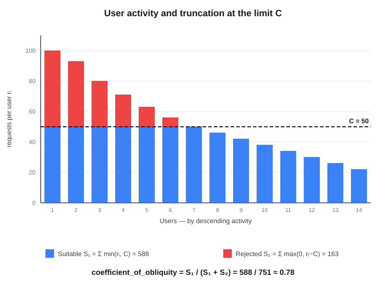
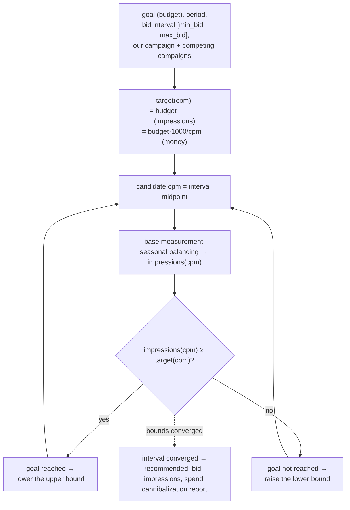

# Traffic balancer: technical description

## General model

### The balancer's task

The balancer solves the problem of **distributing ad flows under given constraints**: it computes how many times each ad must be shown over a period. This problem is formulated as a **linear programming (LP) problem**: find a traffic distribution that maximizes the chosen KPI (revenue or volume) under the given campaign constraints.

Formally, given $n$ ads and a total traffic $total$, one must find a distribution $\{\text{volume}[ad]\}$ satisfying:

- the limits of each campaign: $\text{min vol}[ad] \le \text{volume}[ad] \le \text{max vol}[ad]$;
- the physical traffic constraints for each targeting tag;
- the global balance: $\sum_{ad} \text{volume}[ad] \le total$.

There is also the **online auction**: for each incoming request a winner is selected stochastically. The randomness here is essential — it ensures that in the long run the law of large numbers brings the real impression distribution to the planned one.

### Probabilistic model and invariants

Each user request is characterized by a set of tags from different **vocabularies** (targeting dimensions): city, gender, age. A request is treated as a random variable whose distribution is defined by the probabilities of the individual tags:

- within one vocabulary the tags are **mutually exclusive** (a request cannot be from both Moscow and St. Petersburg) — so probabilities are combined by the sum rule (OR);
- different vocabularies are considered **statistically independent** (the gender distribution does not depend on the city) — so a product (AND) is used between them.

This independence assumption is the key simplification of the model. In practice correlations between dimensions exist (for example, the age composition differs between cities), but accounting for them would make the state space hard to compute. Independence allows factoring the probabilities and working with each vocabulary separately.

Three invariants rest on this model, on which the narrowing of vocabularies, the LP constraints, and the auction all rely.

**Completeness of a vocabulary's probability space.** Any request carries exactly one value for each dimension, so the probability distribution over a vocabulary is complete:

$$\sum_{tag \in vocab} P(tag) = 1$$

This invariant is critically important: the recomputation of probabilities when vocabularies are narrowed, the correctness of the LP constraints, and the normalization of the weights in the auction all rest on it.

**P(target) — the probability of a specific combination of tags.** A target is one row of the Cartesian product of the vocabularies: exactly one tag from each. By the independence of the vocabularies:

$$P(\text{target}) = \prod_{vocab} P(\text{tag}_{vocab})$$

Targets are a **non-overlapping partition** of the request space into "elementary outcomes".

**P(ad) — the probability that a request matches the ad's target.** An ad is considered "suitable" for a request if, for every vocabulary, the request's value falls into one of the chosen tags. Since an ad's targets do not overlap, its probability is the sum of the probabilities of all targets it is aimed at:

$$P(ad) = \sum_{\text{targ} \in ad} P(\text{target})$$

Physical meaning: $P(ad) \cdot total$ is the **maximum traffic flow** that can get into the ad's target at all.

### Notation

| Symbol | Type | Meaning |
| ------ | --- | ----- |
| `total` | `int` | Total traffic volume over the period |
| `vocab` | `VocabName` | A targeting dimension: `City`, `Gender`, `Age` |
| `tag` | `RawTag` | A value within a vocabulary: `Moscow`, `M`, `18-25` |
| `FullTag` | `str` | A tag with the vocabulary prefix, e.g.: `City:Moscow`, City is the vocabulary, Moscow is the tag |
| `TAG_OTHER` | `FullTag` | A container for all unused tags of a vocabulary: `City::OTHER` |
| `TAG_EMPTY` | `FullTag` | A placeholder when the request carries no value for the vocabulary |
| `P(tag)` | `float` | The probability that a random request carries the given tag |
| `P(ad)` | `float` | The probability that a random request falls into the ad's target |
| `P(target)` | `float` | The probability of a specific combination of tags |
| `target` | `RequestFlow` | One tag from each vocabulary simultaneously — a row of the Cartesian product |
| `x_(ad,targ)` | LP variable | The "raw" traffic assigned to the (ad, target) pair |
| `k` | `float` | The inverse-sampling coefficient `P(ad) / Σ P(target)` = `1/α` |
| `distribution[ad]` | `int` | The planned number of impressions of the ad |
| `bid` | `float` | The campaign's bid — price per **1000** impressions (CPM); the coefficient in `maximize_money` |
| `budget` | `float` | The campaign's budget for the period (in money) |
| `x` | `float` | The allowed volume drawdown of every other campaign, a share $\in [0, 1)$ |
| `bid_min` | `float` | The lower bound of the bid (reserve price) |

---

## Tag transformation

### Narrowing vocabularies

**Motivation.** The size of the LP problem depends on the number of targets, and the number of targets grows as the product of the vocabulary sizes. Tags that no ad targets get into the LP but give no new information: they represent "background" traffic that no ad claims. They can be merged into one tag.

**The problem.** If unused tags are simply discarded, the invariant $\sum P(\text{tag}) = 1$ is violated: the sum becomes less than one, and all subsequent estimates of ad and target probabilities are biased. This overstates $P(ad)$ and breaks the consistency of the LP constraints.

**The solution — TAG_OTHER.** All unused tags are merged into a single "composite" tag. Since the tags within a vocabulary are mutually exclusive, their probabilities can be added (the OR rule for incompatible events):

$$P(\text{TAG OTHER}) = \sum_{\text{tag is not used}} P(\text{tag})$$

Equivalently: $P(\text{TAG OTHER}) = 1 - \sum_{\text{tag is used}} P(\text{tag})$. The invariant is preserved automatically.

**Example.** The vocabulary `Age = [18-25, 26-35, 36-45, 46-55, 55+]`, the ads use only `[18-25, 26-35]`:

```
New vocabulary: [18-25, 26-35, Age::OTHER]
P(OTHER) = 1 − P(18-25) − P(26-35)
```

The target space shrinks, the completeness invariant is preserved, and the probabilities of the individual tags remain unchanged.

**Rebuilding the ads' tags.** After a vocabulary is narrowed, the ads' targets must be reconciled with the new structure. The logic:

- if an ad was **not targeted** at specific tags of the vocabulary, it effectively does not filter by this dimension and gets the whole new vocabulary;
- if an ad covered **all** tags of the old vocabulary — it also gets the whole new vocabulary;
- if an ad covered **some** of the tags — we keep exactly those (they are guaranteed to have entered the new vocabulary since they were used);
- tags that went into `TAG_OTHER` are not needed by the ad itself (the ad was not targeted at them).

---

## The LP problem

Solver: GLOP (Google OR-Tools) — an implementation of the simplex method for linear programming problems.

**The task.** Distribute ad traffic among ads so that each ad gets an impression volume within its contractual limits (`min_vol` … `max_vol`), the total traffic for each tag combination does not exceed the physically possible flow through it, and the global flow does not exceed `total`. The chosen KPI must be maximized — total revenue or total impression volume.

**Solution method.** The objective function and all constraints are linear in the variables — the problem is a linear programming (LP) problem and is solved by the simplex method via GLOP.

**Pricing rule: DEVEX.** At each iteration the simplex chooses the variable to enter the basis by a *pricing rule*. By default GLOP uses `STEEPEST_EDGE` — it picks the "best" direction more accurately, but each iteration is more expensive (it requires maintaining exact edge norms). **DEVEX** is an approximation of steepest-edge: it estimates the same norms approximately but noticeably cheaper per iteration, usually at the cost of slightly more iterations, and on large problems wins in total time. It is enabled via the text proto `GlopParameters`:

```text
optimization_rule: DEVEX  feasibility_rule: DEVEX
```

On large problems (≥ 0.5M variables) this gives better speed. Important: changing the pricing rule only changes the order in which pivot columns are chosen, **the optimum and its value do not change** (up to LP degeneracy), so the balancing result is identical.

**Which targets get into the problem.** The full set of an ad's targets — the Cartesian product of the vocabularies — grows exponentially, so it is impossible to enumerate all of them. The LP includes not all but only the **top-$`K`$ most probable targets** of each ad; the selection itself and its algorithm are described in the section ["Algorithms and optimizations"](#algorithms-and-optimizations). Such a subsample covers only a part of the ad's probability mass, which is then restored by the inverse-sampling coefficient $k$ (see ["Inverse-sampling coefficient k"](#inverse-sampling-coefficient-k)).

### Formulation as an LP problem

Traffic balancing is the **maximization of a linear functional** under a system of linear constraints. A solution exists and is unique (up to degenerate cases) thanks to the convexity of the feasible set.

The decomposition "ad → targets → tags" allows reducing the problem to the classical form:

- **variables** — volumes per target within ads;
- **constraints** — two-sided inequalities describing physical and contractual limits;
- **objective function** — a weighted sum of variables.

### Variables

A **target** is a combination of tags (a single tag from each vocabulary). An ad campaign is a collection of targets. For example, for an ad with the vocabularies `City`, `Gender`, `Age` a cell looks like `(Moscow, M, 18-25)`.

**Target probability** — the product of the probabilities of each tag in the target: $$P(\text{targ}) = P(\text{Moscow}) \cdot P(\text{M}) \cdot P(\text{18-25})$$

**Definitions of the basic LP variables**. For each `(ad, target)` pair a **continuous** variable $x_{(ad, targ)} \ge 0$ is introduced. Continuity (rather than integrality) is due to optimization considerations (it guarantees polynomial solution time by the simplex method). The variable is bounded above by the statistically possible traffic through the target:

$$x_{(ad,  targ)} \in \bigl[0,   total \cdot P(\text{targ})\bigr]$$

The meaning of the upper bound: through the target `(Moscow, M, 18-25)` no more than $total \cdot P(\text{targ})$ requests can physically pass over the period.

**What $x$ measures and in what units.** $x_{(ad, targ)}$ is the number of **impressions** given to the ad through **one specific target**, not through all targets at once. Ads are usually broader and cover **many** targets, so **an ad has as many variables $x$ as it has selected top-$`K`$ targets**. The dimension of $x$ is impressions (the upper bound is $total \cdot P(\text{targ})$, where $total$ is the number of impressions over the period and $P(\text{targ})$ is dimensionless), but the quantity is **continuous** (real-valued): whole impressions appear only at the very end, when rounding the result $\mathrm{floor}(k \cdot \sum_{targ} x)$.

**Why "raw".** $x$ is called *unnormalized* because only the top-$`K`$ targets, covering a share $\alpha \le 1$ of the ad's probability mass, get into the LP. Therefore the sum $\sum_{targ} x_{(ad, targ)}$ systematically **understates** the real volume, and the multiplier $k = 1/\alpha$ (see below) restores the scale. The real volume of an ad through a target is $k \cdot x$, and the ad's full volume is $k \cdot \sum_{targ} x_{(ad, targ)}$.

### Inverse-sampling coefficient k

Selecting the top-$`K`$ targets is **sampling**: from the full set of an ad's targets (the Cartesian product of the vocabularies) we take not all possible ones, but only a subsample of the most probable. The sampled subsample covers only a share

$$\alpha = \frac{\sum_{\text{selected targ}} P(\text{targ})}{P(ad)}  \le  1$$

of the ad's whole probability mass (**sampling rate**: the share of outcomes that made it into the sample). Therefore the LP plan $\sum x_{(ad, targ)}$ built on the subsample **understates** the real volume; it describes only this share $\alpha$ of all the traffic.

The **inverse-sampling coefficient** $k$ restores the full result from the subsample: it multiplies the result computed over the sampled targets back to the scale of the whole ad. The coefficient is **computed separately for each ad**.

$$k_{ad} = \frac{1}{\alpha} = \frac{P(ad)}{\sum_{\text{selected targ}} P(\text{targ})}$$

In the formulas below the index $ad$ is dropped where the ad is fixed by context (for example, in a single-ad constraint one writes simply $k$), and retained as $k_{ad}$ where the sum mixes different ads (the cell and global constraints).

If, for example, the top-10 targets cover 80% of the ad's traffic (sampling rate $\alpha = 0.8$), then the inverse-sampling coefficient is $k_{ad} = 1.25$ — the plan over $x$ is multiplied by 1.25, restoring the full volume. With full coverage ($\alpha = 1$, $k_{ad} = 1$) the sampling degenerates into a full enumeration and no inverse correction is needed.

**Application:** $k$ enters the constraints (on the ad and on the cell) and the final volume formula, but is **absent from the objective function**. This speeds up the solver without loss of accuracy: for each ad $k$ is a constant, and multiplying by it does not change the optimum.

$$\text{volume}[ad] = k \cdot \sum_{\text{targ}} x_{(ad,  targ)}$$

**Degenerate case.** If none of the ad's targets passed the `min_probability` threshold, then $\sum P(\text{targ}) = 0$ and $k$ is undefined. The ad is excluded from the LP and gets $\text{volume} = 0$.

### Ad constraints

For each ad the planned volume must lie in the allowed range set by the campaign settings:

$$\text{min vol}  \leq  k \cdot \sum_{\text{targ} \in ad} x_{(ad,  targ)}  \leq  \text{real max vol}$$

- `min_vol` — the guaranteed (contractual) minimum from the campaign settings;
- `real_max_vol` — the upper limit of volume. This is **not** simply `total · P(ad)`, but the minimum of three constraints:

$$\text{real max vol} = \min\bigl(\underbrace{\text{max vol}}_{\text{contractual bound}},   \underbrace{total \cdot P(ad)}_{\text{statistical flow}},   \underbrace{\text{freq}}_{\text{frequency constraint, if}>0}\bigr)$$

- `total · P(ad)` — the statistical flow: more traffic physically does not pass through the ad;
- `max_vol` — the contractual maximum from the campaign settings;
- `freq` — a strict constraint on the impression frequency (how many times per moment of time the ad can be shown), applied before the LP (if set), so that the solver immediately optimizes within it.

In its pure form `total · P(ad)` is only one (and usually the weakest) of these constraints; in practice the upper bound is more often determined by `max_vol` or `freq`. The `freq` term itself is composed of the **ad's frequency limit** and the **user limit** — both are analyzed in detail in the subsections below.

These constraints define the feasible region (a polytope) of volumes in the variable space.

#### Frequency constraints

The `freq` term in `real_max_vol` is the strictest frequency limit of the ad, reduced to a common unit. A frequency limit is set by a set of granularities: `t` (10 minutes), `h` (hour), `d` (day), `w` (week), `m` (month). Each **independently** limits the flow, so all are reduced to a common unit — **impressions per hour** — and the minimum (the strictest) is taken:

$$\text{ad freq}_h = \min\left(6t,\ h,\ \frac{d}{24},\ \frac{w}{24\cdot 7},\ \frac{m}{24\cdot 30}\right)$$

(an hour has six ten-minute slots, so `t` is multiplied by 6). Unset granularities give $+\infty$ and do not participate in the `min`. The same conversion is applied to `user_frequency_limit`, giving `user_freq_h` — the limit of impressions to one user per hour (used in the user constraint below). In the hourly model it is precisely this hourly quantity (more exactly `freq_h`, see below) that is substituted into the `real_max_vol` of each slot; how the slot ceiling is assembled from the hourly limits is described in ["Seasonal balancing model"](#seasonal-balancing-model-hourly-slots-and-frequency-constraints).

#### User constraints

**User limit → campaign upper bound.** `user_frequency_limit` limits impressions to **one** user and is by itself incompatible with an LP that operates on total volume. The translation is via the number of unique users. If in an hour of type $h$ there are $\text{unique}_h = \text{unique users} \cdot w_h$ active users ($w_h$ is the hourly weight from the seasonal profile, see ["Seasonal balancing model"](#seasonal-balancing-model-hourly-slots-and-frequency-constraints)), and each can be shown no more than `user_freq_h`, then the upper bound of the campaign volume dictated by the user limit is:

$$\text{user campaign bound}_h = \text{user freq}_h \cdot \text{unique users} \cdot w_h$$

The final hourly upper bound of the campaign is the minimum of its own and the user constraint:

$$\text{freq}_h = \min(\text{ad freq}_h,\ \text{user campaign bound}_h)$$

Edge cases: if `user_frequency_limit` is not set — `user_freq_h = ∞` and `freq_h = ad_freq_h`; if `ad_frequency_limit` is not set — the opposite; if both are absent — there is no frequency constraint, and the volume is limited only by `max_vol` and the statistical flow `total_h · P(ad)`.

**Obliquity coefficient (`coefficient_of_obliquity`).** The campaign upper bound above (`user_campaign_bound_h`) implicitly assumes a **homogeneous** audience: as if each of the `unique_users` generates the same number of requests per hour. In practice the distribution of the number of requests per user has a pronounced **right skew** (a heavy right tail) — a small group of highly active users generates a disproportionately large share of traffic. Having reached its frequency limit $`C = \text{user freq}_h \cdot n_\text{hours}`$ (impressions per user per period), such a user stops receiving impressions: its excess requests physically cannot be delivered. Therefore the real volume the campaign can collect is **lower** than the theoretical limit computed from `ad_frequency_limit` under the homogeneity assumption.

**The idea — truncating the activity distribution.** Sort the users by descending number of requests $`r_i`$ over the period and consider the limit level $`C`$. The part of each value above $`C`$ is cut off — this is the excess, rejected volume; the sum of the values below $`C`$ is suitable traffic. The share of achievable traffic is the sought lowering multiplier:



*The bars are the number of requests $`r_i`$ per user (users are sorted by descending activity). The horizontal line is the user limit $`C`$. The part of the bars **above** the line is the truncated excess traffic $`\sum_i \max(0,\ r_i - C)`$ (rejected); the part **below** is the suitable traffic $`\sum_i \min(r_i,\ C)`$. Their ratio is `coefficient_of_obliquity`.*

$$\text{coefficient of obliquity} = \frac{\displaystyle\sum_i \min(r_i,\ C)}{\displaystyle\sum_i r_i} \in (0,\ 1]$$

where $r_i$ is the number of auction requests of the $i$-th user over the period, $C$ is the user limit over the same period. Meaning:

- `coefficient_of_obliquity = 1` — there are no highly active users (all $r_i \le C$), all traffic is suitable, no correction (coincides with the base seasonal model — backward compatibility);
- `coefficient_of_obliquity < 1` — the share $1 - \text{coefficient of obliquity}$ of the total traffic is rejected due to saturation of the active part of the audience.

**Application.** The coefficient **lowers** the ad's upper bound before it is fed into the LP: the campaign's contractual bound is multiplied by it, and the result is taken as a minimum with the absolute physical upper bound of the whole audience $C \cdot \text{unique users}$ (more than $C$ impressions cannot be delivered to each of the `unique_users`):

$$\text{effective bound} = \min\bigl(\underbrace{\text{ad bound} \cdot \text{coefficient of obliquity}}_{\text{bound adjusted for obliquity}},\ \underbrace{C \cdot \text{unique users}}_{\text{absolute audience bound}}\bigr)$$

Here the `min` contains two **independent** constraints:

- **the first** — `ad_bound · coefficient_of_obliquity`. `ad_bound` is the ad's own frequency upper bound for the period (how many impressions it is entitled to make under its limit `ad_freq_h`); the multiplier `coefficient_of_obliquity` lowers it, accounting for the fact that part of the traffic is rejected because of highly active users;
- **the second** — `C · unique_users`. This is the absolute physical ceiling of the audience: no more than `C` impressions can be delivered to each of the `unique_users` over the period, so the campaign cannot collect more than `C · unique_users` impressions under any conditions.

Since both constraints act simultaneously, the **stricter** of them must be chosen, i.e. their minimum. `real_max_vol = min(max_vol, total · P(ad), effective_bound)`.

**Assumption.** $r_i$ are *requests* while $C$ is a limit of *impressions*; `min(r_i, C)` equates a request with a potential impression of the given ad, i.e. estimates under the scenario "the ad wins all of the user's auctions". Therefore `coefficient_of_obliquity` is an **upper** estimate of the suitable share of traffic (a correction of the physical upper bound), not the expected delivery taking competition for auctions into account. Edge case: an empty distribution or zero total traffic → `coefficient_of_obliquity = 1.0`.

### Target (cell) constraints

**The substantive problem.** The same tag combination (target) can be contained in several ads. Without a constraint the solver could "pile" into one cell the traffic of several ads at once, exceeding the physically possible flow through it and making the solution infeasible.

**The constraint itself.** The entire real volume of the pair `(ad, targ)`, equal to $k \cdot x_{(ad,  targ)}$, falls wholly on the cell `targ`. The total volume assigned to a cell by all ads must not exceed the number of requests physically falling into it:

$$\sum_{\substack{(ad, targ) \\ targ  =  c}} k_{ad} \cdot x_{(ad,  targ)}  \leq  total \cdot P(targ)$$

**Completeness.** Since the cells do not overlap and each is bounded by its physical capacity, this system of constraints is exhaustive: the constraints on individual tags ($`\sum_{targ \ni tag} k x \le total\cdot P(tag)`$) and the global constraint are **derived** from it and are not separately needed for correctness.

### Global constraint

The total traffic over all ads does not exceed the available flow:

$$\sum_{\text{all } (ad,  targ)} k_{ad} \cdot x_{(ad,  targ)}  \leq  total$$

This is a balance constraint: one cannot distribute more traffic than there is. Although it is derivable from the sum of the cell constraints, adding it explicitly makes the LP problem numerically more stable, but slows the convergence of the simplex method. It is not used in the code, to speed up solving the LP.

### Objective function

| Mode | Coefficient on $x$ | What is maximized |
| ----- | ------------------- | ------------------- |
| `maximize_money` | `price[ad]` | Total revenue |
| `maximize_volume` | `1.0` | Total number of impressions |

The coefficient $k$ is **absent** from the objective function. Optimization is over the "raw" $x$, the coefficient on the variable is `price` or `1`. This is correct: $k_{ad}$ is constant for all targets of **one** ad, so scaling all its variables by a constant does not change the relative ordering of solutions and does not affect the optimum.

### Result

After solving the LP, for each ad:

$$\text{volume}[ad] = \mathrm{floor}\!\left(k \cdot \sum_{\text{targ}} x^*_{(ad,  targ)}\right)$$

The rounding introduces a small error (on the order of the number of ads), but is necessary: impressions are an integer quantity.

---

## Seasonal balancing model: hourly slots and frequency constraints

### Seasonal profile

The daily (or weekly) non-uniformity is given by a profile of weights $w_h \ge 0$, $\sum_h w_h = 1$ — the share of traffic falling on each hour. Profile sources: precomputed weights (`hourly_weights`, modes `hour_of_day` — 24 keys, cyclic over days, or `hour_of_week` — 168 keys, with a weekday/weekend split). In the absence of data — a uniform profile $w_h = 1/24$.

### Hourly LP split

A period of $H$ hours is solved not by a single LP, but by $H$ **independent** ones, one per slot. A slot $t$ with hour type $h$ gets its share of traffic, and all upper bounds are scaled by the same profile:

$$total_t = total \cdot w_h, \qquad \text{real max}_t(ad) = \min\bigl(\text{max vol}\cdot w_h,   total_t \cdot P(ad),   \text{freq}_h\bigr)$$

The structure of the LP within a slot is **identical** to the base one (variables $x_{(ad, targ)}$, cell constraints, objective function — unchanged), only `total` and the variable upper bounds change. Slots share no variables, so the result is a simple sum over hours:

$$\text{volume}[ad] = \sum_{t=0}^{H-1} \text{volume}_t[ad]$$

Since $\sum_t total_t = total$, the global balance is preserved, and the frequency constraints are satisfied in **each** hour separately — which cannot be expressed by a single LP over the whole period.

### Campaign activity within the period

A campaign with its own window `[start_date, end_date]` may be active only for part of the balancing period. In the hourly model this is accounted for by the **slot mechanics**:

- **skipping inactive hours** — a slot whose time does not fall into `[start_date, end_date]` is not run for this campaign; in such hours it collects no impressions;
- **proportional division of the ceiling over active hours** — the campaign's contractual volume for the period is distributed only over its active hours in proportion to their weight in the seasonal profile: slot $t$ of type $h$ gets the share

$$\text{share}_t(ad) = \left\lceil \text{max vol} \cdot \frac{w_h}{W_\text{active}(ad)} \right\rceil, \qquad W_\text{active}(ad) = \sum_{t':\ ad\ \text{is active in } t',\ total_{t'} > 0} w_{h(t')}.$$

$W_\text{active}(ad)$ is the sum of the weights of only those hours where the campaign is active **and** the slot is actually run ($total_t>0$; zero-weight hours are skipped and are not included in the sum). Normalizing by $W_\text{active}(ad)$, rather than by $\sum_h w_h=1$ over the whole profile, guarantees that the shares over active hours add up to exactly `max vol`, even if the campaign is active only part of the period. If the campaign is active the whole period, this formula degenerates into $\text{max vol}\cdot w_h$ — the same scaling as in $\text{real max}_t(ad)$ above. If $W_\text{active}(ad)=0$ (the campaign is active only in zero-weight hours), a uniform division $\lceil \text{max vol}/n_\text{active}\rceil$ is used as a degradation.

Thus the same behavior covers both campaigns running only part of the period and the dependence of activity on the day of the week: the campaign "feels" which day it is through which calendar hours it is active at all, even if the profile collapses them into one hour type.

### Grouping identical hours

The seasonal profile is set in one of **two** aggregation modes:

- **daily** (`hour_of_day`) — **24** hour types (hour of day $0\ldots23$); the profile repeats cyclically every day;
- **weekly** (`hour_of_week`) — **168** hour types ($24 \times 7$); the profile distinguishes days of the week (weekdays and weekends).

All calendar hours of one type are statistically identical: they have the same weight $w_h$ and the same tag profile.

This is the grouping: it is enough to solve the LP **once per hour type** and multiply the result by the number of occurrences of this type in the period, instead of a separate run for each calendar hour. Slots of one type give the same solution, so the result is identical to the hourly one, but the number of runs is bounded above by 24 (or 168) regardless of the length of the period.

**Scope of applicability.** In the daily mode the day of the week is lost: all weekday and weekend "14:00"s fall into one type. If a campaign's activity depends on the day of the week (for example, the ad runs only on weekdays), this is accounted for not by the profile but by the slot mechanics (see ["Campaign activity within the period"](#campaign-activity-within-the-period)): inactive hours are simply not run.

---

## `auction` — the online auction

**Bayesian inference of an ad's weight.** The planned volume `distribution[ad]` is the expected number of impressions of the ad over **all** possible requests over the period. We need to distribute this expectation over request types: how many of the `distribution[ad]` impressions will fall precisely on requests of the given type.

Requests of the given type make up a share $P(\text{request})$ of all traffic, but the ad participates only in the part of the traffic that falls into its target — the share $P(\text{ad})$. So among the impressions of **this** ad, the share falling on the given request type is the conditional probability:

$$P(\text{request} \mid \text{ad}) = \frac{P(\text{request} \cap \text{ad})}{P(\text{ad})} = \frac{P(\text{request})}{P(\text{ad})}$$

(the last equality holds provided the request falls into the ad's target, i.e. $`\text{request} \subseteq \text{ad}`$, hence $`P(\text{request} \cap \text{ad}) = P(\text{request})`$). Multiplying the total expected impressions by this share, we get the expected number of impressions of the ad precisely on the given request type — and this is the weight:

$$w[ad] = \text{distribution}[ad] \cdot P(\text{request} \mid \text{ad}) = \text{distribution}[ad] \cdot \frac{P(\text{request})}{P(\text{ad})}$$

where $P(\text{request}) = \prod_{vocab} P(\text{tag}_{vocab}(\text{request}))$ is the probability of the specific request (the same model of independence of dimensions).

**Important: $P(\text{request})$ cancels out.** For all ads in one draw $P(\text{request})$ is the same multiplier, and the winner is chosen by the **normalized** weights $w[ad] / \sum_{ad'} w[ad']$. Therefore $P(\text{request})$ drops out of the selection, and in effect an ad is chosen in proportion to $\text{distribution}[ad] / P(\text{ad})$.

**Request tags outside the narrowed vocabulary.** If a request carries no value for some vocabulary, `TAG_EMPTY` is taken; if it carries a value that is not in the narrowed vocabulary (it went into `TAG_OTHER` at the planning stage), the probability is taken from `P(TAG_OTHER)`. Thus the auction uses exactly the same narrowed vocabularies and probabilities under which the plan was computed.

**Why random selection and not deterministic.** If one always picked the best by weight, the planned distribution would be distorted: less frequent request types would get a disproportionately large number of impressions of the same ad, and the planned structure would be broken. Random selection in proportion to the weights guarantees that **in expectation** the number of impressions of each ad per request type coincides with the plan.

```
auction(ads, parameters):
    P(request) = ∏_vocab P(request tag in the vocabulary)        # fallback to P(TAG_OTHER)

    for each ad:
        weight[ad] = distribution[ad] · P(request) / P(ad)

    return random_choice(ads, weights=weight)
```

---

## Forecasting: campaign results and the recommended bid

All the sections above answer the question "how to distribute traffic among a **given** set of campaigns". Forecasting solves a planning problem that is inverse in meaning for a **single** campaign *before* its launch: the advertiser does not yet know either the final volume or the required bid and wants to estimate them in advance — taking into account the seasonal profile and the already running competing campaigns.

### Two axes of the problem

Any forecasting question decomposes along two independent axes.

**Axis 1 — direction of calculation.**

- **Forward problem** ("results"): the bid `cpm` is **given**, the outcome is sought — how many impressions the campaign will collect and how much money it will spend. This is exactly **one** balancing run and reading the result.
- **Inverse problem** ("recommended bid"): a **goal** is given (a budget in impressions or money), and the minimum bid at which the goal is reached is sought. This is a **series** of runs driven by a search over `cpm`.

**Axis 2 — targeting.**

- **With targeting**: the campaign competes only for the traffic of its segment, $P(ad) < 1$, and the upper bound is set by the capacity of the target cells (see ["Target constraints"](#target-cell-constraints)).
- **Without targeting**: the campaign's targets are replaced with empty ones ("all tags"), which is equivalent to $P(ad) = \prod_{vocab}\sum_{tag\in vocab}P(tag) = 1$ by the completeness invariant. The campaign competes for the **whole** flow, the inverse-sampling coefficient $k \to 1$, and the per-tag constraints become insignificant — only its own limits `min_vol`/`max_vol` and the global balance bind.

### Base measurement: one model run

Both forward problems rely on a single operation — **a measurement at a fixed bid**. A campaign with the bid `cpm` is added to the competing campaigns, a seasonal balancing is run, and two numbers are read from its result:

$$\text{impressions}(cpm) = \text{volume}[ad], \qquad \text{spend}(cpm) = \text{impressions}(cpm)\cdot \frac{cpm}{1000}$$

These two numbers are the entire outcome of the forward forecast:

- **volume (impressions)** $\text{impressions}(cpm) = \text{volume}[ad]$ — taken **directly** from the balancing result: how many times the ad will be shown over the period at the given bid
- **spend** $\text{spend}(cpm)$ — **not** read from the LP, but **computed** from the volume and the bid: how much money the campaign will actually spend to collect this volume.

The division by 1000 is because `cpm` is the price per thousand impressions. The forecast logic is as follows: balancing answers only the question "how many impressions", and "how much money" is simple arithmetic on top of it; therefore the forward forecast is one model run and one multiplication.

### Targeting in the measurement: a segment versus the whole market

The two forward forecasters — with and without targeting — use **the same** base measurement and differ in exactly **one preprocessing** of the input data: whether to account for the campaign's own targets or replace them with empty ones (with "all tags").

**Without targeting — the capacity of the whole market.** The preprocessing replaces the campaign's targets with empty ones. An empty target means "all tags of every vocabulary", so the inner sum over each vocabulary equals $\sum_{tag\in vocab} P(tag) = 1$ (the invariant of [completeness of the probability space](#probabilistic-model-and-invariants)), and the product of ones gives

$$P(ad) = 1,\qquad k = \frac{P(ad)}{\sum P(targ)} \to 1.$$

The campaign competes for the **whole** flow `total`, the inverse-sampling coefficient degenerates to one, and the per-tag cell constraints stop binding anything (the campaign covers all cells at once). Only its own limits `min_vol`/`max_vol` and the global balance $\sum_{ad}\text{volume}[ad]\le total$ remain. The forecast answers the question "how much will the campaign take if it can be shown on **any request** — without a targeting restriction".

**Why the difference is fundamental.** All other campaign fields (volume, bid, frequency limits, dates) and the whole pipeline below the preprocessing are **identical** — only the set of requests being competed for differs. Since a segment is always a subset of the whole market, the forecast without targeting is **systematically no lower** than the forecast with targeting:

$$\text{impressions}_{\text{without targeting}}(cpm) \ge \text{impressions}_{\text{with targeting}}(cpm).$$

This gives two qualitatively different estimates. The forecast with targeting is a **realistic** plan for an already segmented campaign. The forecast without targeting is an upper, "run-of-network" estimate of inventory capacity: what the campaign could achieve without segmentation at all.

### Forward problem: results at a given bid

A results forecast is the base measurement performed with the necessary ads. Substantively, two limiting modes of behavior of the competing campaigns are distinguished (they also underlie the inverse problem, see below):

- **free** — all campaigns, including the input one, are reoptimized jointly (as in `predict_rebalance`): the competitors' volume may decrease;
- **frozen** — the competitors' volumes are fixed at the current distribution, and the input campaign takes only the unoccupied capacity (as in `add_new_balanced_campaign`): the competitors lose nothing.

In both cases the forecast is one LP solution and the revenue arithmetic.

### Inverse problem: the recommended bid

Here the **goal** is known — the required volume over the period — and the minimum bid that ensures it is sought.

**Translating the budget into target impressions.** If the budget is given in impressions, the goal coincides with it: $\text{target} = \text{budget}$. If in money — the goal **depends on the bid itself**:

$$\text{target}(cpm) = \frac{\text{budget}\cdot 1000}{cpm}$$

This dependence is nonlinear and decreasing in `cpm`, so with a money budget the goal is recomputed at each search step rather than fixed in advance.

**The monotonicity property — the basis for the search.** The campaign's forecast volume $\text{impressions}(cpm)$ **does not decrease** in the bid: by raising `cpm`, the campaign wins no fewer auctions than before. This monotonicity turns bid selection into a **binary search** over the interval $[\text{min bid},  \text{max bid}]$: at each step the candidate midpoint `cpm` is taken, the base measurement is performed, and it is checked whether the goal is reached

$$\text{impressions}(cpm)  \ge  \text{target}(cpm).$$

If reached — the bid can be lowered (move the right bound), otherwise — raised (move the left). In $\lceil\log_2((\text{max bid}-\text{min bid})/\varepsilon)\rceil$ iterations the interval contracts to the minimum sufficient bid `recommended_bid`. Each iteration is a seasonal balancing run, so the cost of the forecast equals the cost of one balancing times the number of search steps.



**Unreachable goal.** If even at `max_bid` the volume is less than the goal, a minimum sufficient bid does not exist. The forecaster returns the maximum achievable volume together with the bid.

**Cannibalization.** Raising the input campaign's bid while the competing campaigns are freely reoptimized takes traffic away from them. Each campaign's loss is the difference between its volume before and after the input campaign arrives:

$$\Delta[ad] = \text{volume}_{\text{before}}[ad] - \text{volume}_{\text{after}}[ad], \qquad \text{(}\Delta > 0 \Rightarrow \text{loss)}$$

The total cannibalization $\sum_{ad}\Delta[ad]$ and its share of the competitors' previous volumes are part of the forecast report: they show the "price" of our volume for the rest of the inventory.

#### Variants of competing campaign behavior

The inverse problem exists in several variants — they differ in what the competing campaigns are allowed to do within each measurement. The bid search and the goal check are the same in all variants; only the behavior of the competing campaigns and, as a consequence, the cannibalization change.

| Variant | What happens to competitors | Base function | Cannibalization |
| ------- | ------------------ | --------------- | -------------- |
| **Free** | reoptimized jointly with the input campaign | free balancing | possible |
| **Frozen** | volumes fixed, only the free capacity is given | adding without rebalancing | absent ($=0$) |
| **With a `min_vol` guarantee** | optimized freely, but the input campaign is rigidly guaranteed a lower bound | balancing with `min_vol` | possible |
| **With a cannibalization threshold** | like free, but the loss of **each** competitor individually is bounded above | free balancing and a threshold check | each $\le$ the given threshold |

The **threshold** variant requires checking **two** conditions at each step simultaneously — whether the goal is reached *and* whether **no** competing campaign loses more than allowed:

$$\text{impressions}(cpm) \ge \text{target}(cpm) \quad\text{AND}\quad \forall ad:   \frac{\Delta[ad]}{\text{volume}_{\text{before}}[ad]} \le \text{cannibalization}_{\max}.$$

The threshold $\text{cannibalization}_{\max}$ is **set by the user** — it is the maximum allowed loss of an **individual** competing campaign as a **percentage** of its own previous volume (for example, "do not take more than 10% of any campaign's volume"). The constraint is checked for each competitor **individually**: a single campaign crossing the threshold is enough for the candidate bid to be rejected. If the conditions are incompatible (the goal is achievable only at the cost of exceeding the threshold for at least one competitor), the maximum volume that violates the threshold for no one is returned.

#### The theoretical ceiling as a reference point

The limiting case of the inverse problem is a campaign that is **alone in the system**, with no competitors. Then the bid affects nothing, and a single measurement gives the **absolute ceiling** of impressions, determined only by targeting, frequency limits, and the seasonal traffic volume. This ceiling does not depend on `cpm` and serves as an upper bound for all the other variants: no configuration of competing campaigns will allow collecting more than the campaign would take alone.

---

## Algorithms and optimizations

### The combinatorial explosion problem

The target space is the Cartesian product of the tags of all vocabularies. With three vocabularies of 10 tags each, that is $10^3 = 1000$ targets **per ad**, and with more vocabularies the growth is exponential.

At the same time the probability distribution of targets is usually **highly non-uniform**: 5–10% of targets cover 90%+ of the probability mass (a heavy-tail property in products of probabilities). Including all targets in the LP is inefficient — most variables would have a zero upper bound.

The task: find the $K$ targets with the highest probability **without fully enumerating** the remaining space.

### The K-best algorithm on a partial-order structure

**Target profiles.** If the tags within each vocabulary are sorted by descending probability, each target corresponds uniquely to a **profile** — a vector of indices $(i_1, i_2, \ldots, i_n)$, where $i_j$ is the position of the chosen tag in vocabulary $j$. The profile $(0, 0, \ldots, 0)$ corresponds to the target made up of the most probable tags of each vocabulary — it is globally optimal.

**Partial order.** A partial order is introduced on profiles: profile $A \preceq B$ if $A_j \le B_j$ for all $j$. The further "right" a profile is in each coordinate, the smaller the probability of the corresponding target (since the tags are sorted by descending probability). This turns the search for the $K$ best into a problem of traversing a **lattice** from the top face downward.

**Neighbors.** A neighbor of a profile is a profile that differs in exactly one coordinate by $+1$. Neighbors are always worse than the current one, exactly by as much as the next tag of vocabulary $j$ is inferior to the current one. This is the key to efficiency: when a target is extracted from the heap, its neighbors **are guaranteed** to have a lower probability, so the heap invariant holds without special checks.

**Best-first lattice traversal (lazy $K$-best).** A greedy traversal: start from $(0,\ldots,0)$, at each step extract from the min-heap the most probable target on the frontier, generate its neighbors, and put them into the heap. Stop on reaching $K$ targets or the threshold $P(\text{targ}) < \text{min probability}$. How a profile is stored as a single integer and how neighbors are generated without repeats (without a "visited" set) — see the subsection "Implementation: integer profile and lazy generation".

Correctness rests not on relaxation but on monotonicity: a neighbor is never more probable than its parent (the proof is in the section on incremental recomputation).

**Vocabulary order.** Before the traversal, the ad's vocabularies are sorted by descending number of tags: the vocabulary with greater branching goes first. This does not affect **correctness** (the set of extracted top-$`K`$ targets is the same) but speeds up the traversal — the heap fills with probable mass faster. Within each vocabulary the tags are sorted by descending probability, so the profile $(0,\ldots,0)$ always corresponds to the best target.

### Logarithmic transformation

$P(\text{target}) = \prod_{j} P(\text{tag}_j)$ is a product of many numbers from $(0, 1)$. With $D = 5$ vocabularies and an average probability of $0.1$ we get $P(\text{targ}) \sim 10^{-5}$, with $D = 10$ — already $10^{-10}$, and so on. At the boundary of normalized `float64` numbers ($\approx 10^{-308}$) the numerical error of comparison becomes critical long before underflow.

The logarithm solves both problems — of accuracy and of underflow. The product turns into a sum:

$$\log P(\text{target}) = \sum_{vocab} \log P(\text{tag}_{vocab})$$

Comparing probabilities $P_1 < P_2$ is equivalent to comparing $\log P_1 < \log P_2$ (the logarithm is monotone). The heap stores $-\log P(\text{target})$: this is a positive number, and the **minimum** in the min-heap corresponds to the maximum probability.

### Incremental recomputation of a neighbor's probability

When moving from the current target to a neighbor, exactly one tag changes at position $i$: $t_{\text{prev}} \to t_{\text{next}}$. Because of the additivity of the logarithmic formula, the probability is recomputed in $O(1)$:

$$\log P(\text{neighbor}) = \log P(\text{current}) - \log P(t_{\text{prev}}) + \log P(t_{\text{next}})$$

In terms of the value stored in the heap:

$$-\log P(\text{neighbor}) = -\log P(\text{current}) + \log P(t_{\text{prev}}) - \log P(t_{\text{next}})$$

Since the tags within a vocabulary are sorted by descending probability, $P(t_{\text{prev}}) > P(t_{\text{next}})$, and the term $\log P(t_{\text{prev}}) - \log P(t_{\text{next}}) > 0$. Hence $-\log P(\text{neighbor}) > -\log P(\text{current})$ — the neighbor comes **after** the current one in the heap. This is the monotonicity that guarantees the correctness of the traversal.

### Implementation: integer profile and lazy generation

Two optimizations speed up the traversal **without changing** the set and order of the selected targets. In the time profile the bottleneck was not the heap itself (it is already bounded by $K$) but allocations: rebuilding profile tuples when generating neighbors and storing tag paths in every node.

**The profile as an integer (mixed-radix).** Instead of a tuple of indices $(i_1,\ldots,i_D)$ the profile is encoded by a single integer in a mixed numeral system:

$$\text{id} = \sum_j i_j \cdot \text{prefix}_j, \qquad \text{prefix}_j = \prod_{l>j} |\text{vocab}_l|$$

(vocabulary $0$ is the most significant digit). Then moving to the neighbor along vocabulary $j$ is simply $\text{id} + \text{prefix}_j$ (one addition instead of an O(D) rebuild of a tuple), and the index within the vocabulary is recovered as $\lfloor \text{id} / \text{prefix}_j \rfloor \bmod |\text{vocab}_j|$. The heap stores the pair $(-\log P,\ \text{id})$; the targets' tags are decoded from `id` only for the $K$ emitted targets, not for all nodes in the heap. This turns a heap entry from $O(D)$ into $O(1)$ and removes the bulk of allocations. (Correct as long as $\prod_j |\text{vocab}_j|$ fits in a machine word — in the real range it always does.)

**Lazy generation without repeats.** A lattice node is reachable from several parents (by incrementing any dimension), so the naive traversal produced duplicates and required a "visited" set (with hashing of paths — $O(D)$ per check). Uniqueness is achieved by a rule: **incrementing vocabulary $j$ is allowed only if all the lower digits of the profile are zero**, i.e. $\text{id} \bmod \text{prefix}_j = 0$. Then each target has exactly one parent — the decrement of the most significant nonzero digit — and the "visited" set becomes **unnecessary**: each target enters the heap exactly once. This reduces both the number of heap operations and memory (no set of paths).

**The price of precision.** With lazy generation the path of accumulating $-\log P$ to a specific target differs from that of the naive traversal, so due to the non-associativity of floating-point addition the final probability may differ at the rounding level ($\sim 10^{-15}$). The set of targets, their tags, and order are identical; the probability value coincides mathematically.

### Pseudocode

```
select_top_targets(ad_tags, tag_probabilities, K, min_probability):
    for each ad:
        sort the tags in each vocabulary by descending probability
        log[j][n] = log P(n-th tag of vocabulary j)         # positional arrays
        size[j]   = |vocabulary j|
        prefix[j] = ∏_{l>j} size[l]                    # mixed-radix digit weights

        # best target = id 0 (zero index in every vocabulary)
        heap = [(−Σ_j log[j][0], id=0)]
        result = []

        while heap is not empty and |result| < K:
            (negative_log, id) = pop the minimum from heap
            if exp(−negative_log) < min_probability:
                break                               # only worse from here
            result.append(decode_tags(id))          # tags are needed only here

            for each dimension j:
                n = ⌊id / prefix[j]⌋ mod size[j]        # index of vocabulary j in id
                # path uniqueness: increment j only if the lower digits are zero
                if n+1 < size[j] and id mod prefix[j] == 0:
                    # incremental recomputation in O(1):
                    neighbor_log = negative_log + log[j][n] − log[j][n+1]
                    push (neighbor_log, id + prefix[j]) into heap

        return result
```

**Complexity:** $O(K \cdot D \cdot \log K)$ in time and $O(K \cdot D)$ in memory per ad, where $D$ is the number of vocabularies.

---

## Main balancer functions

### `balance_traffic`

The base, single-period mode of operation: distribute a given traffic volume among ads in one period. It takes the ads (with targets and limits) and traffic parameters (total volume, tag probabilities, objective function).

This is a wrapper function: it validates the input data, translates the external parameters into the internal format, and delegates all the work to the core [`optimize`](#optimize--the-balancer-core). All the other functions (`add_new_balanced_campaign`, `predict_rebalance`, `balance_by_sellout`) and the seasonal add-ons are built on top of the same core, preparing the input for it in different ways.

```
balance_traffic(ads, parameters):
    validate the input data
    internal_parameters = convert to internal format(parameters)
    return optimize(ads, internal_parameters)
```

---

### `optimize` — the balancer core

An internal function and the actual executor: `balance_traffic` and all the functions above merely prepare data and call it. `optimize` goes through **five consecutive phases** — from the source ads and vocabularies to a solved LP problem and a planned distribution.

1. **Narrowing vocabularies.** From each vocabulary only the tags actually used by at least one ad remain; all the others are collapsed into a single bucket `TAG_OTHER`. Without this the completeness invariant $\sum P(\text{tag}) = 1$ would be violated. The probabilities are recomputed: the removed tags correspond to the total `P(TAG_OTHER)`. In detail — in the section ["Narrowing vocabularies"](#narrowing-vocabularies).

2. **Rebuilding the ads' tags.** After the vocabularies change, the ads' targets are re-mapped into their new structure so that further computations proceed in the narrowed space.

3. **Ad and target probabilities.** For each ad $P(ad)$ is computed — the probability that a random request matches its target. A greedy heap traversal selects only the $K$ most probable targets. Ads whose even best target is below the `min_probability` threshold are excluded from the LP and get volume 0. The selection algorithm — in the section ["The K-best algorithm"](#the-k-best-algorithm-on-a-partial-order-structure).

4. **Building the LP problem.** Each (ad, target) pair is assigned a variable $x$ with the upper bound $total \cdot P(\text{targ})$. Constraints on each ad's volume and on the capacity of the target cells are added, and the objective function is set — maximizing revenue or volume. Details — in the section ["The LP problem"](#the-lp-problem).

5. **Solving and the final distribution.** The GLOP solver finds the optimal planned volume for each ad with targets, while an ad without targets gets 0.

```
optimize(ads, parameters):
    vocabularies, probabilities ← narrow the vocabularies (unused tags → TAG_OTHER)
    ad targets   ← re-map to the new vocabularies
    for each ad:
        P(ad)                     ← probability of a request matching the target
        top-K targets, Σ P(targ)  ← greedy heap traversal of the K most probable targets
    LP ← variables x_(ad, targ) + volume and cell constraints + objective function
    solve the LP
    return {ad: floor(k · Σ x*)} for ads with targets, otherwise 0
```

---

### `add_new_balanced_campaign` — adding a campaign without rebalancing

The task: add new ads so as **not to violate** the volumes already allocated to the existing ads.

From the LP point of view, this is equivalent to **narrowing the set of feasible solutions**: the variables of the old ads are turned from free into fixed. This is achieved by setting `min_vol = max_vol = fixed_volume` — the two-sided inequality degenerates into an equality, and the solver must output exactly this value. The remaining freedom is distributed only among the new ads.

```
add_new_balanced_campaign(ads, current_distribution, parameters):
    for each ad in ads:
        if ad is in current_distribution:
            fix: min_vol = max_vol = current_distribution[ad]
    return optimize(ads_with_freeze, parameters)
```

---

### `predict_rebalance` — predicting a rebalancing

Answers the question: *"If the traffic parameters change, how much will the planned volumes change?"* — **without applying the changes**.

From the mathematical point of view this is a **sensitivity analysis**: two LP solutions under different parameters are compared, and the delta shows the direction and magnitude of the optimum's shift.

```
predict_rebalance(ads, current_distribution, new_parameters):
    new_distribution = optimize(ads, new_parameters)  # hypothetical plan
    delta = {ad: new_distribution[ad] − current_distribution[ad]}
    return new_distribution, delta
```

A positive delta — the ad should get more traffic under the new parameters; negative — less.

---

### `balance_by_sellout` — maximizing the minimum sellout of campaigns

Maximizes the **minimum sellout percentage** among campaigns: after balancing, each campaign has a sellout share `volume / max_vol`; the function looks for a distribution in which the **smallest** of these shares is maximal (maximin).

From the mathematical point of view this is a **maximization of the minimum** (max-min filling): the largest $\varphi \in [0, 1]$ is sought for which the LP problem with the forced minimum `min_vol_ad = ⌊max_vol_ad · φ⌋` for **all** ads is still solvable. The higher $\varphi$, the greater the guaranteed minimum for each campaign, but the harsher the constraints — at some point the physical traffic is not enough for everyone and the LP becomes infeasible. This boundary is the sought $\varphi^*$.

**Monotonicity → binary search.** Feasibility is monotone in $\varphi$: if a plan with share $\varphi$ exists, then any smaller share $\varphi' < \varphi$ is also achievable (relaxing `min_vol` merely widens the set of solutions). So the feasible shares form an interval $`[0, \varphi^*]`$, and $`\varphi^*`$ is found by **binary search**. The binary search accuracy is controlled via $\varepsilon$, given in percent. The search stops when the interval width becomes smaller than $\varepsilon$.

**Unlimited ads.** An ad may have no upper bound for volume. To handle such ads, a user-supplied function is used, which takes the upper volume bounds of the limited ads:

- **All ads are unlimited** — there is no common finite scale of shares, and a binary search is pointless: `optimize` over all ads is returned right away, and `sellout_percent` is formally $\min_{ad}\bigl(\text{volume}_{ad} / \text{big number}\bigr)\cdot 100 \approx 0$.
- If the replacement function is **set** — the unlimited `max_vol` is replaced by the function's value, after which such ads participate in the search and the final `optimize` on a par with the others.
- **Otherwise** (the default) — unlimited ads are **excluded** from the binary search (it runs only over the limited ads), but are returned to the **final** `optimize` with their original `min_vol`.

**Fallback case.** If the binary search found no feasible share $\varphi > 0$ (even the minimum common minimum is unreachable), the function returns a plain `optimize` over the search participants without forced minimums, and `sellout_percent` is computed as the smallest share actually achieved over the same ads.

```
balance_by_sellout(ads, accuracy):
    # look for the maximum share φ at which all campaigns are still achievable
    φ ∈ [0, 1];  best_distribution ← none

    while the search interval is wider than the accuracy:
        φ ← interval midpoint
        force a minimum ⌊max_vol · φ⌋ on each campaign
        if the LP with these minimums is solvable:
            remember the solution; look for a larger share
        else:
            share φ is unreachable; look for a smaller one

    if no share φ > 0 fit:
        best_distribution ← the solution without forced minimums

    sellout ← min over campaigns (volume / max_vol) · 100
    return the distribution and the sellout
```

---

### `seasonal_balance_traffic`

The seasonal analog of `balance_traffic`: distributes traffic over a date range taking the hourly profile into account. Internally it goes through the hours of the period, in each solves an ordinary balancing problem on the share of traffic of that hour, and sums the obtained volumes. The contractual minimums `min_vol` within the hourly problems are **relaxed to zero** (an integer distribution of volume over fractional hours is unstable to rounding), so the function optimizes the seasonal profile without guaranteeing minimums at the level of individual slots.

```
seasonal_balance_traffic(ads, period, traffic, profile):
    total ← 0 for each ad
    for each hourly slot of the period:
        allocate to the slot its share of traffic by the profile
        bring the ads' upper bounds to this hour
        solve the balancing problem for the slot
        add the slot's volumes to the total
    return total
```

### `seasonal_add_new_balanced_campaign`

The seasonal analog of `add_new_balanced_campaign`: adds new ads **without revisiting** the volumes of the existing ones. Each existing ad's volume is distributed over active hours and **fixed** in each slot, while the new ads claim only the free capacity of that hour. The old campaigns' contractual volumes are preserved, and the new ones are fitted into the remainder of the flow.

```
seasonal_add_new_balanced_campaign(ads, current_volumes, period, ...):
    total ← 0
    for each hourly slot:
        fix the share of each existing ad in the slot
        distribute the new ads over the free capacity of the slot
        add the slot's volumes to the total
    return the total and, separately, the volumes of the new ads only
```

### `seasonal_balance_by_sellout`

The seasonal analog of `balance_by_sellout`: it aims at the most **equal sellout** of campaigns (see ["balance_by_sellout"](#balance_by_sellout--maximizing-the-minimum-sellout-of-campaigns)). Since the achievable share depends on the flow of the specific hour, the search for an equal sellout level is conducted **within each slot** independently, and the final percentage for the period is taken as the **minimum** share achieved among campaigns with a finite plan.

```
seasonal_balance_by_sellout(ads, period, traffic, profile):
    total ← 0
    for each hourly slot:
        pick the largest equal sellout within the slot's flow
        add the slot's volumes to the total
    sellout ← minimum over ads (assigned / plan) · 100
    return the total and the sellout
```

The selection within a slot is correct because relaxing the minimums merely widens the set of feasible solutions — feasibility is monotone in the sellout level, and slots share no variables. Unlimited ads (with no finite plan) are not included in the final minimum: their sellout share is undefined.

---

### `open_balance_traffic` — balancing without targeting

All ads compete for the **entire** traffic, ignoring their targets. Before the computation, each ad's targets are replaced with empty ones ("all tags"), which is equivalent to $P(ad) = 1$ and $k = 1$: the per-tag constraints stop binding, and the campaign is limited only by its limits `min_vol`/`max_vol` and the global balance. Used for "run-of-network" campaigns and for estimating inventory capacity **before** segmentation is introduced.

```
open_balance_traffic(ads, period, traffic, profile):
    for each ad: replace the targets with empty ones (= all tags)
    return seasonal_balance_traffic(ads_without_targets, period, traffic, profile)
```

Everything except the target replacement is identical to [`seasonal_balance_traffic`](#seasonal_balance_traffic) — the difference is only in this preprocessing.

---

### `forecast_bid` — selecting the recommended bid

The inverse planning problem. **Two constraints** are given — `max_budget` (the budget in money) and `min_impressions` (the minimum required volume) — and `forecast_bid` looks for the bid `cpm` at which the campaign reaches `min_impressions` while staying within `max_budget` (with a tolerance of `budget_tolerance %`). The search direction is set by `bid_direction`:

- `'minimize'` — find the **minimum** `cpm` at which the goal is reached;
- `'maximize'` — find the **maximum** `cpm` within the budget.

**Budget tolerance.** `budget_tolerance` is the allowed overrun of `max_budget` in **percent** (default `0` — the budget is strict). During the check the spend is compared not with the budget itself but with its "softened" version:

$$\text{effective budget} = \text{max budget} \cdot \left(1 + \frac{\text{budget tolerance}}{100}\right)$$

For example, with `max_budget = 50000` and `budget_tolerance = 5` a candidate bid is acceptable as long as the spend does not exceed `52500`. `budget_tolerance` compensates for the discreteness of impressions: with a strict comparison a suitable `cpm` might not be found, slightly exceeding the exact budget.

At each step the budget is converted to the ad's quota `max_volume(cpm) = max_budget · 1000 / cpm`. Since the forecast volume is monotone in the bid (see ["Inverse problem"](#inverse-problem-the-recommended-bid)), `cpm` is found by **binary search** on the interval `[min_bid, max_budget · 1000 / min_impressions]`: at each step a trial `cpm` is run through the seasonal balancing, and it is checked whether `min_impressions` is collected without exceeding the budget. It returns the recommended bid, the expected impressions and spend, and also the competitors' cannibalization.

```
forecast_bid(parameters with mode):
    [lo, hi] ← [min_bid, max_budget · 1000 / min_impressions]
    binary search for cpm in [lo, hi] by bid_direction:
        ad.volume ← max_budget · 1000 / cpm
        result ← measurement by mode (competitors + the ad at bid cpm)
        ok ← volume(result) ≥ min_impressions AND spend ≤ max_budget·(1 + budget_tolerance/100)
        minimize: ok → lower the upper bound, otherwise raise the lower
        maximize: ok → raise the lower bound, otherwise lower the upper
    return the recommended bid, expected impressions/spend, cannibalization
```

**Four environment modes (`mode = 1..4`).** The mode selects what the competing campaigns are allowed to do within each measurement (see ["Behavior variants"](#variants-of-competing-campaign-behavior)); the bid search and the goal check are the same in all modes.

| `mode` | Competitor behavior | Base measurement function | Cannibalization |
| ------ | --------------------- | ---------------------- | -------------- |
| **1** | reoptimized freely | [`seasonal_balance_traffic`](#seasonal_balance_traffic) with all campaigns | possible |
| **2** | frozen at `current_report` | [`seasonal_add_new_balanced_campaign`](#seasonal_add_new_balanced_campaign) | absent (`= 0`) |
| **3** | free, the input campaign is guaranteed `min_vol` from `Ad` | [`seasonal_balance_traffic`](#seasonal_balance_traffic) with `min_vol` | possible |
| **4** | like mode 1, but the loss of **each** competitor is bounded by `max_cannibalization` | [`seasonal_balance_traffic`](#seasonal_balance_traffic) + threshold check | each ≤ threshold |

Cannibalization is computed identically in all modes: `Δ[ad] = current_report[ad] − result[ad]`. In mode 4 a candidate bid is rejected if at least one competitor loses more than `max_cannibalization %` of its previous volume.

**Unreachable goal.** If the goal is unreachable even at the boundary of the range (and in mode 4 — unreachable without exceeding the threshold for at least one competitor), the best result within the constraints is returned.

The full formulation (the forward/inverse problem, environment modes, the cannibalization threshold) is in the section ["Forecasting"](#forecasting-campaign-results-and-the-recommended-bid).
